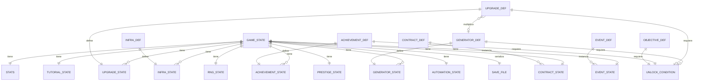
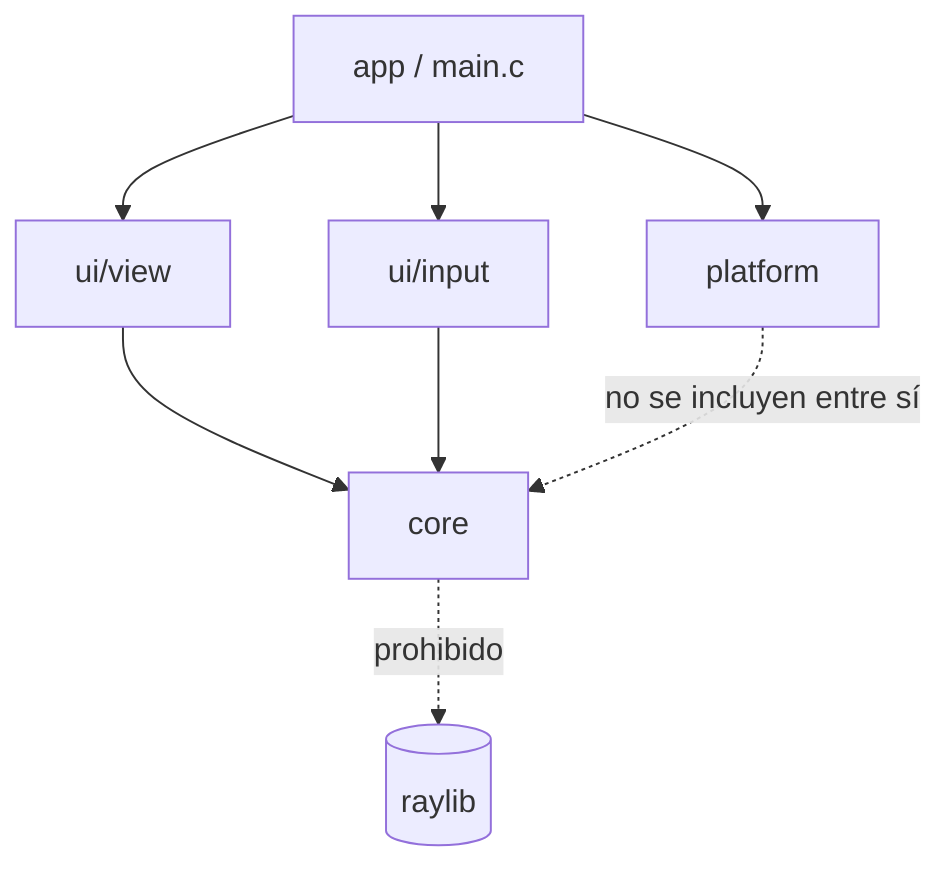
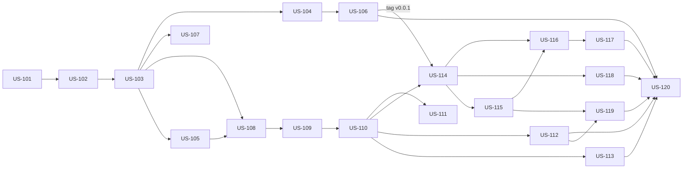

# Datacenter Tycoon (nombre de trabajo) — PRD / Plan de Desarrollo

## 1. Descripción general del producto

### 1.1 Nombre del juego

"Datacenter Tycoon" es un **nombre de trabajo**: ya existe un idle con el mismo nombre en itch.io e
iOS (whitemarshgames), con tiers de servidores, prestigio y contratos. Publicar con ese nombre
confunde a los jugadores y perjudica la búsqueda. El nombre definitivo es la decisión ADR-P06
(sección 9.2) y tiene que tomarse antes del primer canal público (US-120). Candidatos (sin juegos
homónimos encontrados al 2026-10):

| Candidato                    | Idea                                                                              |
| ---------------------------- | --------------------------------------------------------------------------------- |
| **Five Nines** (recomendado) | "Cinco nueves" = 99,999% de disponibilidad: la meta de cualquier datacenter (SLA) |
| **Uptime Idle**              | Directo y descriptivo del género; fácil de encontrar en portales                  |
| **Racks to Riches**          | Juego de palabras con "rags to riches": del garage al imperio de racks            |

Cambiar el nombre no toca la lógica: afecta el título de la ventana, la carpeta de guardado
(sección 4.4), los metadatos de distribución y el README.

### 1.2 Visión del producto

Datacenter Tycoon es un juego idle/tycoon 2D donde el jugador arranca con una PC vieja y escala hacia racks, clusters y datacenters completos. Es un **proyecto de equipo (dos personas, dentro de stack-dos) de aprendizaje y portfolio**: el juego tiene que ser divertido y pulido, pero el objetivo de fondo es practicar C (lógica, arquitectura, memoria) con estándares profesionales de calidad y distribución.

La referencia de diseño principal es **Revolution Idle**: capas de reinicio (prestigio) que cambian
la forma de jugar, automatización como recompensa, sistemas que se revelan de a uno a medida que se
avanza y una partida que siempre tiene un próximo objetivo a la vista. Del nicho datacenter se toma
lo que los jugadores piden y no encuentran: energía, refrigeración, redundancia y SLA como
restricciones reales.

**Pilares:**

- **Core en C puro, testeable y aislado:** el modelo nunca depende de raylib.
- **Data-driven:** generadores, upgrades, contratos, eventos, logros y textos definidos en JSON, balance sin recompilar.
- **Desbloqueo progresivo:** cada sistema aparece cuando el jugador llega a él, no todo de entrada.
- **Distribución automatizada:** cada tag genera ejecutables, instalador y versión web.
- **Gratuito:** sin pagos para jugar; donaciones opcionales (ver sección 12).
- **Base primero, extensiones después:** C++ solo se suma sobre la v1.0 terminada.

### 1.3 Metas y no metas

**En el alcance (v1.0):**

- Clic manual para atender requests (además de la PC inicial).
- Generadores (PCs y servidores por marca y generación) que producen req/s; racks que dan slots;
  infraestructura por niveles (sala, energía, refrigeración, incendio).
- Upgrades que multiplican la producción, con costos exponenciales
  (`costo = base × crecimiento^cantidad`) y compra ×1 / ×10 / ×100 / Máx.
- Hitos de cantidad: ×2 a un generador al llegar a 25, 50, 100… unidades.
- Contratos de clientes con SLA y slots de contratos que se van desbloqueando.
- Eventos: picos de tráfico para clickear e incidentes (cortes, fallas, incendios) que la
  infraestructura mitiga; boost "Escalado de emergencia" con tiempo de espera.
- Logros con bonus de producción y pantalla de estadísticas de la partida.
- Prestigio "Nueva sede" (etapa 7): reputación como moneda permanente, vista previa de la ganancia,
  árbol de mejoras y automatización (autocompradores).
- Desbloqueo progresivo de sistemas y pestañas, y tutorial integrado (objetivo en pantalla,
  checklist con recompensas y pistas al aparecer cada sistema).
- Generadores, upgrades, contratos, eventos, logros, objetivos y textos cargados desde JSON.
- Guardado versionado, autoguardado, backups, progreso offline y recuperación del tiempo perdido
  (pestaña oculta, ventana congelada).
- Números grandes con `double` y formateo (1.2K, 3.4M, 5e20) con opción de notación.
- UI con raylib + raygui, escalable y en español; audio básico; accesibilidad básica;
  simulación con fixed timestep.
- Tests unitarios e integración del core con CTest, ASan + UBSan.
- Builds: Windows (`.zip` + instalador), Linux (AppImage), web (WebAssembly) en GitHub Pages e itch.io.
- Donaciones opcionales (sin anuncios en v1.0).
- CI/CD con GitHub Actions (`ci.yml`, `release.yml`, `pages.yml`).

El contenido se libera de forma incremental en versiones 0.x (ver 2.4): v1.0 es el juego base "completo y pulido" con las 7 etapas de la progresión y los sistemas transversales de la sección 2.5.

**Fuera de alcance (v1.0):**

- **Steam: descartado.** Cuesta USD 100 por juego que un juego gratuito nunca recupera y prohíbe los
  anuncios con recompensa (ver sección 12).
- Anuncios con recompensa en portales web y en Android — después de v1.0 (sección 12).
- Versión Android / Play Store (horizontal) — v2.x (sección 12).
- Segunda capa de prestigio y desafíos al estilo Revolution Idle — v1.x.
- Otros idiomas además del español — v1.x (los textos ya viven en una tabla desde v0.1).
- Recursos adicionales como monedas (ancho de banda, etc.) — v1.x.
- Telemetría o métricas de jugadores enviadas a un servidor: requiere backend, consentimiento y política de privacidad; no aporta al objetivo de aprendizaje de v1.0.
- Cualquier código C++ (panel de debug con Dear ImGui, ECS, pathfinding A\*, mapa tycoon visual) — se hace después de la v1.0, ver Roadmap futuro.
- Wrapping de headers en `extern "C"` — se agrega al final, sin tocar lógica.
- Go u otros lenguajes — descartado explícitamente.
- macOS — no está entre las plataformas objetivo.

### 1.4 Métricas de éxito

| Métrica                        | Definición / cómo se mide                                                              | Objetivo                  |
| ------------------------------ | -------------------------------------------------------------------------------------- | ------------------------- |
| **North Star: v1.0 publicada** | Release `v1.0.0` en GitHub Releases con binarios Windows + Linux y versión web jugable | 1 release completo        |
| Cobertura de tests del core    | Porcentaje de líneas de `src/core/` cubiertas por CTest                                | ≥ 80%                     |
| Sanitizers limpios             | Errores de ASan/UBSan en la suite de tests en CI                                       | 0                         |
| Leaks                          | Bytes perdidos reportados por Valgrind en los tests                                    | 0                         |
| Warnings del core              | Warnings con `-Wall -Wextra -Wpedantic -Werror`                                        | 0 (el build falla si hay) |
| CI verde                       | Porcentaje de pushes a `main` con `ci.yml` en verde                                    | 100%                      |
| Paridad de plataformas         | Plataformas donde el build del release funciona                                        | 3/3 (Windows, Linux, web) |
| Onboarding                     | Tiempo de un jugador nuevo hasta su primera compra (playtest con partida nueva)        | < 30 s                    |
| Retención de la partida        | % de playtesters externos que llegan al primer prestigio                               | ≥ 50%                     |

---

## 2. Contexto / dominio del problema: diseño de progresión

### 2.1 Recurso central

- **Capacidad (req/s):** cada servidor aguanta una cantidad de requests por segundo. Es el "poder de cómputo" del jugador y lo que se muestra como producción principal.
- **Dinero ($):** se gana por cada request atendida: `dinero/s = req/s × tarifa_por_request`. Es lo que se gasta en comprar y mejorar.
- Recursos adicionales (energía, temperatura, ancho de banda) se suman en versiones posteriores como **restricciones**, no como monedas nuevas (ver 2.4).
- **Reputación (v0.8):** moneda de prestigio. Se gana al abrir una nueva sede, da un bonus permanente
  y se gasta en mejoras que sobreviven a los reinicios (ver 2.5 y regla 17).

### 2.2 Secuencia de progresión propuesta

| Etapa                 | Qué se desbloquea                                                   | Mecánica nueva                                                                                                                                                          | Condición de desbloqueo                                                |
| --------------------- | ------------------------------------------------------------------- | ----------------------------------------------------------------------------------------------------------------------------------------------------------------------- | ---------------------------------------------------------------------- |
| 1. Garage             | PC de escritorio vieja (arranca con 1) + clic manual                | Atender requests a mano y comprar más PCs (costo exponencial)                                                                                                           | Inicio del juego                                                       |
| 2. Primer rack        | Rack 42U + servidores Gen 1 de dos marcas ficticias                 | Los servidores ocupan **slots** de rack: hay que comprar racks para poder sumar servidores                                                                              | Alcanzar X req/s totales                                               |
| 3. Sala de servidores | Ampliación de la sala (más espacio para racks)                      | Límite de racks por sala, ampliable                                                                                                                                     | Tener N racks llenos                                                   |
| 4. Infraestructura    | Generadores eléctricos, aire acondicionado, sistema contra incendio | Cada servidor consume **kW** y genera **calor**; si se supera la capacidad, la producción cae                                                                           | Primera ampliación de sala                                             |
| 5. Generaciones       | Gen 2, Gen 3, … de cada marca                                       | Servidores más modernos: más req/s por slot y por kW                                                                                                                    | Investigación/compra con dinero acumulado                              |
| 6. Cluster            | Clusterización de racks                                             | No se compra directamente: es un **upgrade** que da bonus multiplicador a racks agrupados (ej. cada 4 racks llenos = 1 cluster con ×1.5)                                | Tener N racks de la misma generación                                   |
| 7. Datacenter         | Nuevo datacenter (otra sede)                                        | Mecánica de **prestigio**: se reinicia la partida a cambio de **reputación**, que da un bonus permanente y se gasta en un árbol de mejoras (incluida la automatización) | Ganar `prestige_divisor` en la partida (con vista previa desde el 50%) |

**Marcas ficticias (placeholders, nombres a definir):** "Dellmar" (balanceada) y "Hewpack" (más cara, más eficiente en energía). Ambas con generaciones Gen 1 → Gen N.

### 2.3 Upgrades

Todos temáticos. Se compran con dinero, salvo los de prestigio, que se compran con reputación:

| Tipo                            | Ejemplos                                                       | Efecto                                              |
| ------------------------------- | -------------------------------------------------------------- | --------------------------------------------------- |
| **Por generador**               | SSD en lugar de HDD (PC), más RAM (Gen 1), fuentes redundantes | ×2 a la producción de ese generador                 |
| **De clic**                     | Teclado mecánico, script de respuestas                         | Multiplica el valor del clic manual                 |
| **Globales**                    | Balanceador de carga, virtualización, caché/CDN, monitoreo     | ×1.25 a ×2 a toda la producción                     |
| **Por infraestructura** (v0.4+) | Pasillo frío/caliente, UPS eficiente                           | Reduce consumo de kW o calor                        |
| **Investigación** (v0.5+)       | Dellmar Gen 2, Clusterización                                  | Desbloquea generadores o una mecánica               |
| **De cluster** (v0.6+)          | Orquestador, red 100G                                          | Mejora el bonus o el tamaño de los clusters         |
| **De capacidad** (v0.7+)        | Mesa de ayuda, equipo de cuentas                               | Suma un slot de contratos                           |
| **De prestigio** (v0.8+)        | Guardia 24/7, capital inicial, sysadmin junior                 | Permanentes: tope offline, arranque, automatización |

### 2.4 Liberación incremental

Cada versión agrega una etapa de la tabla 2.2 o un sistema de la sección 2.5, así siempre hay un
juego jugable y publicado:

| Versión | Contenido                                                                                                                                                                            |
| ------- | ------------------------------------------------------------------------------------------------------------------------------------------------------------------------------------ |
| v0.0.1  | Preparación: repo, build, tests, CI y un ejecutable mínimo (ventana vacía). Sin juego                                                                                                |
| v0.1    | Etapa 1: clic manual, PCs, upgrades por generador, hitos de cantidad y objetivo en pantalla. Loop de juego base, sin guardado. Canal: ejecutable Windows (`.zip`) y Linux (AppImage) |
| v0.2    | Guardado, autoguardado, backups, progreso offline y recuperación del tiempo perdido. Canal nuevo: versión web en GitHub Pages e itch.io                                              |
| v0.3    | Etapa 2: racks, slots, servidores Gen 1 de las dos marcas + desbloqueo progresivo de sistemas y checklist de objetivos                                                               |
| v0.4    | Etapas 3 y 4: ampliación de sala + energía, refrigeración e incendio                                                                                                                 |
| v0.5    | Etapa 5: generaciones nuevas, upgrades globales y compra ×1 / ×10 / ×100 / Máx                                                                                                       |
| v0.6    | Etapa 6: clusters + logros con bonus y estadísticas de la partida                                                                                                                    |
| v0.7    | Contratos con SLA y slots, eventos (picos de tráfico e incidentes) y boost con tiempo de espera                                                                                      |
| v0.8    | Etapa 7: prestigio "Nueva sede", árbol de reputación y automatización. **Feature freeze** hasta v1.0                                                                                 |
| v1.0    | Pulido: tutorial completo, opciones, audio, accesibilidad, instalador, donaciones y balance completo                                                                                 |
| v1.x    | Desafíos y segunda capa de prestigio, idiomas, anuncios con recompensa en portales web (sección 12)                                                                                  |
| v2.x    | Versión Android horizontal con anuncios; extensiones C++ (ver Roadmap futuro)                                                                                                        |

> Los canales de distribución también se suman de a uno: ejecutables en v0.1, web (GitHub Pages e itch.io) en v0.2, instalador de Windows y donaciones en v1.0. Los anuncios llegan recién después de v1.0. La v1.0 marca el juego base "completo y pulido".

### 2.5 Sistemas transversales (referencia: Revolution Idle)

Sistemas que no son una etapa de la tabla 2.2 sino que atraviesan toda la partida. Cada uno se
libera en su versión de la tabla 2.4 y se revela en el juego cuando el jugador llega a él.

**Desbloqueo progresivo de sistemas.** Una pestaña o mecánica futura no se muestra hasta que se
cumple su condición (regla 21). Dentro de una pestaña abierta, el próximo ítem bloqueado se ve como
"???" con su condición y una barra de progreso. Calendario tentativo (los umbrales se validan con el
simulador de balance):

| Sistema / pestaña        | Disparador tentativo                        | Versión |
| ------------------------ | ------------------------------------------- | ------- |
| Upgrades                 | Comprar la segunda PC                       | v0.1    |
| Racks y servidores       | Alcanzar X req/s totales (etapa 2)          | v0.3    |
| Infraestructura          | Llenar el primer rack                       | v0.4    |
| Investigación            | Dinero total de la partida ≥ X              | v0.5    |
| Clusters                 | Comprar la investigación "Clusterización"   | v0.6    |
| Logros y estadísticas    | Obtener el primer logro                     | v0.6    |
| Contratos (slot 1)       | Alcanzar X req/s                            | v0.7    |
| Contratos (slot 2)       | Cumplir el primer contrato                  | v0.7    |
| Contratos (slots 3 a 5)  | Upgrades de capacidad (costo × 10 por slot) | v0.7    |
| Eventos e incidentes     | Tener el primer servidor en un rack         | v0.7    |
| Prestigio (vista previa) | Llegar al 50% de `prestige_divisor`         | v0.8    |
| Automatización           | Comprarla con reputación                    | v0.8    |

**Hitos de cantidad (regla 15).** Cada generador duplica su producción al llegar a 25, 50, 100, 200…
unidades. Crea "victorias locales" que compensan el costo exponencial.

**Contratos con SLA (regla 16).** Un cliente pide sostener cierta cantidad de req/s durante un
tiempo, dentro de un plazo. El nivel de exigencia se expresa en "nueves" de disponibilidad (99%,
99,9%, 99,99%): más nueves, más req/s pedidas y mejor pago. Al aceptar se deja un depósito de
garantía que se devuelve al cumplir y se pierde al fallar o abandonar. Los slots de contratos
arrancan en 1 y crecen hasta 5.

**Eventos (regla 18).** Picos de tráfico que aparecen cada 5-15 min sobre la vista del datacenter y
se clickean para ganar un boost o un bonus. Incidentes (corte de energía, falla de hardware,
incendio) que bajan la producción por un rato, salvo que la infraestructura los mitigue (energía
con redundancia N+1, sistema contra incendio, técnico). Nunca destruyen compras.

**Escalado de emergencia (regla 19).** Un boost ×2 que se activa gratis y tiene tiempo de espera.
Es el punto donde, después de v1.0, los anuncios con recompensa pueden reiniciar la espera, sin
cambiar el balance del juego (sección 12).

**Logros con bonus (regla 14).** Cada logro suma un pequeño multiplicador global, así coleccionarlos
tiene peso mecánico.

**Prestigio "Nueva sede" (regla 17).** Reinicio voluntario con vista previa de la reputación que se
gana y lista de qué se conserva. La reputación da un bonus permanente y se gasta en un árbol:
ampliar el tope offline, capital inicial, slots de contratos y autocompradores (regla 22). Como en
Revolution Idle, la automatización es una recompensa del prestigio, no algo que se tiene de entrada.

**Tutorial integrado.** No hay pantallas de texto largas: un objetivo en pantalla en el primer
minuto (v0.1), un checklist de objetivos con recompensa (v0.3) y una pista de 1-2 frases la primera
vez que aparece cada sistema (v1.0). Se puede saltar y reiniciar desde opciones; el progreso del
tutorial se guarda en la partida (sección 4.4).

**Ritmo objetivo (se valida con el simulador).** Siempre hay una compra posible en menos de 5 min;
un sistema nuevo cada 10-30 min durante la primera hora; el primer prestigio entre 1 y 3 h; una
partida hasta el final de v1.0 de 10-15 h de juego activo.

**Quejas del género que el diseño evita.** Muros de espera sin nada para hacer (cada muro ofrece una
actividad paralela: contratos, eventos, investigación); juego activo que aplasta al idle (el clic y
los eventos no superan 2-3× el ingreso idle); topes de offline cortos (regla 8); acciones
repetitivas a mano (compra Máx y automatización); y falta de tutorial.

---

## 3. Perfiles de usuario

| Perfil                                | Rol y contexto                                                                                    | Objetivo principal                                                                         | Problema actual                                                        |
| ------------------------------------- | ------------------------------------------------------------------------------------------------- | ------------------------------------------------------------------------------------------ | ---------------------------------------------------------------------- |
| **Jugador de idle games** (principal) | Juega Cookie Clicker, Adventure Capitalist o similares en pestañas abiertas o en ratos libres     | Ver números crecer, desbloquear cosas nuevas y volver después a cobrar el progreso offline | Los idle games suelen tener temáticas genéricas (galletitas, negocios) |
| **Público técnico** (secundario)      | Sysadmins, devs o estudiantes de IT que conocen racks, generaciones de servidores y refrigeración | Disfrutar referencias reales del mundo datacenter                                          | No hay idle games con temática de infraestructura realista             |
| **Reclutador / revisor de portfolio** | Mira el repo y la versión web                                                                     | Evaluar calidad de código, arquitectura y CI/CD                                            | Necesita ver un producto terminado y jugable en segundos               |

**Perfil ampliado — jugador idle:** abre la versión web en itch.io o GitHub Pages, juega 10-15 minutos comprando servidores y upgrades, cierra la pestaña y vuelve horas después. Espera que el progreso offline esté calculado, que los números sean legibles (1.2K, 3.4M) y que siempre haya un próximo desbloqueo a la vista.

---

## 4. Arquitectura de datos

### 4.1 Entidades principales

- **GameConfig** (JSON, solo lectura): valores globales de balance: dinero inicial, tarifa por request, tope offline, % de reembolso de venta, parámetros de cluster.
- **GeneratorDef** (JSON, solo lectura): id, nombre, categoría (`pc`/`server`/`rack`), marca, generación, costo base, crecimiento, req/s, slots que ocupa (servidores), slots que provee (racks), kW, calor, hitos de cantidad (`milestones`, por defecto 25, 50, 100, 200…), condición de desbloqueo.
- **GeneratorState** (guardado): id de generador, cantidad comprada.
- **UpgradeDef** (JSON): id, nombre, tipo (`generator`/`click`/`global`/`infra`/`research`/`cluster`/`capacity`/`prestige`), objetivo, multiplicador, moneda (dinero o reputación), costo, condición de desbloqueo.
- **UpgradeState** (guardado): id, comprado sí/no.
- **InfraDef / InfraState** (v0.4+): sala, energía, refrigeración e incendio, cada uno con niveles (costo, capacidad, requisitos, `redundant` si el nivel es N+1) y el nivel actual. Los racks **no** son infraestructura: son generadores de categoría `rack`.
- **UnlockCondition**: tipo (req/s totales, dinero total, cantidad de X, investigación, logros, contratos cumplidos, prestigios) + umbral. El objetivo puede ser un ítem (generador, upgrade) o un **sistema** (`feature:contracts`, `feature:infra_tab`, `feature:contract_slot_2`…).
- **GameState**: dinero, dinero total de la partida, desbloqueos de ítems y sistemas, estado del PRNG, más las colecciones de estados.
- **SaveFile**: serialización JSON de GameState con campos `version` y `saved_at` (ubicación en 4.4).
- **AchievementDef** (JSON, v0.6+): id, nombre, descripción, condición (reusa UnlockCondition).
- **AchievementState** (guardado): ids de logros obtenidos con su timestamp.
- **Stats** (guardado, v0.6+): tiempo jugado, clics totales, compras totales, récord de req/s, dinero offline cobrado, contratos cumplidos y fallidos, eventos atrapados, fecha de inicio de la partida.
- **ObjectiveDef** (JSON, v0.3+): id, texto (clave de la tabla de strings), condición (UnlockCondition), recompensa en dinero. El objetivo en pantalla de v0.1 es el primer objetivo de la lista.
- **TutorialState** (guardado): bitmask de objetivos completados y de pistas vistas, más el flag "tutorial saltado".
- **ContractDef** (JSON, v0.7+): id, cliente, nivel de SLA (nueves), factor de req/s pedido respecto de la producción actual, duración a sostener, plazo, recompensa, depósito de garantía.
- **ContractState** (guardado, v0.7+): ofertas vigentes con su vencimiento, contratos activos con su progreso, slots desbloqueados.
- **EventDef** (JSON, v0.7+): id, tipo (`spike`/`incident`), frecuencia, duración, efecto, mitigación (tipo de infraestructura y nivel o upgrade que lo evita).
- **EventState** (guardado, v0.7+): evento visible, incidentes activos con su tiempo restante, boost activo y tiempo de espera del Escalado de emergencia.
- **RngState** (guardado, v0.7+): semilla y estado del PRNG propio del core.
- **PrestigeState** (guardado, v0.8+): reputación total ganada, reputación disponible para gastar, cantidad de sedes abiertas (prestigios).
- **AutomationState** (guardado, v0.8+): autocompradores desbloqueados y encendidos por categoría.
- **Strings** (JSON, solo lectura, v0.1+): tabla clave → texto en español (`data/strings_es.json`); otro idioma es otro archivo.
- **Settings** (archivo aparte del guardado, v1.0): escala de UI, notación numérica, volúmenes, reducir movimiento. Son preferencias del dispositivo, no de la partida. No es parte del core.

### 4.2 Reglas de integridad

- Todo `id` de estado debe existir en las definiciones cargadas; si un guardado trae un id desconocido se descarta con log, sin romper la carga.
- `cantidad ≥ 0`, `dinero ≥ 0`, `reputación ≥ 0`; una compra sin dinero suficiente no modifica el estado.
- Todo número cargado de un guardado es finito (`isfinite`); si no, el guardado se trata como corrupto.
- Servidores comprados ≤ slots disponibles (v0.3+); racks ≤ capacidad de la sala (v0.4+); contratos activos ≤ slots de contratos (v0.7+).
- Un guardado con `version` mayor a la soportada no se carga **ni se modifica** (no se renombra a `.bak`); con versión menor se migra.

### 4.3 Valores derivados (no se guardan, se calculan)

- req/s totales, dinero/s, costo de la próxima unidad, multiplicador efectivo (upgrades, hitos,
  logros, reputación), consumo de kW y calor vs. capacidad, reputación que daría un prestigio ahora,
  objetivo actual del tutorial.



### 4.4 Dónde se guarda el progreso

Decisión ADR-015 (sección 9.1):

- **Escritorio:** carpeta de datos del usuario, nunca junto al ejecutable (Program Files no es
  escribible y un AppImage es de solo lectura). Windows: `%APPDATA%\<NombreDelJuego>\`. Linux:
  `$XDG_DATA_HOME/<nombre-del-juego>/` (o `~/.local/share/<nombre-del-juego>/`). El nombre sale de
  ADR-P06.
- **Web:** IndexedDB a través de IDBFS de Emscripten, montado en `/save`. El mismo código de archivo
  que escritorio; solo se agrega la sincronización (`FS.syncfs`).
- **Archivos:** `save.json` (partida), `save.json.tmp` (escritura en curso), `save.json.bak1` a
  `.bak3` (backups rotativos de los últimos guardados buenos), `save.json.corrupt` (archivo que no se
  pudo leer, apartado para recuperarlo a mano) y `settings.json` (preferencias del dispositivo).
- **Qué va en cada uno:** todo lo que es de la partida, **incluido el progreso del tutorial**, va en
  `save.json`, así viaja con exportar/importar y se reinicia con la partida. Lo que es del
  dispositivo (escala, notación, volumen, reducir movimiento) va en `settings.json`.
- **Portabilidad:** exportar/importar como texto (portapapeles) o como archivo descargado (web).
- **Datos del juego (`data/`):** se buscan junto al ejecutable con `GetApplicationDirectory()`, no en
  el directorio de trabajo.

---

## 5. Arquitectura de software

### 5.1 Capas y responsabilidades

| Capa                      | Carpeta                      | Responsabilidad                                                                                                                                                 | Puede incluir                             |
| ------------------------- | ---------------------------- | --------------------------------------------------------------------------------------------------------------------------------------------------------------- | ----------------------------------------- |
| **core** (Model)          | `src/core/`, `include/core/` | Estado del juego, generadores, upgrades, economía, progreso offline, guardado (serialización), formateo de números                                              | Solo C estándar + cJSON. **Nunca raylib** |
| **ui/view** (View)        | `src/ui/view/`               | Dibuja el estado; lo lee sin modificarlo (`const GameState *`)                                                                                                  | core, raylib, raygui                      |
| **ui/input** (Controller) | `src/ui/input/`              | Lee mouse/teclado y genera **acciones** (`ACTION_BUY_GENERATOR` + id)                                                                                           | core, raylib                              |
| **platform**              | `src/platform/`              | Lo que cambia entre web y escritorio: escritura de guardado (archivo vs IndexedDB), rutas, timestamps, links externos (donaciones) y, después de v1.0, anuncios | C estándar, Emscripten                    |
| **app**                   | `src/main.c`                 | Game loop: input → `game_apply()` → `game_update()` (fixed timestep) → draw; detecta el tiempo perdido (regla 20)                                               | Todo lo anterior                          |

### 5.2 Regla de dependencias

Un solo sentido: `app → ui → core`. `core` no conoce ni a `ui` ni a `platform`; recibe los bytes del guardado y el tiempo actual como parámetros.



### 5.3 Patrones usados

- **Acciones (Command):** toda modificación del estado pasa por `game_apply(GameState *, Action)`. La UI nunca escribe el estado directamente → el core se testea sin ventana.
- **Structs opacos:** `GameState` se declara en el header y se define en el `.c`; se accede con funciones `game_*`.
- **Pares create/destroy:** `game_create()` / `game_destroy()`, ownership documentado en el header.
- **Data-driven:** definiciones en `data/*.json`, cargadas al inicio con cJSON.
- **Fixed timestep:** acumulador de tiempo; la simulación avanza en pasos fijos de 1/60 s independientes de los FPS. Los huecos grandes de tiempo real no se simulan paso a paso: se procesan como progreso offline (regla 20).
- **PRNG propio en el core:** toda aleatoriedad (contratos, eventos) sale de un generador con semilla guardada en `GameState`; nunca de `rand()` ni de `GetRandomValue()`. Así la simulación sigue siendo determinista y testeable (ADR-018).
- **Textos en tabla:** ningún texto visible se escribe en el código; la vista los busca por clave en la tabla de strings (ADR-016).

### 5.4 Estructura de carpetas

```txt
include/{core,ui,platform}/    headers públicos por capa
src/core/                      modelo (sin raylib)
src/ui/view/  src/ui/input/    vista y controlador
src/platform/                  escritorio / web
src/main.c                     game loop
tests/{unit,integration,fixtures}/
tools/                         simulador de balance y benchmark (linkean solo dct_core)
data/                          JSON de balance, contenido y textos
assets/                        fuentes, íconos, sonidos, estilo de raygui
lib/                           submódulos: raylib, raygui, cjson, unity
web/shell.html                 página contenedora de la versión web
installer/                     Inno Setup y metadatos de Linux
cmake/  scripts/  docs/  .github/workflows/
```

---

## 6. Acuerdo de ingeniería y estándares

Proyecto en equipo dentro de **stack-dos**, desarrollado en tiempo libre.

### 6.1 Principios de desarrollo

- **Tests junto con cada historia:** ninguna historia que toque `core/` se cierra sin sus tests.
- **Git flow:** `main` (solo releases taggeados), `develop` (integración), `feature/US-xxx-nombre`, `release/vX.Y.Z`, `hotfix/vX.Y.Z`.
- **Code review obligatorio:** todo merge a `develop` va por PR con al menos 1 aprobación de otro miembro del equipo y CI en verde.
- **Un PR = una historia de usuario** (o una parte acotada de una historia XL).

### 6.2 Calidad de código y pruebas

- Core compilado con `-Wall -Wextra -Wpedantic -Werror`.
- Tests unitarios e integración con CTest; ASan + UBSan en todos los tests y en CI.
- Valgrind en CI (Linux) sobre la suite de tests: 0 leaks.
- Cobertura objetivo del core ≥ 80% (ver 1.4). La UI no se testea automáticamente.
- Formato con `clang-format` (archivo compartido en el repo) para evitar discusiones de estilo.

---

## 7. Reglas de negocio consolidadas

1. **Costo de compra:** `costo(n) = costo_base × crecimiento^n`, donde `n` es la cantidad ya comprada de ese generador. Crecimiento por defecto: 1.15 (definible por generador en JSON).
2. **Compra atómica:** si el dinero no alcanza, la acción no modifica nada. Si alcanza, se descuenta el costo y se suma la unidad en el mismo paso.
3. **Producción:** `req/s = Σ (cantidad × req_s_base × multiplicadores del generador × hitos de cantidad) × multiplicadores globales × bonus de logros × bonus de reputación × boosts activos`. Los multiplicadores se combinan **multiplicando** (×2 y ×2 = ×4).
4. **Ingreso:** `dinero/s = req/s × tarifa_por_request × factor_infra`.
5. **Factor de infraestructura (v0.4+):** si la demanda de kW o de refrigeración supera la capacidad, `factor_infra = min(capacidad_kW / demanda_kW, capacidad_frío / calor)`; si no, 1.
6. **Desbloqueos permanentes:** una vez cumplida una condición de desbloqueo, el ítem queda disponible aunque después el valor baje.
7. **Upgrades de compra única:** cada upgrade se compra una sola vez.
8. **Progreso offline:** `dinero_offline = segundos_ausente × dinero/s` al momento del guardado (sin boosts temporales), con un **tope base de 12 horas** (`offline_cap_seconds`) que las mejoras de reputación amplían hasta 24 h. Si el reloj del sistema va hacia atrás, el tiempo ausente cuenta como 0. Los contratos activos y los incidentes avanzan con el mismo tiempo.
9. **Autoguardado:** cada 30 s, al cerrar la ventana y al ocultar la pestaña (web). En web el guardado se da por hecho recién cuando `FS.syncfs` confirma.
10. **Formateo de números:** < 1.000 se muestra entero (o con un decimal si es menor a 10 y tiene parte decimal, ej. "0.5/s"); hasta 10^18 con sufijos K, M, B, T, Qa y un decimal (1.2K, 3.4M); desde ahí notación científica (5.0e20). Si el redondeo llega a 1000 se pasa al sufijo siguiente (999.95K → "1.0M"). Los negativos llevan signo (−1.5K). El jugador puede elegir notación de sufijos, científica o de ingeniería (Settings).
11. **Venta (v0.5+):** vender una unidad devuelve `0.5 × costo(n − 1)` (porcentaje configurable en JSON) y no reduce el dinero total histórico.
12. **Clusters (v0.6+):** con la investigación "Clusterización", cada `cluster_slots` slots ocupados por servidores de la misma generación forman un cluster; la producción de esa generación se multiplica por `1 + cluster_bonus × clusters`.
13. **Clic manual:** cada clic suma `tarifa × (click_base + click_pct × req/s) × multiplicadores de clic`. Máximo 20 clics por **segundo simulado**: el core cuenta los clics y reinicia el contador cada vez que `game_update()` cruza un segundo entero (así no hace falta guardar la hora en cada `Action`). Lo ganado con clics suma al dinero total de la partida; los clics no cuentan para el progreso offline.
14. **Logros (v0.6+):** se desbloquean una sola vez con las mismas condiciones que los desbloqueos (regla 6) y nunca se pierden, ni al prestigiar. Cada logro suma un bonus global: `×(1 + achievement_bonus × logros_obtenidos)`, con `achievement_bonus = 0.02` en `config.json`.
15. **Hitos de cantidad:** cada valor de `milestones` de un generador que la cantidad actual alcanza (por defecto 25, 50, 100, 200, 300…) duplica la producción de ese generador. Dependen de la cantidad actual: vender por debajo de un hito lo pierde.
16. **Contratos (v0.7+):** aceptar una oferta descuenta un depósito de garantía. El contrato progresa solo mientras `req/s ≥ demanda`; si suma `duración` segundos antes del plazo se cumple (recompensa + depósito devuelto); si vence el plazo o se abandona, se pierde el depósito. El depósito evita el truco de gastar todo antes de fallar. Las ofertas se generan con el PRNG del core a partir de la producción actual (demanda entre ×1.1 y ×2.5 según los nueves del SLA) y vencen si no se aceptan. Slots: 1 al desbloquear el sistema, el 2.º al cumplir el primer contrato y del 3.º al 5.º con upgrades de capacidad que cuestan `base × 10^(slot − 3)`.
17. **Prestigio "Nueva sede" (v0.8+):** la reputación que se gana al abrir una nueva sede es `floor(sqrt(dinero_de_la_partida / prestige_divisor))`, donde "partida" es lo jugado desde el último prestigio. Si da 0, no se puede prestigiar. El bonus permanente es `×(1 + prestige_bonus × reputación_total_ganada)`, con `prestige_bonus = 0.05`; gastar reputación en mejoras no reduce el bonus. Se reinician dinero, generadores, upgrades de dinero, infraestructura, investigaciones, clusters, contratos y eventos. Se conservan reputación, mejoras de reputación, logros, estadísticas y sistemas desbloqueados. Objetivo de diseño: conviene prestigiar cuando la ganancia es +50% a +200% de la reputación total.
18. **Eventos (v0.7+):** un pico de tráfico aparece cada 5-15 min (PRNG), queda 15 s en pantalla y al clickearlo da, al azar, un boost ×3 por 30 s o un bonus igual a 60 s de producción. Los incidentes (corte de energía, falla de hardware, incendio) tienen baja probabilidad, bajan la producción un % fijo durante un tiempo y nunca destruyen compras; se evitan con la mitigación de su `EventDef` (nivel de energía con redundancia N+1, nivel de incendio, upgrade de técnico).
19. **Escalado de emergencia (v0.7+):** boost ×2 durante 10 min que se activa gratis y después espera 30 min. Es igual en todas las plataformas. En builds con anuncios (después de v1.0, sección 12), mirar un anuncio solo reinicia la espera: nunca da algo que no exista sin anuncio.
20. **Tiempo perdido:** si entre dos frames pasan más de 5 s reales (pestaña oculta, ventana arrastrada o congelada, suspensión), ese tiempo no se simula tick a tick: se procesa con la misma función de progreso offline (regla 8, incluido su tope) y se muestra un aviso breve si supera 60 s.
21. **Desbloqueo de sistemas:** un sistema (pestaña, mecánica o slot) se activa cuando se cumple su `UnlockCondition` con objetivo `feature:*`. Antes de eso su pestaña no se muestra. Es permanente (regla 6) y sobrevive al prestigio.
22. **Automatización (v0.8+):** cada autocomprador (uno por categoría: PCs, servidores, racks, infraestructura, upgrades) se desbloquea con reputación, se puede apagar y cada `auto_interval` segundos compra la opción más barata disponible de su categoría que respete dinero, slots, sala y energía (no compra si haría caer el factor de infraestructura por debajo de 1).
23. **Determinismo:** toda aleatoriedad del core usa el PRNG con semilla guardada (ADR-018). Mismo estado + misma semilla + mismas acciones = mismo resultado.

---

## 8. Requisitos No Funcionales (NFR)

| Categoría     | Requisito                                                                              | Objetivo                                                                                                            |
| ------------- | -------------------------------------------------------------------------------------- | ------------------------------------------------------------------------------------------------------------------- |
| Rendimiento   | FPS en escritorio, PC de gama baja (iGPU, 4 GB RAM)                                    | 60 FPS estables                                                                                                     |
| Rendimiento   | FPS en web (Chrome/Firefox actuales)                                                   | ≥ 50 FPS                                                                                                            |
| Rendimiento   | Tiempo de un `game_update()` con todo el contenido de v1.0                             | < 1 ms                                                                                                              |
| Rendimiento   | Tiempo de arranque hasta pantalla jugable                                              | < 2 s escritorio, < 5 s web                                                                                         |
| Tamaño        | Descarga de la versión web (`.wasm` + `.js` + `.data`)                                 | < 5 MB                                                                                                              |
| Tamaño        | Instalador de Windows / AppImage                                                       | < 15 MB                                                                                                             |
| Precisión     | Simulación determinista: mismo estado + misma semilla + mismo tiempo = mismo resultado | 100% en tests                                                                                                       |
| Precisión     | Diferencia entre progreso offline y la misma cantidad de tiempo jugado online          | < 0,1%                                                                                                              |
| Precisión     | Tiempo real perdido (pestaña oculta, ventana congelada) que no se acredita             | 0 (se procesa como offline, regla 20)                                                                               |
| Confiabilidad | Guardado corrupto o ilegible                                                           | Nunca crashea; se carga el backup más reciente válido (o partida nueva) y el archivo malo se aparta como `.corrupt` |
| Confiabilidad | Guardado de una versión futura                                                         | No se carga ni se modifica; se avisa y se juega sin autoguardar                                                     |
| Confiabilidad | Compatibilidad de guardados entre versiones                                            | Todo guardado desde v0.2 se puede cargar en versiones posteriores (migración)                                       |
| Memoria       | Leaks en tests (Valgrind) / errores ASan-UBSan                                         | 0 / 0                                                                                                               |
| Portabilidad  | Plataformas                                                                            | Windows 10+ x64, Linux x64 (glibc 2.35+, Ubuntu 22.04+), navegadores con WebAssembly                                |
| Usabilidad    | Resolución                                                                             | Mínima 1280×720; layout de referencia 1280×800 escalado con `ui_scale`; texto ≥ 12 px a escala 1                    |
| Usabilidad    | Juego completo con mouse; atajos de teclado y navegación por foco con teclado          | 100% de acciones con mouse y con teclado                                                                            |
| Usabilidad    | Idioma                                                                                 | Español en v1.0, con acentos y ñ; ningún texto visible fuera de la tabla de strings                                 |
| Accesibilidad | Pautas básicas (Game Accessibility Guidelines)                                         | El color nunca es la única señal; opción "reducir movimiento"; volúmenes separados; todas las opciones persistidas  |

---

## 9. ADRs (Architecture Decision Records)

### 9.1 Decisiones tomadas

| ID      | Título                            | Decisión                                                                                                                                                                                                                                                                                                  | Estado   |
| ------- | --------------------------------- | --------------------------------------------------------------------------------------------------------------------------------------------------------------------------------------------------------------------------------------------------------------------------------------------------------- | -------- |
| ADR-001 | Lenguaje del juego base           | C puro (C11); C++ solo para extensiones posteriores en `src/ext/`. Go descartado                                                                                                                                                                                                                          | Aceptada |
| ADR-002 | Librería gráfica                  | raylib 6.2 + raygui 5.0                                                                                                                                                                                                                                                                                   | Aceptada |
| ADR-003 | Formato de datos y guardado       | JSON con cJSON 1.7.18                                                                                                                                                                                                                                                                                     | Aceptada |
| ADR-004 | Sistema de build                  | CMake (≥ 3.29) + Ninja, con un `Makefile` raíz como atajo; targets de escritorio, web (Emscripten) y tests                                                                                                                                                                                                | Aceptada |
| ADR-005 | Arquitectura                      | Capas `app → ui → core`, core sin raylib, cambios al estado solo por acciones                                                                                                                                                                                                                             | Aceptada |
| ADR-006 | Números grandes                   | `double` detrás de `typedef double num_t` + formateo propio (sin bignum). Enteros exactos hasta 2^53; tope de diseño ~1e300 (el máximo de `double` es ~1,8e308); chequeo `isfinite` al cargar y en cada tick de debug. Si una capa futura necesita pasar 1e308, se cambia `num_t` por mantisa + exponente | Aceptada |
| ADR-007 | Simulación                        | Fixed timestep, independiente de los FPS                                                                                                                                                                                                                                                                  | Aceptada |
| ADR-008 | CI/CD                             | GitHub Actions: `ci.yml`, `release.yml`, `pages.yml`                                                                                                                                                                                                                                                      | Aceptada |
| ADR-009 | Builds de distribución            | Windows con MinGW (compilación cruzada) + instalador; Linux con AppImage                                                                                                                                                                                                                                  | Aceptada |
| ADR-010 | Estrategia de ramas               | Git flow (`main`, `develop`, `feature/*`, `release/*`, `hotfix/*`)                                                                                                                                                                                                                                        | Aceptada |
| ADR-011 | Modelo de juego y recurso central | Modelo del PRD: req/s como capacidad que se convierte en dinero; racks como contenedores de slots (no producen); infraestructura por niveles (sala, energía, refrigeración, incendio) como restricción. Se descartó la escalera plana de generadores del prototipo                                        | Aceptada |
| ADR-012 | Entorno de desarrollo             | Linux o WSL (Ubuntu); finales de línea LF forzados con `.gitattributes`                                                                                                                                                                                                                                   | Aceptada |
| ADR-013 | Framework de tests                | Unity 2.6.0 (ThrowTheSwitch), ya integrado (antes ADR-P01)                                                                                                                                                                                                                                                | Aceptada |
| ADR-014 | Hosting web                       | GitHub Pages **e** itch.io, los dos desde v0.2 (antes ADR-P02). itch.io además publica los descargables                                                                                                                                                                                                   | Aceptada |
| ADR-015 | Guardado                          | JSON en archivo. Escritorio: carpeta de datos del usuario; web: IDBFS de Emscripten (antes ADR-P04). El progreso del tutorial va en la partida; las preferencias del dispositivo en `settings.json` (sección 4.4)                                                                                         | Aceptada |
| ADR-016 | Idioma y tipografía               | Español en v1.0. Textos en `data/strings_es.json` (clave → texto), nunca en el código. Fuente TTF cargada con `LoadFontEx` y la lista de codepoints Latin-1 (acentos, ñ, ¿, ¡), aplicada con `GuiSetFont`. Otro idioma = otro archivo de strings (v1.x)                                                   | Aceptada |
| ADR-017 | Distribución y monetización       | Juego gratuito. Hasta v1.0: escritorio (Windows/Linux) y web (GitHub Pages + itch.io) con donaciones opcionales y **sin anuncios**. Después de v1.0: anuncios solo con recompensa y opcionales, en un portal web y en Android. Escritorio nunca lleva anuncios. Steam descartado (sección 12)             | Aceptada |
| ADR-018 | Aleatoriedad                      | PRNG propio en el core (ej. xorshift/PCG de 64 bits) con semilla y estado guardados en `GameState`; prohibido `rand()` y `GetRandomValue()` en el core                                                                                                                                                    | Aceptada |
| ADR-019 | Alcance de v1.0                   | Entran prestigio, contratos, eventos, logros con bonus, hitos de cantidad, automatización, tutorial y desbloqueo progresivo; se liberan de a uno entre v0.1 y v0.8 (sección 2.4). Referencia de diseño: Revolution Idle                                                                                   | Aceptada |

### 9.2 ADRs pendientes

| ID      | Decisión pendiente          | Opciones                                                                                                           | Bloquea                               |
| ------- | --------------------------- | ------------------------------------------------------------------------------------------------------------------ | ------------------------------------- |
| ADR-P03 | Instalador Windows          | Inno Setup vs NSIS (Inno se está retirando de las imágenes de runner: hay que instalarlo en el workflow)           | Hito 9 (v1.0, `release.yml` completo) |
| ADR-P05 | Nombres de marcas ficticias | "Dellmar" / "Hewpack" u otros                                                                                      | Hito 3 (v0.3)                         |
| ADR-P06 | Nombre del juego            | Five Nines (recomendado), Uptime Idle, Racks to Riches u otro (sección 1.1)                                        | Hito 1 (antes de publicar v0.1)       |
| ADR-P07 | Portal web con anuncios     | CrazyGames (sin exclusividad, verificar términos) u otro; Poki descartado por exigir exclusividad web (sección 12) | Después de v1.0                       |

---

## 10. Hitos → Épicas → Historias de Usuario

### Hito 1 — Garage: base del proyecto y loop jugable (v0.0.1 → v0.1)

- **Objetivo del hito:** tener el repo, el build, los tests y la CI funcionando, y un primer juego jugable (clic manual, comprar PCs, upgrades por generador, hitos de cantidad y un objetivo en pantalla, todo en español) publicado como ejecutable para Windows y Linux.
- **Épicas:** 4 · **Historias:** 20 · **Esfuerzo total estimado:** ~116 h·persona (~58 h por persona)
- **Dos fases con su propio tag:**
  - **Fase 1.1 — Preparación (tag `v0.0.1`, ~38 h):** épica H1-E1. Repo, build, tests, CI, logs y un ejecutable mínimo (ventana vacía) publicado por `release.yml`, para probar toda la cadena de punta a punta antes de escribir lógica.
  - **Fase 1.2 — Garage (tag `v0.1.0`, ~78 h):** épicas H1-E2 a H1-E4. El juego jugable.
- **Supuesto de este hito:** framework de tests **Unity 2.6.0** (ADR-013, ya integrado).

#### Épica H1-E1: Infraestructura del proyecto (Fase 1.1 — Preparación)

#### US-101 — Estructura de carpetas y build con CMake

- **Esfuerzo:** M (6 h) · **Prioridad:** Urgente · **Dependencias:** —
- **Objetivo Funcional:** que cualquiera de los dos pueda clonar y compilar con un solo comando.
- **Narrativa:** Como desarrollador, quiero una estructura y un build estándar, para empezar a programar sin configurar nada a mano.
- **Detalle técnico:**
  - `CMakeLists.txt` raíz con C11, opción `DCT_BUILD_TESTS` y targets `dct_core` (librería estática) y `datacenter_tycoon` (ejecutable). Los tests se suman en US-103.
  - `dct_core` con `-Wall -Wextra -Wpedantic -Werror`.
  - Generador Ninja y `Makefile` raíz como fachada: `make dependencias`, `make` (configura
    en Debug y compila), `make run`, `make clean`.
  - `.gitignore`, `.gitattributes` (LF), `.clang-format`, `README.md` con instrucciones de build.
  - Ramas `main` y `develop` creadas (ver ADR-010).
- **Criterios de Aceptación:**
  - AC1: `cmake -B build && cmake --build build` compila en Linux y Windows (MinGW) sin warnings.
  - AC2: `dct_core` no linkea ni incluye raylib.
  - AC3: el árbol de carpetas coincide con la sección 5.4.
- **Entidades/Modelos implicados:** —
- **Testing Mínimo:** el build de los dos targets en ambas plataformas (los tests llegan en US-103).
- **Archivos a crear:**

  ```txt
  CMakeLists.txt
  .gitignore
  .clang-format
  README.md
  include/core/  include/ui/  include/platform/  src/core/  src/ui/view/  src/ui/input/  src/platform/
  tests/unit/  tests/integration/  tests/fixtures/  data/  assets/  docs/
  ```

#### US-102 — Dependencias externas (raylib, raygui, cJSON, Unity)

- **Esfuerzo:** M (6 h) · **Prioridad:** Urgente · **Dependencias:** US-101
- **Objetivo Funcional:** dependencias con versión fija, iguales en las dos máquinas y en CI.
- **Narrativa:** Como desarrollador, quiero las dependencias versionadas en el repo, para que el
  build sea reproducible.
- **Detalle técnico:**
  - Submódulos git en `lib/` con tag fijo: raylib `6.2`, raygui `5.0`, cJSON `v1.7.18`,
    Unity `v2.6.0` (Unity se agrega en US-103).
  - raylib con `add_subdirectory` (`BUILD_EXAMPLES=OFF`).
  - raygui es header-only: target estático `raygui` compilado desde `src/ui/raygui_impl.c`
    (único `.c` con `RAYGUI_IMPLEMENTATION`), linkea raylib como `PUBLIC`.
  - cJSON: target estático `cjson` desde `lib/cjson/cJSON.c` (sin usar su CMakeLists).
  - Los warnings estrictos son `PRIVATE` de nuestros targets y **no** se aplican a `lib/`.
  - Paquetes de desarrollo de X11/OpenGL/ALSA/Wayland en `make dependencias`.
- **Criterios de Aceptación:**
  - AC1: `git clone --recursive` + build funciona sin descargar nada más.
  - AC2: cada submódulo apunta a un tag de release, no a una rama.
- **Testing Mínimo:** el build de CI (US-104) valida la integración.
- **Archivos a crear:**
  ```
  .gitmodules
  lib/raylib/  lib/raygui/  lib/cjson/  lib/unity/
  ```

#### US-103 — Tests con CTest, Unity y sanitizers

- **Esfuerzo:** M (8 h) · **Prioridad:** Urgente · **Dependencias:** US-102
- **Objetivo Funcional:** poder escribir tests del core desde el día uno y detectar errores de
  memoria automáticamente.
- **Narrativa:** Como desarrollador, quiero correr todos los tests con ASan y UBSan con un
  comando, para encontrar errores de memoria antes de mergear.
- **Detalle técnico:**
  - `cmake/sanitizers.cmake` con opción `DCT_SANITIZE` (`-fsanitize=address,undefined
-fno-omit-frame-pointer`).
  - Un ejecutable de test por módulo, registrado con `add_test`.
  - `scripts/valgrind.sh` corre la suite con `--leak-check=full --error-exitcode=1`.
- **Criterios de Aceptación:**
  - AC1: `ctest --output-on-failure` corre todos los tests.
  - AC2: un leak introducido a propósito hace fallar el build con sanitizers.
- **Testing Mínimo:** `test_sanity` pasa con y sin sanitizers.
- **Archivos a crear:**
  ```
  cmake/sanitizers.cmake
  tests/CMakeLists.txt
  tests/unit/test_sanity.c
  scripts/valgrind.sh
  ```

#### US-104 — Pipeline de CI (`ci.yml`)

- **Esfuerzo:** M (6 h) · **Prioridad:** Alta · **Dependencias:** US-103
- **Objetivo Funcional:** que ningún PR roto llegue a `develop`.
- **Narrativa:** Como equipo, queremos que cada push y PR compile y corra los tests, para revisar
  código sabiendo que funciona.
- **Detalle técnico:**
  - Jobs: Linux (gcc + sanitizers + Valgrind), Windows (MinGW cross desde Linux), check de
    `clang-format`.
  - Reporte de cobertura del core (gcov/lcov) publicado como artefacto, informativo desde v0.1
    (el mínimo de 80% se exige en US-911).
  - Branch protection en `develop` y `main`: CI verde + 1 aprobación.
- **Criterios de Aceptación:**
  - AC1: un test fallando bloquea el merge del PR.
  - AC2: la CI completa tarda menos de 10 minutos.
- **Testing Mínimo:** PR de prueba con un test roto que la CI rechaza.
- **Archivos a crear:**
  ```
  .github/workflows/ci.yml
  cmake/toolchain-mingw.cmake
  ```

#### US-105 — Módulo de logs

- **Esfuerzo:** S (4 h) · **Prioridad:** Alta · **Dependencias:** US-103
- **Objetivo Funcional:** que cuando un jugador o un miembro del equipo reporte un bug haya
  información para diagnosticarlo (sobre todo errores de carga de JSON y de guardado).
- **Narrativa:** Como desarrollador, quiero un log con niveles, para saber qué pasó sin tener que
  reproducir el bug con un debugger.
- **Detalle técnico:**
  - `log_write(LogLevel, const char *fmt, ...)` con niveles `DEBUG`, `INFO`, `WARN`, `ERROR`.
  - El core no escribe archivos: `log_set_sink(void (*sink)(LogLevel, const char *))` y
    `platform/` decide el destino (escritorio: stderr + `game.log` rotado a 1 MB junto al
    guardado; web: consola del navegador).
  - `DEBUG` solo en builds de debug.
- **Criterios de Aceptación:**
  - AC1: sin sink configurado, `log_write` no hace nada (los tests no ensucian la salida).
  - AC2: un mensaje más largo que el buffer interno se trunca sin overflow.
  - (Los módulos que lo usan —`defs`, `save`— lo dejan en sus propias historias.)
- **Testing Mínimo:** `test_log.c` con un sink falso que captura los mensajes.
- **Archivos a crear:**
  ```
  include/core/log.h
  src/core/log.c
  src/platform/log_sink.c
  tests/unit/test_log.c
  ```

#### US-106 — Ejecutable mínimo y release v0.0.1 (`release.yml`)

- **Esfuerzo:** M (8 h) · **Prioridad:** Alta · **Dependencias:** US-104
- **Objetivo Funcional:** cerrar la fase de preparación con un tag real y la cadena de release
  probada antes de que haya lógica de juego.
- **Narrativa:** Como equipo, queremos publicar un ejecutable mínimo, para saber desde el día uno
  que el empaquetado y la publicación funcionan en las dos plataformas.
- **Detalle técnico:**
  - `src/main.c` mínimo: abre una ventana 1280×800 con el título y la versión, y cierra limpio.
  - `release.yml` con tag `v*`: `.zip` para Windows (MinGW) y AppImage para Linux, adjuntos al
    GitHub Release. El AppImage se compila en `ubuntu-22.04` (NFR glibc 2.35+; el runner
    `ubuntu-20.04` ya no existe). El instalador llega en el Hito 9 (ADR-P03).
  - Versión inyectada desde el tag (`-DDCT_VERSION=...`), visible en la ventana.
  - `CHANGELOG.md` inicial; merge de `develop` a `main` y tag `v0.0.1` (sección 13.3).
- **Criterios de Aceptación:**
  - AC1: pushear el tag `v0.0.1` publica el release con los dos binarios.
  - AC2: los binarios abren en una máquina limpia (sin dependencias instaladas).
- **Testing Mínimo:** probar los binarios descargados en Windows y Linux.
- **Archivos a crear:**
  ```
  src/main.c
  .github/workflows/release.yml
  scripts/package_appimage.sh
  CHANGELOG.md
  ```

#### Épica H1-E2: Core económico (Fase 1.2 — Garage)

#### US-107 — Formateo de números grandes

- **Esfuerzo:** S (4 h) · **Prioridad:** Alta · **Dependencias:** US-103
- **Objetivo Funcional:** que el jugador lea cualquier cantidad de un vistazo.
- **Narrativa:** Como jugador, quiero ver "3.4M" y no "3400000", para entender rápido cuánto tengo.
- **Detalle técnico:**
  - `numfmt_format(num_t value, NumNotation notation, char *buf, size_t buf_len)` en
    `src/core/numfmt.c`, sin `malloc`. `typedef double num_t` en `include/core/num.h` (ADR-006).
  - Notaciones: sufijos (por defecto), científica e ingeniería (la elección se guarda en Settings
    desde v1.0; hasta entonces siempre sufijos).
- **Criterios de Aceptación:**
  - AC1: cumple la regla de negocio 10 (sección 7), incluida la promoción por redondeo y el signo.
  - AC2: nunca escribe más de `buf_len` bytes; devuelve error si no entra.
  - AC3: maneja 0, negativos, `INFINITY` y `NAN` sin crashear.
- **Reglas de Negocio:** regla 10.
- **Testing Mínimo:** `test_numfmt.c`: bordes 0.5, 999, 1000, 999.95K → "1.0M", −1500 → "−1.5K",
  1e18, 5e20, las tres notaciones, buffer chico.
- **Archivos a crear:**
  ```
  include/core/numfmt.h
  src/core/numfmt.c
  tests/unit/test_numfmt.c
  ```

#### US-108 — Carga de definiciones desde JSON

- **Esfuerzo:** M (8 h) · **Prioridad:** Urgente · **Dependencias:** US-103, US-105
- **Objetivo Funcional:** balancear el juego editando JSON, sin recompilar.
- **Narrativa:** Como diseñador del balance, quiero definir generadores y upgrades en JSON, para
  ajustar números sin tocar C.
- **Detalle técnico:**
  - `defs_create()` / `defs_destroy(Defs *)`; `defs_add(Defs *, const char *json_text)` una vez
    por archivo (cada uno con su clave raíz: `config`, `generators`, `upgrades`; las historias
    siguientes suman `strings`, `objectives`, `features`, `infra`, `achievements`, `contracts`,
    `events` y `prestige`) y `defs_finalize(Defs *)` valida las referencias cruzadas. El core recibe el texto, no
    lee archivos (eso es `platform/`). En el resto del documento, "`defs_load()`" se refiere a
    esta secuencia.
  - Struct opaco `Defs` con arrays de `GeneratorDef` y `UpgradeDef` (sección 4.1, solo campos de
    v0.1: id, nombre, costo base, crecimiento, req/s; upgrades: objetivo, multiplicador, costo).
  - `data/config.json` (GameConfig: dinero inicial, tarifa por request; los campos de versiones
    posteriores se agregan con valor por defecto), `data/generators.json` con la PC vieja y
    `data/upgrades.json` con 3 upgrades de la PC.
- **Criterios de Aceptación:**
  - AC1: JSON inválido o con campos faltantes devuelve error con mensaje (también logueado con
    `log_write`), sin leaks.
  - AC2: ids duplicados se rechazan.
  - AC3: un upgrade que apunta a un generador inexistente se rechaza.
- **Reglas de Negocio:** integridad de ids (sección 4.2).
- **Entidades/Modelos implicados:** GameConfig, GeneratorDef, UpgradeDef.
- **Testing Mínimo:** `test_defs.c` con fixtures válidos e inválidos, bajo ASan.
- **Archivos a crear:**
  ```
  include/core/defs.h
  src/core/defs.c
  data/config.json
  data/generators.json
  data/upgrades.json
  tests/unit/test_defs.c
  tests/fixtures/defs_valid.json
  tests/fixtures/defs_invalid_*.json
  ```

#### US-109 — Estado del juego y compra de generadores

- **Esfuerzo:** M (8 h) · **Prioridad:** Urgente · **Dependencias:** US-108
- **Objetivo Funcional:** que el jugador pueda gastar dinero en más PCs.
- **Narrativa:** Como jugador, quiero comprar otra PC, para atender más requests.
- **Detalle técnico:**
  - `game_create(const Defs *)` / `game_destroy(GameState *)`; `GameState` opaco. El estado no
    es dueño de `Defs` (documentado en el header).
  - `enum ActionType { ACTION_BUY_GENERATOR, ACTION_BUY_UPGRADE }`; `Action { type, id }`.
  - `game_apply(GameState *, Action)` devuelve un código de resultado (ok, sin dinero, id inválido).
  - `economy_cost(const GeneratorDef *, unsigned owned)`.
  - Getters: `game_money()`, `game_owned()`, `game_next_cost()`.
- **Criterios de Aceptación:**
  - AC1: se arranca con 1 PC y el dinero inicial definido en JSON.
  - AC2: comprar sin dinero suficiente no cambia el estado.
  - AC3: el costo de la unidad n respeta la regla 1.
- **Reglas de Negocio:** reglas 1 y 2.
- **Entidades/Modelos implicados:** GameState, GeneratorState.
- **Testing Mínimo:** `test_economy.c` (fórmula de costo), `test_game_buy.c` (compra ok, sin
  dinero, id inválido).
- **Archivos a crear:**
  ```
  include/core/game.h
  include/core/economy.h
  src/core/game.c
  src/core/economy.c
  tests/unit/test_economy.c
  tests/unit/test_game_buy.c
  ```

#### US-110 — Producción con fixed timestep

- **Esfuerzo:** M (6 h) · **Prioridad:** Urgente · **Dependencias:** US-109
- **Objetivo Funcional:** que el dinero crezca solo y siempre igual, sin importar los FPS.
- **Narrativa:** Como jugador, quiero que mis PCs generen dinero solas, para que el juego avance
  aunque no haga clic.
- **Detalle técnico:**
  - `game_update(GameState *, double dt)` con acumulador y paso fijo `GAME_TICK = 1.0 / 60`.
    El acumulador cuenta ticks enteros (no compara `double` contra `GAME_TICK` con `>=` a secas)
    para que 60 × (1/60) dé exactamente 60 ticks.
  - Tope de pasos por llamada para evitar el "espiral de la muerte" si un frame tarda mucho. Los
    huecos de tiempo grandes no llegan acá: `main.c` los procesa como offline (regla 20).
  - Getters `game_reqs_per_sec()`, `game_money_per_sec()` y `game_money_total()` (dinero total
    de la partida, base de los desbloqueos de v0.3).
- **Criterios de Aceptación:**
  - AC1: 60 llamadas de 1/60 s ejecutan 60 ticks y producen el mismo dinero que 1 llamada de 1 s
    (diferencia **relativa** < 1e-12, para que el test siga valiendo con números grandes).
  - AC2: se cumplen las reglas 3 y 4 (sin factor de infra todavía).
  - AC3: gastar dinero no reduce el dinero total histórico.
- **Reglas de Negocio:** reglas 3 y 4.
- **Testing Mínimo:** `test_production.c`: determinismo y fórmula.
- **Archivos a crear:**
  ```
  src/core/production.c
  tests/unit/test_production.c
  ```

#### US-111 — Upgrades por generador

- **Esfuerzo:** S (4 h) · **Prioridad:** Alta · **Dependencias:** US-110
- **Objetivo Funcional:** primera decisión de juego: ¿más PCs o mejorar las que tengo?
- **Narrativa:** Como jugador, quiero ponerle SSD a mis PCs, para duplicar su producción.
- **Detalle técnico:**
  - `ACTION_BUY_UPGRADE` en `game_apply()`; `UpgradeState` con flag de comprado.
  - El multiplicador se aplica en `production.c`.
- **Criterios de Aceptación:**
  - AC1: un upgrade comprado no se puede volver a comprar (regla 7).
  - AC2: dos upgrades ×2 dan ×4 (regla 3).
- **Reglas de Negocio:** reglas 2, 3 y 7.
- **Entidades/Modelos implicados:** UpgradeDef, UpgradeState.
- **Testing Mínimo:** `test_upgrades.c`; integración `test_session_basic.c` (comprar PCs +
  upgrade + avanzar 60 s → dinero esperado).
- **Archivos a crear:**
  ```
  include/core/upgrade.h
  src/core/upgrade.c
  tests/unit/test_upgrades.c
  tests/integration/test_session_basic.c
  ```

#### US-112 — Clic manual: atender requests a mano

- **Esfuerzo:** S (4 h) · **Prioridad:** Alta · **Dependencias:** US-110
- **Objetivo Funcional:** que el jugador tenga algo para hacer desde el segundo uno, antes de que
  la producción pasiva sea significativa.
- **Narrativa:** Como jugador nuevo, quiero hacer clic para atender requests a mano, para sentir
  que hago avanzar mi datacenter desde el principio.
- **Detalle técnico:**
  - `ACTION_MANUAL_CLICK` en `game_apply()`: suma dinero según la regla 13.
  - `click_base` y `click_pct` en `config.json`; tipo de upgrade `click` para mejorarlo
    (ej. "Teclado mecánico": ×2).
  - Tope por segundo simulado: contador de clics en `GameState` que `game_update()` reinicia al
    cruzar cada segundo entero de simulación (regla 13). `Action` no necesita timestamp.
  - `clicks_total` en `GameState` desde acá: lo usan los objetivos (US-119), se guarda desde v0.2
    (US-201) y las estadísticas de US-605 solo lo muestran.
- **Criterios de Aceptación:**
  - AC1: un clic suma `tarifa × (click_base + click_pct × req/s)` (regla 13).
  - AC2: se ignoran los clics por encima de 20 dentro del mismo segundo simulado (tope
    anti-autoclicker).
  - AC3: lo ganado con clics suma al dinero total de la partida y no cuenta para el progreso offline.
- **Reglas de Negocio:** regla 13.
- **Testing Mínimo:** `test_click.c`: valor del clic, upgrade de clic, 21 clics en el mismo segundo
  simulado (el 21.º se ignora), contador reiniciado en el segundo siguiente.
- **Archivos a crear:**
  ```
  src/core/click.c
  tests/unit/test_click.c
  ```

#### US-113 — Hitos de cantidad

- **Esfuerzo:** S (4 h) · **Prioridad:** Alta · **Dependencias:** US-110
- **Objetivo Funcional:** pequeñas victorias que compensan el costo exponencial y dan una meta
  cercana ("×2 en 7 unidades").
- **Narrativa:** Como jugador, quiero que mis PCs dupliquen su producción al llegar a 25, para tener
  un motivo para seguir comprando la misma cosa.
- **Detalle técnico:**
  - `GeneratorDef` suma `milestones` (array opcional; por defecto 25, 50, 100, 200, 300…).
  - `milestone_multiplier(def, owned)` = 2^(hitos alcanzados), aplicado en `production.c`
    (regla 15).
  - Getter `game_next_milestone(id)` (cantidad que falta) para la vista.
- **Criterios de Aceptación:**
  - AC1: con 24 unidades el multiplicador es ×1; con 25, ×2; con 50, ×4 (regla 15).
  - AC2: un generador sin `milestones` en el JSON usa los valores por defecto.
- **Reglas de Negocio:** reglas 3 y 15.
- **Entidades/Modelos implicados:** GeneratorDef.
- **Testing Mínimo:** `test_milestones.c`: 24/25/49/50/100 unidades, lista vacía, lista propia.
- **Archivos a crear:**
  ```
  src/core/milestones.c
  tests/unit/test_milestones.c
  ```

#### Épica H1-E3: UI y game loop

#### US-114 — Game loop de escritorio y web

- **Esfuerzo:** M (6 h) · **Prioridad:** Urgente · **Dependencias:** US-106, US-110
- **Objetivo Funcional:** abrir el juego y que corra.
- **Narrativa:** Como jugador, quiero abrir el juego en ventana o en el navegador, para jugarlo.
- **Detalle técnico:**
  - `src/main.c`: carga de `data/*.json` vía `src/platform/fs.c`, loop input → apply → update →
    draw. `emscripten_set_main_loop` bajo `#ifdef __EMSCRIPTEN__`.
  - `data/` se resuelve con `GetApplicationDirectory()`, no con el directorio de trabajo (accesos
    directos y AppImage no lo garantizan).
  - Ventana 1280×800 redimensionable (mínimo 1280×720), 60 FPS objetivo.
- **Criterios de Aceptación:**
  - AC1: el ejecutable abre en Linux y Windows; si falta un JSON muestra un error claro.
  - AC2: al cerrar la ventana se libera todo (Valgrind sin leaks del código propio).
- **Testing Mínimo:** manual en ambas plataformas, con checklist en el PR.
- **Archivos a crear:** (`src/main.c` ya existe desde US-106; acá se completa el loop)
  ```
  src/platform/fs.c
  include/platform/fs.h
  ```

#### US-115 — Tabla de textos en español y fuente con acentos

- **Esfuerzo:** S (4 h) · **Prioridad:** Alta · **Dependencias:** US-108, US-114
- **Objetivo Funcional:** que el juego se lea bien en español desde la primera versión y que sumar
  otro idioma después sea agregar un archivo, no tocar código.
- **Narrativa:** Como jugador hispanohablante, quiero ver "Atender petición" con sus acentos y eñes
  bien dibujados, para que el juego se sienta terminado.
- **Detalle técnico:**
  - `data/strings_es.json` (clave → texto) cargado con `defs_add()`; `str_get(defs, "key")`
    devuelve la clave misma si falta (y deja `log_write(WARN)`), así un texto faltante se nota sin
    crashear (ADR-016).
  - Los nombres de generadores y upgrades de los JSON también son claves de la tabla.
  - Fuente TTF en `assets/fonts/` cargada con `LoadFontEx` y la lista de codepoints Latin-1 (á, é,
    í, ó, ú, ü, ñ, ¿, ¡) y aplicada con `GuiSetFont`; los textos fijos de raygui (botones de los
    cuadros de diálogo) también pasan por la tabla.
- **Criterios de Aceptación:**
  - AC1: ningún texto visible está escrito en el código (se revisa con un grep en el PR).
  - AC2: "¿Comprás 10 servidores? ¡Ñandú!" se dibuja sin caracteres faltantes.
  - AC3: una clave inexistente muestra la clave y no crashea.
- **Reglas de Negocio:** NFR de idioma (sección 8).
- **Entidades/Modelos implicados:** Strings.
- **Testing Mínimo:** `test_strings.c`: clave existente, faltante y texto con UTF-8.
- **Archivos a crear:**
  ```
  include/core/strings.h
  src/core/strings.c
  data/strings_es.json
  assets/fonts/
  tests/unit/test_strings.c
  ```

#### US-116 — Vista: panel de generadores, upgrades y totales

- **Esfuerzo:** L (12 h) · **Prioridad:** Alta · **Dependencias:** US-114, US-115
- **Objetivo Funcional:** que el jugador vea qué tiene, cuánto gana y qué puede comprar.
- **Narrativa:** Como jugador, quiero ver mi dinero, mis req/s y los botones de compra, para
  decidir qué hacer.
- **Detalle técnico:**
  - `view_draw(const GameState *, const Defs *)` con raygui: barra superior (dinero, $/s,
    req/s), botón grande "Atender request" (clic manual, US-112), lista de generadores
    (cantidad, costo, botón, "×2 en N unidades" de US-113) y lista de upgrades.
  - Layout escalable desde el día uno: todas las medidas se definen para 1280×800 y se multiplican
    por `ui_scale = min(ancho/1280, alto/800)`; tamaño de texto ≥ 12 px a escala 1.
  - Botones deshabilitados cuando no alcanza el dinero.
  - Todos los números pasan por `numfmt_format()`.
- **Criterios de Aceptación:**
  - AC1: la vista no modifica el estado (recibe `const`).
  - AC2: se ve bien desde 1280×720 hasta 1920×1080 sin elementos superpuestos ni cortados.
- **Testing Mínimo:** manual, con captura de pantalla en el PR.
- **Archivos a crear:**
  ```
  include/ui/view.h
  src/ui/view/view.c
  ```

#### US-117 — Input: clics → acciones

- **Esfuerzo:** S (4 h) · **Prioridad:** Alta · **Dependencias:** US-116
- **Objetivo Funcional:** que los botones compren de verdad.
- **Narrativa:** Como jugador, quiero hacer clic en "Comprar", para sumar una PC.
- **Detalle técnico:**
  - `input_poll(...)` devuelve las `Action` del frame y `main.c` las aplica con `game_apply()`.
    Como raygui detecta el clic durante el draw, la vista registra la acción pedida y el input
    la entrega (acuerdo documentado en `input.h`).
- **Criterios de Aceptación:**
  - AC1: un clic = una acción, aunque el botón quede presionado.
  - AC2: ninguna función de `ui/` escribe el estado directamente.
- **Testing Mínimo:** manual.
- **Archivos a crear:**
  ```
  include/ui/input.h
  src/ui/input/input.c
  ```

#### US-118 — Overlay de debug y benchmark del core

- **Esfuerzo:** S (4 h) · **Prioridad:** Media · **Dependencias:** US-110, US-114
- **Objetivo Funcional:** poder medir los NFR de rendimiento (sección 8) desde v0.1 en vez de
  descubrir problemas recién en v1.0.
- **Narrativa:** Como desarrollador, quiero ver FPS y tiempo de `game_update()` en pantalla, y un
  benchmark repetible, para detectar si un cambio empeoró el rendimiento.
- **Detalle técnico:**
  - Overlay con F3 (solo builds de debug): FPS, ms por frame, ms de `game_update()`, ticks por
    frame.
  - `tools/bench_update.c` (solo linkea `dct_core`, target `dct_bench`): estado sintético con
    todo el contenido de `data/` y cantidades altas, corre 100.000 `game_update()` e imprime ms
    promedio y máximo. Como lee los JSON reales, crece solo a medida que se agrega contenido.
  - Se corre a mano antes de cada release (paso del checklist de 13.3), no en CI: los runners
    compartidos dan tiempos demasiado variables.
- **Criterios de Aceptación:**
  - AC1: el benchmark imprime un resultado comparable entre corridas en la misma máquina (±10%).
  - AC2: el overlay no aparece en builds de release.
- **Testing Mínimo:** —
- **Archivos a crear:**
  ```
  src/ui/view/debug_overlay.c
  tools/bench_update.c
  ```

#### US-119 — Objetivo en pantalla y aparición de los upgrades

- **Esfuerzo:** M (6 h) · **Prioridad:** Alta · **Dependencias:** US-111, US-112, US-115
- **Objetivo Funcional:** que un jugador nuevo sepa qué hacer en los primeros 30 segundos sin leer
  un tutorial (métrica de onboarding, sección 1.4), y que la pantalla no muestre todo de entrada.
- **Narrativa:** Como jugador nuevo, quiero ver una sola meta clara ("Atendé 10 requests a mano"),
  para saber qué hacer sin leer instrucciones.
- **Detalle técnico:**
  - `data/objectives.json`: lista ordenada de objetivos con texto (clave de strings) y condición
    mínima `{ type, target_id, threshold }` con los tipos que existen en v0.1: `OWNED`,
    `MONEY_TOTAL`, `CLICKS` y `UPGRADE_BOUGHT`. US-302 generaliza esta misma estructura en
    `UnlockCondition`.
  - El core avanza al siguiente objetivo cuando se cumple el actual (chequeo en `game_update()` y
    después de cada `game_apply()`); `game_current_objective()` devuelve id y progreso 0..1.
  - Primeros objetivos: atender 10 requests, comprar la segunda PC, comprar el primer upgrade,
    llegar a 10 req/s.
  - La lista de upgrades no se muestra hasta comprar la segunda PC (calendario de 2.5):
    `game_feature_unlocked(FEATURE_UPGRADES)`. En v0.3 este flag pasa a ser una condición
    `feature:upgrades` de US-302 (regla 21).
  - La vista dibuja el objetivo arriba del botón de clic con su barra de progreso.
- **Criterios de Aceptación:**
  - AC1: con una partida nueva, el primer objetivo está visible desde el primer frame.
  - AC2: al cumplir un objetivo aparece el siguiente en el mismo frame; al terminar la lista la
    caja se oculta.
  - AC3: con 1 PC no se ven los upgrades; con 2 sí, y no vuelven a ocultarse aunque se venda
    (regla 6).
- **Reglas de Negocio:** reglas 6 y 21.
- **Entidades/Modelos implicados:** ObjectiveDef, TutorialState.
- **Testing Mínimo:** `test_objectives.c`: cada tipo de condición, avance en orden, fin de lista,
  aparición permanente de upgrades.
- **Archivos a crear:**
  ```
  include/core/objectives.h
  src/core/objectives.c
  data/objectives.json
  tests/unit/test_objectives.c
  ```

#### Épica H1-E4: Publicación v0.1

#### US-120 — Release v0.1

- **Esfuerzo:** S (4 h) · **Prioridad:** Alta · **Dependencias:** US-106, US-111, US-112, US-113,
  US-117, US-118, US-119
- **Objetivo Funcional:** primera versión jugable descargable para Windows y Linux.
- **Narrativa:** Como jugador, quiero bajar el juego para mi sistema operativo, para jugarlo
  sin navegador.
- **Detalle técnico:**
  - Antes del tag se decide el nombre definitivo (ADR-P06): título de la ventana, nombre de los
    artefactos y carpeta de guardado lo usan desde acá.
  - `release.yml` ya existe (US-106): solo se suman `data/` y `assets/` al paquete.
  - Rama `release/v0.1.0`, CHANGELOG, tag `v0.1.0`.
  - La web llega en v0.2 (US-210): los canales se suman de a uno.
- **Criterios de Aceptación:**
  - AC1: pushear el tag `v0.1.0` publica el release con los dos binarios, `data/` y `assets/`.
  - AC2: se puede jugar una partida completa de v0.1 en las dos plataformas.
  - AC3: ADR-P06 está cerrado y el nombre elegido aparece en la ventana y en los artefactos.
- **Testing Mínimo:** probar los binarios descargados en Windows y Linux.
- **Archivos a crear:** — (actualiza `release.yml` y `CHANGELOG.md`)

**Dependencias del Hito 1** (después de US-103, el core y la infraestructura de CI se pueden
repartir entre las dos personas):



### Hito 2 — Persistencia: guardado y progreso offline (v0.2)

- **Objetivo del hito:** que el jugador nunca pierda su partida y que el juego "trabaje" mientras
  no está, en escritorio y en web.
- **Épicas:** 3 · **Historias:** 12 · **Esfuerzo total estimado:** ~68 h·persona (~34 h por persona)
- **Decisión aplicada:** guardado web con **IDBFS** de Emscripten y ubicación de los archivos según
  ADR-015 y sección 4.4: el core y `platform/` escriben un archivo igual que en escritorio y solo se
  agrega la sincronización con IndexedDB.

#### Épica H2-E1: Serialización en el core

#### US-201 — Serializar y deserializar el estado

- **Esfuerzo:** M (8 h) · **Prioridad:** Urgente · **Dependencias:** US-111
- **Objetivo Funcional:** convertir la partida a texto y de vuelta sin perder nada.
- **Narrativa:** Como jugador, quiero que mi partida se guarde completa, para seguir exactamente
  donde la dejé.
- **Detalle técnico:**
  - `save_serialize(const GameState *, char **out_json)`: el llamador libera `out_json` con
    `save_free()` (ownership documentado en `save.h`).
  - `save_deserialize(const char *json, const Defs *, GameState **out)`.
  - Formato: `{ "version": 1, "money", "money_total", "clicks_total", "saved_at",
"generators": {id: cantidad}, "upgrades": [ids], "features": [ids], "tutorial": { "objective": id } }`.
    El progreso del tutorial va en la partida (sección 4.4).
  - Todo número leído se valida con `isfinite` y `≥ 0`; si no, el guardado es corrupto (4.2).
  - `saved_at` lo recibe como parámetro y `save_saved_at()` lo devuelve al cargar (el core no lee
    el reloj).
- **Criterios de Aceptación:**
  - AC1: serializar → deserializar da un estado igual al original (dinero exacto, cantidades,
    upgrades, sistemas desbloqueados y objetivo actual).
  - AC2: ids desconocidos se descartan con `log_write(WARN)`, sin fallar (regla 4.2).
  - AC3: un `NaN`, infinito o negativo en el JSON se informa como corrupto.
- **Reglas de Negocio:** integridad 4.2.
- **Entidades/Modelos implicados:** GameState, SaveFile.
- **Testing Mínimo:** `test_save_roundtrip.c`; fixture con id desconocido.
- **Archivos a crear:**
  ```
  include/core/save.h
  src/core/save.c
  tests/unit/test_save_roundtrip.c
  tests/fixtures/save_v1_valid.json
  tests/fixtures/save_v1_unknown_id.json
  ```

#### US-202 — Versionado, migraciones y guardados corruptos

- **Esfuerzo:** M (6 h) · **Prioridad:** Alta · **Dependencias:** US-201
- **Objetivo Funcional:** que una actualización del juego nunca rompa una partida existente.
- **Narrativa:** Como jugador, quiero que mi partida siga funcionando cuando sale una versión
  nueva, para no empezar de cero.
- **Detalle técnico:**
  - `SAVE_VERSION` actual + tabla de funciones `migrate_vN_to_vN1(cJSON *)` aplicadas en cadena.
  - Resultado de carga distingue: ok, migrado, versión futura, corrupto.
- **Criterios de Aceptación:**
  - AC1: un guardado con `version` mayor a la soportada no se carga y se informa.
  - AC2: un JSON corrupto devuelve "corrupto" sin crashear ni perder memoria.
  - AC3: existe una migración de prueba v0 → v1 cubierta por tests (sirve de plantilla).
- **Reglas de Negocio:** NFR de compatibilidad de guardados (sección 8).
- **Testing Mínimo:** `test_save_migration.c` con fixtures de cada versión y uno truncado.
- **Archivos a crear:**
  ```
  src/core/save_migrate.c
  tests/unit/test_save_migration.c
  tests/fixtures/save_v0.json
  tests/fixtures/save_corrupt.json
  ```

#### Épica H2-E2: Plataforma y autoguardado

#### US-203 — Guardado en archivo (escritorio)

- **Esfuerzo:** M (6 h) · **Prioridad:** Urgente · **Dependencias:** US-201
- **Objetivo Funcional:** guardar en disco sin riesgo de dejar un archivo a medio escribir.
- **Narrativa:** Como jugador, quiero que si se corta la luz mientras guarda no pierda la partida,
  para confiar en el autoguardado.
- **Detalle técnico:**
  - `platform_save_write(const char *json)` / `platform_save_read(char **out)`.
  - Escritura atómica: escribir `save.json.tmp`, hacer `fflush` + `fsync` (`_commit` en Windows) y
    renombrar sobre `save.json` (en Windows, `MoveFileEx` con `MOVEFILE_REPLACE_EXISTING`, porque
    `rename` falla si el destino existe).
  - Backups rotativos: antes de reemplazar, el `save.json` anterior pasa a `.bak1`, `.bak1` a
    `.bak2` y `.bak2` a `.bak3` (como mucho uno por minuto, para que los tres no sean casi iguales).
  - `platform_save_read_backup(int n, char **out)` para que US-208 pruebe los backups en orden.
  - `platform_save_quarantine()`: renombra el `save.json` ilegible a `save.json.corrupt` (pisa el
    anterior) sin borrar nada más.
  - Ruta según la sección 4.4: `%APPDATA%\<NombreDelJuego>\` en Windows,
    `$XDG_DATA_HOME/<nombre-del-juego>/` (o `~/.local/share/...`) en Linux; se crea si no existe.
- **Criterios de Aceptación:**
  - AC1: matar el proceso durante el guardado nunca deja un `save.json` inválido.
  - AC2: después de 4 guardados separados por más de un minuto existen `.bak1` a `.bak3` con los
    tres anteriores.
  - AC3: `platform_save_quarantine()` deja el archivo malo como `.corrupt` y no toca los backups.
- **Testing Mínimo:** `test_platform_save.c` (integración, escritorio) sobre un directorio temporal:
  escritura, rotación de backups y cuarentena.
- **Archivos a crear:**
  ```
  include/platform/save_io.h
  src/platform/save_io_desktop.c
  tests/integration/test_platform_save.c
  ```

#### US-204 — Guardado en web con IDBFS

- **Esfuerzo:** M (8 h) · **Prioridad:** Alta · **Dependencias:** US-203, US-210
- **Objetivo Funcional:** que la partida web sobreviva a cerrar la pestaña o el navegador.
- **Narrativa:** Como jugador web, quiero volver al link y encontrar mi partida, para jugar desde
  el navegador igual que en escritorio.
- **Detalle técnico:**
  - Montar IDBFS en `/save` al iniciar y esperar `FS.syncfs(true)` antes de cargar.
  - Después de cada escritura, `FS.syncfs(false)`; el guardado se informa como hecho recién en el
    callback (regla 9). Si hay un sync en curso, el siguiente se encola en vez de solaparse.
  - Backups y cuarentena iguales que en escritorio (es el mismo código de archivo sobre `/save`).
  - Linkear con `-lidbfs.js`.
- **Criterios de Aceptación:**
  - AC1: recargar la página conserva la partida en Chrome y Firefox.
  - AC2: si IndexedDB no está disponible (modo privado), el juego corre igual y avisa que no se
    va a guardar.
  - AC3: dos guardados seguidos nunca lanzan dos `FS.syncfs` en paralelo.
- **Testing Mínimo:** manual en ambos navegadores, incluido modo privado.
- **Archivos a crear:**
  ```
  src/platform/save_io_web.c
  ```

#### US-205 — Autoguardado

- **Esfuerzo:** S (4 h) · **Prioridad:** Alta · **Dependencias:** US-204, US-208
- **Objetivo Funcional:** que el jugador nunca tenga que acordarse de guardar.
- **Narrativa:** Como jugador, quiero que el juego se guarde solo, para cerrarlo cuando quiera.
- **Detalle técnico:**
  - Timer en `main.c` (acumulando `dt`): cada 30 s y al cerrar la ventana (`WindowShouldClose`).
  - En web, `visibilitychange`/`beforeunload` registrados con `EM_JS` en `save_io_web.c`
    (regla 9).
  - Indicador visual breve "Guardado" en la vista (estado de UI que le pasa `main.c`).
- **Criterios de Aceptación:**
  - AC1: se guarda en los tres momentos de la regla 9.
  - AC2: guardar no produce un salto visible de FPS (< 1 frame).
- **Reglas de Negocio:** regla 9.
- **Testing Mínimo:** manual; cada guardado deja un `log_write(DEBUG)` con su timestamp.
- **Archivos a crear:** — (modifica `main.c` y `save_io_web.c`)

#### Épica H2-E3: Progreso offline y release

#### US-206 — Cálculo de progreso offline

- **Esfuerzo:** M (6 h) · **Prioridad:** Urgente · **Dependencias:** US-201
- **Objetivo Funcional:** que el juego produzca mientras el jugador no está.
- **Narrativa:** Como jugador, quiero volver horas después y cobrar lo que ganaron mis servidores,
  para sentir que el datacenter siguió funcionando.
- **Detalle técnico:**
  - `game_apply_offline(GameState *, double seconds_away)` devuelve el dinero ganado.
  - Tope configurable en JSON (`offline_cap_seconds`, por defecto 12 h, regla 8); tiempo negativo
    → 0. Desde v0.8 las mejoras de reputación lo amplían hasta 24 h.
  - Cálculo directo (`segundos × dinero/s`), no simulando tick por tick. Los sistemas que llegan
    después (contratos e incidentes en v0.7) suman su avance a esta misma función.
  - Es la misma función que usa la recuperación del tiempo perdido (regla 20, US-209).
- **Criterios de Aceptación:**
  - AC1: cumple la regla 8, incluido el tope y el reloj hacia atrás.
  - AC2: difiere < 0,1% de jugar online el mismo tiempo sin comprar nada (NFR).
- **Reglas de Negocio:** regla 8.
- **Testing Mínimo:** `test_offline.c`: 0 s, 1 h, 13 h (se aplica el tope de 12 h), tiempo
  negativo, comparación con `game_update()`.
- **Archivos a crear:**
  ```
  src/core/offline.c
  tests/unit/test_offline.c
  ```

#### US-207 — Pantalla "Mientras no estabas"

- **Esfuerzo:** S (4 h) · **Prioridad:** Media · **Dependencias:** US-208
- **Objetivo Funcional:** que el jugador vea y disfrute lo que ganó offline.
- **Narrativa:** Como jugador, quiero ver cuánto gané mientras no estaba, para tener ganas de
  seguir.
- **Detalle técnico:**
  - Modal en la vista con tiempo ausente, dinero ganado y aviso si se alcanzó el tope (datos que
    devuelve US-208 al iniciar).
  - Se cierra con un clic. Es estado de UI, no del juego: no pasa por `game_apply()`.
- **Criterios de Aceptación:**
  - AC1: aparece solo si el tiempo ausente es mayor a 60 s.
  - AC2: los números usan `numfmt_format()`.
- **Testing Mínimo:** manual.
- **Archivos a crear:**
  ```
  src/ui/view/offline_modal.c
  ```

#### US-208 — Carga al iniciar y aplicación del progreso offline

- **Esfuerzo:** M (6 h) · **Prioridad:** Urgente · **Dependencias:** US-202, US-203, US-206
- **Objetivo Funcional:** unir las piezas: al abrir el juego se carga la partida y se cobra el
  tiempo ausente.
- **Narrativa:** Como jugador, quiero abrir el juego y encontrar mi partida con lo ganado mientras
  no estaba, para no tener que hacer nada.
- **Detalle técnico:**
  - `platform_time_now()` (segundos Unix UTC) en `src/platform/time.c`.
  - Arranque en `main.c`: `platform_save_read()` → `save_deserialize()` → según el resultado:
    - ok o migrado: carga.
    - versión futura: no se carga **ni se toca** el archivo; se avisa y se juega sin autoguardar.
    - corrupto: `platform_save_quarantine()` y se prueban `.bak1` → `.bak3`; se carga el primero
      válido avisando "Se recuperó un guardado anterior"; si ninguno sirve, partida nueva.
  - Después de cargar, `game_apply_offline(now − saved_at)`.
  - Devuelve a la UI el resumen offline (segundos, dinero, si se tocó el tope) para US-207.
- **Criterios de Aceptación:**
  - AC1: sin guardado, arranca partida nueva sin errores.
  - AC2: un guardado de versión futura no se pisa ni se renombra: se avisa y se juega sin
    autoguardar (4.2).
  - AC3: el dinero offline se aplica una sola vez por arranque.
  - AC4: con `save.json` corrupto y `.bak1` válido, se carga `.bak1` y el malo queda como
    `.corrupt` (NFR de confiabilidad).
- **Reglas de Negocio:** regla 8; integridad 4.2.
- **Testing Mínimo:** `test_startup.c` (integración): ok, migrado, futuro, corrupto con backup
  válido y corrupto sin backups, con fixtures.
- **Archivos a crear:**
  ```
  include/platform/time.h
  src/platform/time.c
  tests/integration/test_startup.c
  ```

#### US-209 — Recuperación del tiempo perdido

- **Esfuerzo:** S (4 h) · **Prioridad:** Alta · **Dependencias:** US-206, US-208
- **Objetivo Funcional:** que el jugador no pierda producción cuando el navegador pausa la pestaña
  oculta o la ventana se congela (al arrastrarla en Windows, al suspender la PC).
- **Narrativa:** Como jugador web, quiero cambiar de pestaña media hora y volver con lo que gané,
  para no tener que dejar el juego a la vista.
- **Detalle técnico:**
  - `main.c` compara `platform_time_now()` entre frames: si pasaron más de 5 s reales, no le pasa
    ese `dt` a `game_update()` (que lo cortaría con el tope de pasos de US-110) sino que llama a
    `game_apply_offline(segundos)` (regla 20).
  - Si el hueco supera 60 s, muestra un toast "Mientras no mirabas: +$X" (el modal de US-207 queda
    para el arranque).
  - En web también se escucha `visibilitychange` para guardar al ocultar (US-205) y recalcular al
    volver.
- **Criterios de Aceptación:**
  - AC1: con la pestaña oculta 10 min, al volver el dinero ganado difiere < 0,1% del que daría el
    progreso offline de 10 min (NFR "tiempo perdido = 0").
  - AC2: un hueco de 3 s se simula normal (no dispara el modo offline).
  - AC3: el tope de la regla 8 también se aplica acá.
- **Reglas de Negocio:** reglas 8 y 20.
- **Testing Mínimo:** test de integración que simula un salto de reloj de 10 min con un
  `platform_time_now()` falso; prueba manual con pestaña oculta en Chrome y Firefox.
- **Archivos a crear:**
  ```
  tests/integration/test_time_gap.c
  ```

#### US-210 — Build web y deploy a GitHub Pages (`pages.yml`)

- **Esfuerzo:** M (8 h) · **Prioridad:** Alta · **Dependencias:** US-114
- **Objetivo Funcional:** segundo canal de distribución: que cualquiera pueda jugar desde un link.
- **Narrativa:** Como jugador, quiero jugar en el navegador, para no tener que instalar nada.
- **Detalle técnico:**
  - Target web con `emcmake`, `--preload-file data` y `web/shell.html` propio. El
    `#ifdef __EMSCRIPTEN__` del loop ya existe desde US-114; acá se compila y publica.
  - `pages.yml`: en cada push de un tag `v*` (el mismo disparador que `release.yml`, así la web
    siempre coincide con el último release), build y deploy a GitHub Pages (ADR-014).
  - Job de build web también en `ci.yml`, para que no se rompa entre releases.
  - `web/shell.html` propio: pantalla de carga con barra de progreso, canvas que se adapta a la
    ventana y aviso si el navegador no soporta WebAssembly.
- **Criterios de Aceptación:**
  - AC1: el juego carga en Chrome y Firefox actuales.
  - AC2: descarga total < 5 MB (NFR).
- **Testing Mínimo:** smoke test manual del link publicado.
- **Archivos a crear:**
  ```
  web/shell.html
  .github/workflows/pages.yml
  ```

#### US-211 — Publicación en itch.io con butler

- **Esfuerzo:** S (4 h) · **Prioridad:** Media · **Dependencias:** US-120, US-210
- **Objetivo Funcional:** sumar el canal donde está el público de los juegos idle y gratuitos
  (ADR-014), con la misma automatización que el resto.
- **Narrativa:** Como jugador de itch.io, quiero encontrar el juego en el portal, jugarlo en el
  navegador o bajarlo, para no tener que ir a GitHub.
- **Detalle técnico:**
  - Página del juego en itch.io (borrador hasta v0.2) con el build web como "playable in browser"
    a 1280×800 y los descargables de Windows y Linux.
  - Job en `release.yml` que, con el tag, sube cada artefacto con `butler push` a su canal
    (`web`, `windows`, `linux`) usando `--userversion` = tag. La API key va en un secret del repo
    (`BUTLER_API_KEY`), nunca en el código.
  - Donaciones apagadas hasta v1.0 (sección 12); el precio es "gratis".
- **Criterios de Aceptación:**
  - AC1: pushear un tag actualiza los tres canales de itch.io sin pasos manuales.
  - AC2: el build web corre dentro del iframe de itch.io (guardado incluido).
- **Testing Mínimo:** verificar la página publicada y jugar en el iframe.
- **Archivos a crear:** — (actualiza `release.yml`)

#### US-212 — Release v0.2

- **Esfuerzo:** S (4 h) · **Prioridad:** Media · **Dependencias:** US-205, US-207, US-208, US-209,
  US-210, US-211
- **Objetivo Funcional:** publicar la versión con guardado y estrenar la versión web.
- **Narrativa:** Como jugador, quiero bajar la versión que guarda mi partida o jugarla en el
  navegador.
- **Detalle técnico:**
  - Rama `release/v0.2.0`, CHANGELOG, tag; `release.yml` existente y primer deploy de `pages.yml`
    y de itch.io.
  - Verificar que un guardado de v0.2 cargue en una build de `develop` posterior.
- **Criterios de Aceptación:**
  - AC1: release publicado en GitHub Releases, GitHub Pages e itch.io.
  - AC2: guardar, cerrar, esperar y abrir funciona en Windows, Linux y web.
- **Testing Mínimo:** checklist manual de las tres plataformas.
- **Archivos a crear:** — (solo actualiza `CHANGELOG.md`)

### Hito 3 — Primer rack: slots y servidores Gen 1 (v0.3)

- **Objetivo del hito:** pasar del garage al primer rack: los servidores necesitan slots, los
  slots vienen de comprar racks, y el contenido y los sistemas se desbloquean por progreso, con un
  checklist de objetivos que guía al jugador.
- **Épicas:** 3 · **Historias:** 10 · **Esfuerzo total estimado:** ~56 h·persona (~28 h por persona)
- **Supuesto de este hito:** marcas **"Dellmar"** y **"Hewpack"** (ADR-P05); como son datos en
  JSON, renombrarlas después no toca código.

#### Épica H3-E1: Modelo de racks y desbloqueos

#### US-301 — Definiciones extendidas: categorías, slots, marca y generación

- **Esfuerzo:** M (6 h) · **Prioridad:** Urgente · **Dependencias:** US-108
- **Objetivo Funcional:** que el JSON pueda describir PCs, servidores y racks.
- **Narrativa:** Como diseñador del balance, quiero definir servidores con marca, generación y
  slots que ocupan, para agregar contenido sin tocar C.
- **Detalle técnico:**
  - `GeneratorDef` suma: `category` (`pc`, `server`, `rack`), `brand`, `generation`,
    `slots_used` (servidores), `slots_provided` (racks), `unlock` (opcional).
  - Validación en `defs_load()`: un `server` necesita `slots_used > 0`; un `rack` necesita
    `slots_provided > 0` y produce 0 req/s.
- **Criterios de Aceptación:**
  - AC1: los JSON de v0.1 siguen cargando (campos nuevos con valores por defecto: `pc`, sin slots).
  - AC2: combinaciones inválidas (rack con req/s, server sin slots) se rechazan con mensaje.
- **Entidades/Modelos implicados:** GeneratorDef, UnlockCondition.
- **Testing Mínimo:** casos nuevos en `test_defs.c` + fixtures inválidos.
- **Archivos a crear:**
  ```
  tests/fixtures/defs_v03_valid.json
  tests/fixtures/defs_invalid_rack.json
  ```

#### US-302 — Condiciones de desbloqueo

- **Esfuerzo:** M (6 h) · **Prioridad:** Urgente · **Dependencias:** US-301
- **Objetivo Funcional:** que siempre haya un próximo objetivo a la vista.
- **Narrativa:** Como jugador, quiero desbloquear cosas nuevas al crecer, para sentir progreso.
- **Detalle técnico:**
  - `UnlockCondition { type, target_id, threshold }` generaliza la condición de objetivos de
    US-119, con tipos `REQS_TOTAL`, `MONEY_TOTAL`, `OWNED` (cantidad de un generador), `CLICKS` y
    `UPGRADE_BOUGHT`. Los hitos siguientes suman tipos (`RESEARCH`, `ACHIEVEMENTS`,
    `CONTRACTS_DONE`, `PRESTIGES`).
  - Aplica a generadores, upgrades **y sistemas**: `data/features.json` define las condiciones de
    los objetivos `feature:*` (pestañas, mecánicas y slots, regla 21). El flag de upgrades de
    US-119 pasa a ser `feature:upgrades`.
  - `unlock_check(GameState *)` en cada `game_update()` y al final de `game_apply_offline()`;
    los desbloqueos se guardan en el estado.
  - `game_apply()` rechaza comprar algo bloqueado (`RESULT_LOCKED`).
  - Getter `game_next_locked(category)`: el próximo ítem bloqueado de una categoría, para
    mostrarlo como "???" con su condición.
- **Criterios de Aceptación:**
  - AC1: cumplida la condición, el ítem o sistema queda desbloqueado para siempre (reglas 6 y 21).
  - AC2: comprar un ítem bloqueado devuelve error y no cambia el estado.
  - AC3: `game_unlock_progress(id)` devuelve un valor 0..1 para mostrar en la UI.
- **Reglas de Negocio:** reglas 6 y 21.
- **Testing Mínimo:** `test_unlock.c`: cada tipo de condición, permanencia, compra bloqueada,
  desbloqueo de un `feature:*`.
- **Archivos a crear:**
  ```
  include/core/unlock.h
  src/core/unlock.c
  data/features.json
  tests/unit/test_unlock.c
  ```

#### US-303 — Racks y slots

- **Esfuerzo:** M (8 h) · **Prioridad:** Urgente · **Dependencias:** US-301
- **Objetivo Funcional:** la mecánica central del hito: para sumar servidores hay que tener lugar.
- **Narrativa:** Como jugador, quiero comprar un rack para poder instalar más servidores, para
  escalar más allá del garage.
- **Detalle técnico:**
  - Slots totales = Σ (racks × `slots_provided`); slots usados = Σ (servidores × `slots_used`).
  - `game_apply(ACTION_BUY_GENERATOR)` de un `server` verifica slots libres; nuevo resultado
    `RESULT_NO_SLOTS`.
  - Getters `game_slots_total()` y `game_slots_used()`. Las PCs no usan slots.
- **Criterios de Aceptación:**
  - AC1: sin slots libres, la compra de servidor falla y no descuenta dinero (regla 2).
  - AC2: un rack 42U con servidores 1U/2U suma correctamente.
- **Reglas de Negocio:** regla 2; integridad "servidores ≤ slots" (4.2).
- **Entidades/Modelos implicados:** GeneratorDef, GeneratorState.
- **Testing Mínimo:** `test_slots.c`: slots exactos, rack lleno, servidores de distinto tamaño.
- **Archivos a crear:**
  ```
  src/core/slots.c
  tests/unit/test_slots.c
  ```

#### US-304 — Migración de guardado v1 → v2

- **Esfuerzo:** S (4 h) · **Prioridad:** Alta · **Dependencias:** US-202, US-302
- **Objetivo Funcional:** que las partidas de v0.2 sigan en v0.3.
- **Narrativa:** Como jugador de v0.2, quiero actualizar sin perder la partida.
- **Detalle técnico:**
  - `SAVE_VERSION = 2`: suma la lista `unlocked` (ítems) y cambia `tutorial` de "objetivo actual"
    a bitmask de objetivos cumplidos (para el checklist de US-309). `migrate_v1_to_v2()` recalcula
    los desbloqueos según el estado cargado y marca como cumplidos los objetivos anteriores al
    actual.
- **Criterios de Aceptación:**
  - AC1: un guardado v1 carga con el mismo dinero y cantidades.
  - AC2: lo que la partida ya merecía queda desbloqueado al cargar.
  - AC3: los objetivos cumplidos en v0.2 no vuelven a dar recompensa.
- **Testing Mínimo:** caso nuevo en `test_save_migration.c` con `save_v1_valid.json`.
- **Archivos a crear:**
  ```
  tests/fixtures/save_v2_valid.json
  ```

#### Épica H3-E2: Contenido Gen 1 y balance

#### US-305 — Contenido: rack y servidores Gen 1 de Dellmar y Hewpack

- **Esfuerzo:** M (6 h) · **Prioridad:** Alta · **Dependencias:** US-302, US-303
- **Objetivo Funcional:** primer catálogo real de hardware.
- **Narrativa:** Como jugador técnico, quiero elegir entre dos marcas con ventajas distintas,
  para tomar decisiones de compra.
- **Detalle técnico:**
  - `data/generators.json`: Rack 42U, Dellmar Gen 1 (1U y 2U), Hewpack Gen 1 (1U y 2U). Dellmar
    más barato, Hewpack más req/s por slot (la eficiencia en kW se usa recién en v0.4).
  - `data/upgrades.json`: 2 upgrades por servidor (ej. más RAM, fuentes redundantes).
- **Criterios de Aceptación:**
  - AC1: el rack se desbloquea al llegar a un umbral de req/s alcanzable en ~10-15 min de juego.
  - AC2: ninguna marca domina a la otra en todos los aspectos.
- **Testing Mínimo:** `test_content_load.c` carga los JSON reales de `data/` sin errores.
- **Archivos a crear:**
  ```
  tests/integration/test_content_load.c
  ```

#### US-306 — Simulador de balance

- **Esfuerzo:** S (4 h) · **Prioridad:** Media · **Dependencias:** US-305
- **Objetivo Funcional:** verificar el ritmo del juego sin jugarlo a mano durante horas.
- **Narrativa:** Como diseñador del balance, quiero simular una partida con una estrategia simple,
  para saber cuánto tarda cada desbloqueo.
- **Detalle técnico:**
  - Ejecutable `dct_balance` (solo linkea `dct_core`): estrategia "comprar siempre lo más barato
    que mejore $/s", imprime minuto de cada desbloqueo.
- **Criterios de Aceptación:**
  - AC1: corre en < 1 s para 2 h simuladas.
  - AC2: su salida se usa para validar el AC1 de US-305.
- **Testing Mínimo:** test `test_balance_v03` (registrado en CTest) que verifica que el rack se
  desbloquea entre 10 y 15 min simulados (el AC1 de US-305). Los hitos siguientes agregan sus
  propios casos al mismo test.
- **Archivos a crear:**
  ```
  tools/balance_sim.c
  ```

#### Épica H3-E3: UI del rack y release

#### US-307 — Vista: pestañas por categoría, ítems bloqueados y toasts

- **Esfuerzo:** M (6 h) · **Prioridad:** Alta · **Dependencias:** US-302
- **Objetivo Funcional:** que el jugador vea qué viene y qué acaba de desbloquear.
- **Narrativa:** Como jugador, quiero ver qué me falta para desbloquear lo próximo, para planear
  compras.
- **Detalle técnico:**
  - Pestañas por categoría (PCs, Servidores, Racks, Upgrades). Las pestañas de hitos siguientes
    (Infraestructura, Investigación, Clusters, Logros, Contratos, Nueva sede, Opciones) se suman a
    este mismo componente.
  - Una pestaña cuyo `feature:*` no está desbloqueado **no se muestra**; al desbloquearse aparece
    con un indicador de "nuevo" hasta que se abre (regla 21).
  - Dentro de una pestaña solo el **próximo** ítem bloqueado se ve, como "???" con su condición y
    barra de progreso (`game_next_locked`, `game_unlock_progress`); los siguientes no aparecen.
  - Sistema de toasts reutilizable: "¡Desbloqueado: X!" y mensajes de error de compra según el
    resultado de `game_apply()` que `main.c` le pasa a la vista.
- **Criterios de Aceptación:**
  - AC1: la vista sigue sin modificar el estado.
  - AC2: cada desbloqueo muestra un solo toast.
  - AC3: con una partida nueva solo se ven las pestañas PCs y (después de la segunda PC) Upgrades.
- **Testing Mínimo:** manual, con capturas en el PR.
- **Archivos a crear:**
  ```
  src/ui/view/tabs.c
  src/ui/view/toast.c
  ```

#### US-308 — Vista: rack y slots

- **Esfuerzo:** M (6 h) · **Prioridad:** Alta · **Dependencias:** US-303, US-307
- **Objetivo Funcional:** que el jugador entienda de un vistazo cuánto lugar le queda.
- **Narrativa:** Como jugador, quiero ver mi rack llenándose, para saber cuándo comprar otro.
- **Detalle técnico:**
  - Dibujo del rack con slots ocupados/libres e indicador "slots: 12/42".
  - Toast "Sin slots libres: comprá un rack" ante `RESULT_NO_SLOTS` (usa US-307).
- **Criterios de Aceptación:**
  - AC1: el estado de slots en pantalla coincide siempre con el core.
  - AC2: se ve bien desde 1280×720 con muchos racks (scroll o resumen).
- **Testing Mínimo:** manual, con capturas en el PR.
- **Archivos a crear:**
  ```
  src/ui/view/rack_view.c
  ```

#### US-309 — Checklist de objetivos con recompensa

- **Esfuerzo:** M (6 h) · **Prioridad:** Alta · **Dependencias:** US-119, US-302, US-307
- **Objetivo Funcional:** convertir el objetivo único de v0.1 en el tutorial por acción del juego:
  una lista corta de metas con premio que enseña cada sistema usándolo.
- **Narrativa:** Como jugador, quiero una lista de objetivos con recompensa ("Comprá tu primer rack:
  +$500"), para saber qué probar y sentir que avanzo.
- **Detalle técnico:**
  - `ObjectiveDef` suma `reward` (dinero) y usa `UnlockCondition` (US-302). Se muestran hasta 3
    objetivos activos a la vez; al cumplir uno entra el siguiente de la lista.
  - Cobrar la recompensa es una acción (`ACTION_CLAIM_OBJECTIVE` + id): el dinero no aparece
    solo, el jugador lo reclama (refuerzo positivo).
  - Opción "saltar tutorial" (acción `ACTION_SKIP_TUTORIAL`): marca todo como visto, sin
    recompensas. Queda en `TutorialState` (va en la partida, sección 4.4).
  - Objetivos de v0.3: primer servidor, primer rack, llenar un rack, ambas marcas; cada hito
    siguiente suma los suyos al JSON.
- **Criterios de Aceptación:**
  - AC1: cada recompensa se cobra una sola vez, también después de guardar y cargar.
  - AC2: saltar el tutorial no da dinero y oculta el checklist.
  - AC3: la recompensa de cada objetivo es menor a 2 min de producción en el momento esperado
    (no rompe el balance; lo verifica el simulador).
- **Reglas de Negocio:** regla 6.
- **Entidades/Modelos implicados:** ObjectiveDef, TutorialState.
- **Testing Mínimo:** casos nuevos en `test_objectives.c`: varios activos, cobro único, salto.
- **Archivos a crear:**
  ```
  src/ui/view/objectives_view.c
  ```

#### US-310 — Release v0.3

- **Esfuerzo:** S (4 h) · **Prioridad:** Media · **Dependencias:** US-304, US-306, US-308, US-309
- **Objetivo Funcional:** publicar la versión con racks.
- **Narrativa:** Como jugador, quiero la versión con racks y servidores, para seguir creciendo.
- **Detalle técnico:** rama `release/v0.3.0`, CHANGELOG, tag; pipelines existentes.
- **Criterios de Aceptación:**
  - AC1: release y web publicados.
  - AC2: un guardado de v0.2 se actualiza sin pérdida en las tres plataformas.
- **Testing Mínimo:** checklist manual de las tres plataformas.
- **Archivos a crear:** — (solo actualiza `CHANGELOG.md`)

### Hito 4 — Sala de servidores e infraestructura (v0.4)

- **Objetivo del hito:** agregar la primera restricción real: la sala tiene un límite de racks y
  cada servidor consume energía y genera calor que hay que cubrir con infraestructura.
- **Épicas:** 3 · **Historias:** 8 · **Esfuerzo total estimado:** ~50 h·persona (~25 h por persona)
- **Supuesto de este hito:** el sistema contra incendio es un **requisito** para ampliar la sala.
  En v0.7 además mitiga el incidente de incendio (regla 18), y la energía con redundancia N+1
  mitiga el corte de energía: por eso los niveles ya se definen acá con el flag `redundant`.

#### Épica H4-E1: Modelo de infraestructura

#### US-401 — Definiciones de infraestructura por niveles

- **Esfuerzo:** M (6 h) · **Prioridad:** Urgente · **Dependencias:** US-301
- **Objetivo Funcional:** describir sala, energía, refrigeración e incendio en JSON.
- **Narrativa:** Como diseñador del balance, quiero definir niveles de infraestructura con costo y
  capacidad, para ajustar la curva sin tocar C.
- **Detalle técnico:**
  - `data/infra.json` (clave raíz `infra`, cargado con `defs_add()`): tipos `room` (racks máx.),
    `power` (kW), `cooling` (calor), `fire` (nivel). Cada tipo tiene una lista de niveles con
    `cost`, `capacity`, `requires` y `redundant` (opcional, N+1; lo usan los incidentes de v0.7).
    `InfraState` (nivel por tipo) se suma a `GameState`.
  - `GeneratorDef` suma `power_kw` y `heat`.
  - `infra_level(state, type)` y `infra_capacity(state, type)`.
- **Criterios de Aceptación:**
  - AC1: niveles fuera de orden o requisitos a tipos inexistentes se rechazan.
  - AC2: los JSON de v0.3 cargan con `power_kw` y `heat` en 0.
- **Entidades/Modelos implicados:** InfraDef, InfraState.
- **Testing Mínimo:** `test_infra_defs.c` con fixtures válidos e inválidos.
- **Archivos a crear:**
  ```
  include/core/infra.h
  src/core/infra.c
  data/infra.json
  tests/unit/test_infra_defs.c
  tests/fixtures/infra_valid.json
  ```

#### US-402 — Ampliación de sala con requisitos

- **Esfuerzo:** M (6 h) · **Prioridad:** Urgente · **Dependencias:** US-303, US-401
- **Objetivo Funcional:** que crecer en racks obligue a invertir en la sala.
- **Narrativa:** Como jugador, quiero ampliar mi sala para poner más racks, para seguir escalando.
- **Detalle técnico:**
  - `ACTION_UPGRADE_INFRA` + tipo. Ampliar la sala exige el nivel de `fire` (y opcionalmente
    `power`) indicado en `requires`.
  - Comprar un rack falla con `RESULT_NO_ROOM` si se supera `room.capacity`.
- **Criterios de Aceptación:**
  - AC1: sin el requisito, la ampliación falla y no descuenta dinero.
  - AC2: racks comprados ≤ capacidad de la sala (regla 4.2).
- **Reglas de Negocio:** regla 2; integridad 4.2.
- **Testing Mínimo:** `test_room.c`: requisitos, límite de racks.
- **Archivos a crear:**
  ```
  tests/unit/test_room.c
  ```

#### US-403 — Energía, calor y factor de infraestructura

- **Esfuerzo:** M (8 h) · **Prioridad:** Urgente · **Dependencias:** US-401
- **Objetivo Funcional:** que la infraestructura importe: si no alcanza, se produce menos.
- **Narrativa:** Como jugador, quiero ver que mis servidores se ahogan sin energía o frío, para
  decidir cuándo invertir en infraestructura.
- **Detalle técnico:**
  - Demanda: `Σ cantidad × power_kw` y `Σ cantidad × heat`.
  - `factor_infra` según regla 5, aplicado en `production.c` y en `offline.c`.
  - Getters `game_power_demand()`, `game_heat_demand()`, `game_infra_factor()`.
- **Criterios de Aceptación:**
  - AC1: con capacidad suficiente el factor es exactamente 1.
  - AC2: con demanda doble a la capacidad, la producción cae a la mitad.
  - AC3: el progreso offline usa el mismo factor.
- **Reglas de Negocio:** reglas 4, 5 y 8.
- **Testing Mínimo:** `test_infra_factor.c`: sin déficit, déficit de kW, de frío y de ambos.
- **Archivos a crear:**
  ```
  tests/unit/test_infra_factor.c
  ```

#### US-404 — Upgrades de infraestructura

- **Esfuerzo:** S (4 h) · **Prioridad:** Media · **Dependencias:** US-403
- **Objetivo Funcional:** una segunda vía para resolver el déficit: eficiencia en vez de capacidad.
- **Narrativa:** Como jugador, quiero instalar pasillo frío/caliente, para generar menos calor sin
  comprar más aire acondicionado.
- **Detalle técnico:** tipo de upgrade `infra` con objetivo `power` o `heat` y multiplicador < 1
  sobre la demanda.
- **Criterios de Aceptación:**
  - AC1: un upgrade ×0.8 de calor reduce la demanda de calor un 20%.
- **Testing Mínimo:** caso nuevo en `test_upgrades.c`.
- **Archivos a crear:** —

#### US-405 — Migración de guardado v2 → v3

- **Esfuerzo:** S (4 h) · **Prioridad:** Alta · **Dependencias:** US-402, US-403
- **Objetivo Funcional:** que las partidas de v0.3 sigan en v0.4.
- **Narrativa:** Como jugador de v0.3, quiero actualizar sin perder la partida.
- **Detalle técnico:**
  - `SAVE_VERSION = 3`: suma `infra: {tipo: nivel}`. La migración asigna el nivel mínimo de sala
    que permite los racks que el jugador ya tiene, y energía/frío suficientes para que no pierda
    producción al actualizar.
- **Criterios de Aceptación:**
  - AC1: un guardado v2 carga con el mismo $/s que tenía en v0.3.
- **Testing Mínimo:** caso nuevo en `test_save_migration.c`.
- **Archivos a crear:**
  ```
  tests/fixtures/save_v3_valid.json
  ```

#### Épica H4-E2: Contenido y balance

#### US-406 — Contenido de infraestructura y balance

- **Esfuerzo:** M (6 h) · **Prioridad:** Alta · **Dependencias:** US-306, US-403
- **Objetivo Funcional:** que la infraestructura aparezca como decisión, no como castigo.
- **Narrativa:** Como jugador, quiero que la falta de energía aparezca de a poco, para entender
  qué pasa antes de que me frene.
- **Detalle técnico:**
  - Niveles de sala, generadores eléctricos, A/C e incendio en `data/infra.json`; `power_kw` y
    `heat` para todos los servidores (Hewpack más eficiente en kW).
  - El simulador de balance suma la estrategia "comprar infraestructura cuando el factor < 1".
- **Criterios de Aceptación:**
  - AC1: el primer déficit aparece después de la primera ampliación de sala (etapa 4).
  - AC2: con la estrategia del simulador, el factor promedio nunca baja de 0.8.
- **Testing Mínimo:** test del simulador que verifica AC1 y AC2.
- **Archivos a crear:** —

#### Épica H4-E3: UI de infraestructura y release

#### US-407 — Vista: panel de infraestructura

- **Esfuerzo:** L (12 h) · **Prioridad:** Alta · **Dependencias:** US-307, US-402, US-403
- **Objetivo Funcional:** que el jugador vea el cuello de botella sin hacer cuentas.
- **Narrativa:** Como jugador, quiero ver barras de energía y calor, para saber qué comprar.
- **Detalle técnico:**
  - Pestaña "Infraestructura": nivel de cada tipo, botón de mejora con requisitos, barras
    demanda/capacidad de kW y calor (verde/amarillo/rojo).
  - Alerta en la barra superior cuando `factor_infra < 1`, mostrando el % de producción perdida.
  - En cada servidor, su consumo de kW y calor.
- **Criterios de Aceptación:**
  - AC1: los valores coinciden con los getters del core.
  - AC2: los colores no son la única señal (también hay texto/porcentaje).
- **Testing Mínimo:** manual, con capturas en el PR.
- **Archivos a crear:**
  ```
  src/ui/view/infra_view.c
  ```

#### US-408 — Release v0.4

- **Esfuerzo:** S (4 h) · **Prioridad:** Media · **Dependencias:** US-405, US-406, US-407
- **Objetivo Funcional:** publicar la versión con infraestructura.
- **Narrativa:** Como jugador, quiero la versión con sala e infraestructura.
- **Detalle técnico:** rama `release/v0.4.0`, CHANGELOG, tag; pipelines existentes.
- **Criterios de Aceptación:**
  - AC1: release y web publicados.
  - AC2: un guardado de v0.3 se actualiza sin pérdida de $/s.
- **Testing Mínimo:** checklist manual de las tres plataformas.
- **Archivos a crear:** — (solo actualiza `CHANGELOG.md`)

### Hito 5 — Generaciones y upgrades globales (v0.5)

- **Objetivo del hito:** dar progresión a largo plazo: investigar generaciones nuevas de
  servidores, reemplazar las viejas y sumar upgrades globales.
- **Épicas:** 3 · **Historias:** 8 · **Esfuerzo total estimado:** ~44 h·persona (~22 h por persona)

#### Épica H5-E1: Mecánicas de generación

#### US-501 — Investigación de generaciones

- **Esfuerzo:** M (6 h) · **Prioridad:** Urgente · **Dependencias:** US-302
- **Objetivo Funcional:** que cada generación nueva sea un hito que se compra.
- **Narrativa:** Como jugador, quiero investigar la Gen 2 de Dellmar, para comprar servidores más
  potentes.
- **Detalle técnico:**
  - Tipo de upgrade `research` que, al comprarse, desbloquea los generadores de una marca y
    generación. Se agrega a US-302 el tipo de condición `RESEARCH` (target = id de la
    investigación). Una investigación también puede habilitar una mecánica en vez de generadores
    (la usa "Clusterización" en US-601).
  - Cada investigación requiere la anterior de la misma marca.
- **Criterios de Aceptación:**
  - AC1: no se puede investigar Gen N+1 sin Gen N.
  - AC2: la investigación queda en el guardado como cualquier upgrade.
- **Reglas de Negocio:** reglas 6 y 7.
- **Testing Mínimo:** casos nuevos en `test_unlock.c`.
- **Archivos a crear:** —

#### US-502 — Vender servidores

- **Esfuerzo:** M (6 h) · **Prioridad:** Alta · **Dependencias:** US-303, US-402
- **Objetivo Funcional:** liberar slots para reemplazar servidores viejos por nuevos.
- **Narrativa:** Como jugador, quiero vender mis servidores Gen 1, para hacer lugar a los Gen 2.
- **Detalle técnico:**
  - `ACTION_SELL_GENERATOR`: reembolso del 50% del costo de la última unidad comprada
    (`reembolso = 0.5 × costo(n − 1)`), configurable en JSON.
  - Vender no reduce `money_total` (no afecta desbloqueos).
  - Vender por debajo de un hito de cantidad pierde su ×2 (regla 15); la confirmación lo avisa.
- **Criterios de Aceptación:**
  - AC1: no se puede vender con cantidad 0, ni la última PC (el jugador nunca queda sin producción).
  - AC2: comprar y vender en bucle nunca genera dinero.
  - AC3: no se puede vender un rack si los slots usados quedarían por encima de los totales
    (`RESULT_SLOTS_IN_USE`).
- **Reglas de Negocio:** reglas 11 y 15.
- **Testing Mínimo:** `test_sell.c`, incluido un test de "no hay ganancia por bucle".
- **Archivos a crear:**
  ```
  tests/unit/test_sell.c
  ```

#### US-503 — Upgrades globales

- **Esfuerzo:** S (4 h) · **Prioridad:** Alta · **Dependencias:** US-111
- **Objetivo Funcional:** compras que mejoran todo el datacenter.
- **Narrativa:** Como jugador, quiero poner un balanceador de carga, para mejorar toda mi
  producción.
- **Detalle técnico:** tipo de upgrade `global`, aplicado en `production.c` según la regla 3.
- **Criterios de Aceptación:**
  - AC1: un global ×1.5 y uno por generador ×2 dan ×3 en ese generador.
- **Testing Mínimo:** caso nuevo en `test_upgrades.c`.
- **Archivos a crear:** —

#### US-504 — Comprar ×1 / ×10 / ×100 / máximo

- **Esfuerzo:** S (4 h) · **Prioridad:** Media · **Dependencias:** US-303, US-402
- **Objetivo Funcional:** que comprar cientos de unidades no sea tedioso.
- **Narrativa:** Como jugador, quiero comprar 10, 100 o el máximo posible de una vez, para no
  hacer cientos de clics.
- **Detalle técnico:**
  - `economy_cost_n(def, owned, k)` con suma geométrica cerrada; `economy_max_affordable()` con
    la fórmula cerrada (logaritmo) y un ajuste de ±1 por redondeo de `double`.
  - `Action` suma el campo `count`; el modo de compra se elige en la UI.
  - Modo "hasta el próximo hito": `count` = unidades que faltan para el siguiente ×2 (US-113).
- **Criterios de Aceptación:**
  - AC1: comprar ×10 cuesta lo mismo que 10 compras de a una (diferencia relativa < 1e-12).
  - AC2: si no alcanza para las 10, no se compra ninguna (regla 2).
  - AC3: "máximo" respeta dinero, slots y sala, y nunca deja el dinero negativo.
- **Testing Mínimo:** casos nuevos en `test_economy.c` y `test_slots.c` (incluido máximo con
  dinero exacto al borde).
- **Archivos a crear:** —

#### Épica H5-E2: Contenido

#### US-505 — Contenido Gen 2 a Gen 4 y upgrades globales

- **Esfuerzo:** M (6 h) · **Prioridad:** Alta · **Dependencias:** US-406, US-501, US-502, US-503
- **Objetivo Funcional:** al menos 1-2 horas más de progresión.
- **Narrativa:** Como jugador, quiero ver servidores cada vez más modernos, para seguir con ganas
  de crecer.
- **Detalle técnico:**
  - Gen 2-4 por marca, investigaciones, 4 upgrades globales (balanceador, virtualización,
    caché/CDN, monitoreo).
  - Cada generación da más req/s por slot y por kW que la anterior.
- **Criterios de Aceptación:**
  - AC1: en el simulador, Gen 4 se alcanza entre 2 y 4 horas de juego activo.
  - AC2: reemplazar Gen 1 por Gen 2 siempre mejora $/s por slot.
- **Testing Mínimo:** test del simulador que verifica AC1.
- **Archivos a crear:** —

#### Épica H5-E3: UI y release

#### US-506 — Vista: investigación, comparador y venta

- **Esfuerzo:** L (10 h) · **Prioridad:** Alta · **Dependencias:** US-502, US-504, US-505
- **Objetivo Funcional:** que elegir qué comprar o vender sea fácil.
- **Narrativa:** Como jugador, quiero comparar servidores por req/s por slot y por kW, para
  decidir qué reemplazar.
- **Detalle técnico:**
  - Pestaña "Investigación" con la línea de generaciones por marca.
  - Columnas req/s/slot y req/s/kW en la lista de servidores; botón Vender con confirmación.
  - Selector ×1 / ×10 / ×100 / Máx / Próximo hito (atajos de teclado 1 a 5).
- **Criterios de Aceptación:**
  - AC1: vender siempre pide confirmación.
  - AC2: se ve bien desde 1280×720.
- **Testing Mínimo:** manual, con capturas en el PR.
- **Archivos a crear:**
  ```
  src/ui/view/research_view.c
  ```

#### US-507 — Vista: desglose de producción

- **Esfuerzo:** S (4 h) · **Prioridad:** Media · **Dependencias:** US-307, US-503
- **Objetivo Funcional:** con upgrades, hitos, globales y factor de infraestructura, el jugador ya
  no puede adivinar por qué produce lo que produce. Los jugadores del género piden ver la cuenta.
- **Narrativa:** Como jugador, quiero pasar el mouse por un generador y ver cada multiplicador que
  lo afecta, para saber qué me conviene mejorar.
- **Detalle técnico:**
  - Getter del core `game_production_breakdown(id, Breakdown *out)`: base, ×upgrades, ×hitos,
    ×globales, ×factor de infraestructura y total. Cada hito siguiente suma su línea (clusters,
    logros, reputación, boosts) al mismo struct.
  - Tooltip en la vista al pasar el mouse (o con foco de teclado) sobre un generador y sobre el
    $/s de la barra superior.
- **Criterios de Aceptación:**
  - AC1: el producto de las líneas del desglose es igual al req/s del generador (diferencia
    relativa < 1e-12).
  - AC2: el tooltip no tapa el botón de compra.
- **Reglas de Negocio:** reglas 3 y 4.
- **Testing Mínimo:** `test_breakdown.c`: el producto coincide con `production.c` en un estado con
  todos los multiplicadores activos.
- **Archivos a crear:**
  ```
  tests/unit/test_breakdown.c
  src/ui/view/tooltip.c
  ```

#### US-508 — Release v0.5

- **Esfuerzo:** S (4 h) · **Prioridad:** Media · **Dependencias:** US-506, US-507
- **Objetivo Funcional:** publicar la versión con generaciones.
- **Narrativa:** Como jugador, quiero la versión con generaciones nuevas.
- **Detalle técnico:** rama `release/v0.5.0`, CHANGELOG, tag; pipelines existentes. Sin cambio de
  formato de guardado (investigaciones = upgrades).
- **Criterios de Aceptación:**
  - AC1: release y web publicados; un guardado de v0.4 carga sin cambios.
- **Testing Mínimo:** checklist manual de las tres plataformas.
- **Archivos a crear:** — (solo actualiza `CHANGELOG.md`)

### Hito 6 — Clusters, logros y estadísticas (v0.6)

- **Objetivo del hito:** premiar la especialización con clusters y darle al jugador objetivos y
  memoria de su partida (logros con bonus de producción y estadísticas).
- **Épicas:** 3 · **Historias:** 9 · **Esfuerzo total estimado:** ~50 h·persona (~25 h por persona)
- **Supuesto de este hito:** el core no guarda en qué rack está cada servidor, solo cantidades.
  Por eso un cluster se define por capacidad: cada `cluster_slots` slots (en `config.json`, ej.
  168 = 4 racks de 42U) ocupados por servidores de **la misma generación** forman un cluster.

#### Épica H6-E1: Mecánica de cluster

#### US-601 — Cálculo de clusters y bonus

- **Esfuerzo:** M (8 h) · **Prioridad:** Urgente · **Dependencias:** US-303, US-501
- **Objetivo Funcional:** un multiplicador que crece con la escala.
- **Narrativa:** Como jugador, quiero que mis racks de la misma generación formen un cluster,
  para producir más.
- **Detalle técnico:**
  - Upgrade `research` "Clusterización" habilita la mecánica.
  - `clusters(gen) = floor(slots_usados_gen / cluster_slots)`.
  - Bonus por generación: `×(1 + cluster_bonus × clusters(gen))`, con `cluster_bonus = 0.5` en
    `config.json`.
- **Criterios de Aceptación:**
  - AC1: sin la investigación, no hay bonus.
  - AC2: mezclar generaciones no forma clusters entre sí.
- **Reglas de Negocio:** regla 12.
- **Testing Mínimo:** `test_cluster.c`: borde exacto de un cluster, generaciones mezcladas.
- **Archivos a crear:**
  ```
  src/core/cluster.c
  tests/unit/test_cluster.c
  ```

#### US-602 — Upgrades de cluster

- **Esfuerzo:** S (4 h) · **Prioridad:** Media · **Dependencias:** US-601
- **Objetivo Funcional:** profundizar la mecánica sin agregar sistemas nuevos.
- **Narrativa:** Como jugador, quiero comprar un orquestador, para mejorar el bonus de mis
  clusters.
- **Detalle técnico:** tipo de upgrade `cluster` que modifica `cluster_bonus` o `cluster_slots`
  (ej. orquestador, red 100G).
- **Criterios de Aceptación:**
  - AC1: los cambios se ven reflejados en el próximo tick.
- **Testing Mínimo:** caso nuevo en `test_cluster.c`.
- **Archivos a crear:** —

#### US-603 — Contenido y balance de clusters

- **Esfuerzo:** S (4 h) · **Prioridad:** Alta · **Dependencias:** US-505, US-602
- **Objetivo Funcional:** que el primer cluster llegue en un momento que se sienta como logro.
- **Narrativa:** Como jugador, quiero armar mi primer cluster después de un esfuerzo razonable,
  para sentirlo como logro.
- **Detalle técnico:** valores en JSON + estrategia de cluster en el simulador.
- **Criterios de Aceptación:**
  - AC1: el primer cluster llega entre 30 y 60 min después de Gen 2 en el simulador.
- **Testing Mínimo:** test del simulador que verifica AC1.
- **Archivos a crear:** —

#### Épica H6-E2: Logros y estadísticas

#### US-604 — Logros en el core

- **Esfuerzo:** M (6 h) · **Prioridad:** Alta · **Dependencias:** US-302
- **Objetivo Funcional:** objetivos extra que no cuestan casi nada de balance.
- **Narrativa:** Como jugador, quiero ganar logros como "Primer rack" o "1M req/s", para tener
  metas además de comprar.
- **Detalle técnico:**
  - `data/achievements.json` (clave raíz `achievements`, cargado con `defs_add()`), con
    condiciones `UnlockCondition` (US-302) más el tipo propio `PLAY_TIME` (tiempo jugado).
  - `achievements_check()` dentro del mismo paso que `unlock_check()`; guarda id + timestamp.
  - Getter `game_achievement_new()` para que la UI muestre el toast una sola vez.
  - Bonus global `×(1 + achievement_bonus × logros_obtenidos)` aplicado en `production.c`
    (regla 14) y sumado al desglose de US-507.
  - 20-25 logros iniciales repartidos en todas las etapas, incluidos los hitos de cantidad
    ("100 PCs"); v0.7 y v0.8 suman los de contratos, eventos y prestigio.
  - El primer logro desbloquea `feature:achievements` (pestañas Logros y Estadísticas).
- **Criterios de Aceptación:**
  - AC1: cada logro se obtiene una sola vez y no se pierde, ni al prestigiar (regla 14).
  - AC2: con 10 logros y `achievement_bonus = 0.02` la producción es ×1.2.
- **Reglas de Negocio:** reglas 3 y 14.
- **Entidades/Modelos implicados:** AchievementDef, AchievementState.
- **Testing Mínimo:** `test_achievements.c`: cada tipo de condición, unicidad, bonus.
- **Archivos a crear:**
  ```
  include/core/achievements.h
  src/core/achievements.c
  data/achievements.json
  tests/unit/test_achievements.c
  ```

#### US-605 — Estadísticas de la partida en el core

- **Esfuerzo:** S (4 h) · **Prioridad:** Media · **Dependencias:** US-112, US-206
- **Objetivo Funcional:** registrar la historia de la partida.
- **Narrativa:** Como jugador, quiero ver cuánto jugué y mis récords, para sentir lo que crecí.
- **Detalle técnico:**
  - Struct `Stats` en `GameState`: tiempo jugado (acumulado en `game_update()`), clics, compras,
    récord de req/s, dinero offline cobrado, fecha de inicio. v0.7 y v0.8 suman contratos
    cumplidos/fallidos, eventos atrapados y prestigios.
  - Cada estadística tiene dos valores: "esta sede" (se reinicia al prestigiar) y "total" (nunca
    se reinicia).
  - Getter `game_stats(const GameState *)` que devuelve una copia `const`.
- **Criterios de Aceptación:**
  - AC1: el tiempo jugado no incluye el tiempo offline.
  - AC2: el récord de req/s nunca baja (aunque se vendan servidores).
- **Entidades/Modelos implicados:** Stats.
- **Testing Mínimo:** `test_stats.c`.
- **Archivos a crear:**
  ```
  src/core/stats.c
  tests/unit/test_stats.c
  ```

#### US-606 — Migración de guardado v3 → v4

- **Esfuerzo:** S (4 h) · **Prioridad:** Alta · **Dependencias:** US-604, US-605
- **Objetivo Funcional:** que las partidas de v0.5 sigan en v0.6 con logros y estadísticas.
- **Narrativa:** Como jugador de v0.5, quiero actualizar y que se me reconozcan los logros que ya
  merecía.
- **Detalle técnico:**
  - `SAVE_VERSION = 4`: suma `achievements` y `stats`. La migración otorga los logros que ya se
    cumplen, inicia `stats` con lo que se puede deducir (récord = req/s actual, fecha de inicio =
    `saved_at`) y el resto en 0.
- **Criterios de Aceptación:**
  - AC1: un guardado v3 carga con el mismo $/s y los logros que corresponden.
- **Testing Mínimo:** caso nuevo en `test_save_migration.c`.
- **Archivos a crear:**
  ```
  tests/fixtures/save_v4_valid.json
  ```

#### US-607 — Vista: logros y estadísticas

- **Esfuerzo:** M (8 h) · **Prioridad:** Media · **Dependencias:** US-307, US-604, US-605
- **Objetivo Funcional:** mostrar logros y estadísticas.
- **Narrativa:** Como jugador, quiero ver qué logros tengo y cuáles me faltan, para elegir mi
  próxima meta.
- **Detalle técnico:**
  - Pestaña "Logros": grilla con obtenidos (fecha) y pendientes (condición visible y progreso).
  - Pestaña "Estadísticas": tabla con `game_stats()` formateada con `numfmt_format()`.
  - Toast al obtener un logro (reusa US-307).
- **Criterios de Aceptación:**
  - AC1: cada logro obtenido muestra un solo toast.
  - AC2: se ve bien desde 1280×720 con todos los logros.
- **Testing Mínimo:** manual, con capturas en el PR.
- **Archivos a crear:**
  ```
  src/ui/view/achievements_view.c
  src/ui/view/stats_view.c
  ```

#### Épica H6-E3: UI de clusters y release

#### US-608 — Vista: clusters

- **Esfuerzo:** M (8 h) · **Prioridad:** Alta · **Dependencias:** US-307, US-601
- **Objetivo Funcional:** mostrar cuánto falta para el próximo cluster.
- **Narrativa:** Como jugador, quiero ver cuántos clusters tengo y cuánto me falta, para planear.
- **Detalle técnico:** sección por generación con clusters actuales, progreso al siguiente y
  bonus activo.
- **Criterios de Aceptación:**
  - AC1: coincide con `cluster.c` en todo momento.
- **Testing Mínimo:** manual, con capturas en el PR.
- **Archivos a crear:**
  ```
  src/ui/view/cluster_view.c
  ```

#### US-609 — Release v0.6

- **Esfuerzo:** S (4 h) · **Prioridad:** Media · **Dependencias:** US-603, US-606, US-607, US-608
- **Objetivo Funcional:** publicar la versión con clusters, logros y estadísticas (etapas 1 a 6
  completas).
- **Narrativa:** Como jugador, quiero la versión con clusters y logros.
- **Detalle técnico:** rama `release/v0.6.0`, CHANGELOG, tag; pipelines existentes.
- **Criterios de Aceptación:**
  - AC1: release y web publicados; un guardado de v0.5 se migra sin pérdida (US-606).
- **Testing Mínimo:** checklist manual de las tres plataformas.
- **Archivos a crear:** — (solo actualiza `CHANGELOG.md`)

### Hito 7 — Contratos, eventos y boosts (v0.7)

- **Objetivo del hito:** darle al jugador cosas para hacer mientras espera la próxima compra:
  contratos con SLA que piden sostener capacidad, picos de tráfico para atrapar, incidentes que la
  infraestructura mitiga y un boost con tiempo de espera.
- **Épicas:** 3 · **Historias:** 12 · **Esfuerzo total estimado:** ~68 h·persona (~34 h por persona)
- **Supuesto de este hito:** la aleatoriedad sale del PRNG propio del core (ADR-018), así todo el
  hito se testea con semillas fijas.

#### Épica H7-E1: Contratos con SLA

#### US-701 — PRNG del core

- **Esfuerzo:** S (4 h) · **Prioridad:** Urgente · **Dependencias:** US-201
- **Objetivo Funcional:** aleatoriedad reproducible para contratos y eventos sin romper el
  determinismo del core (regla 23).
- **Narrativa:** Como desarrollador, quiero que mismo estado y misma semilla den siempre el mismo
  contrato, para poder testear y reproducir bugs.
- **Detalle técnico:**
  - `rng_next_u64(RngState *)`, `rng_next_double(RngState *)` (en [0, 1)) y
    `rng_range(RngState *, lo, hi)`, con un algoritmo chico y conocido (xorshift64\* o PCG32).
  - `RngState` vive en `GameState` y se guarda; la semilla inicial la pasa `main.c` (el core no
    lee el reloj).
  - Prohibido `rand()` y `GetRandomValue()` en `src/core/` (se agrega un chequeo con grep en
    `ci.yml`).
- **Criterios de Aceptación:**
  - AC1: la misma semilla produce la misma secuencia en Linux, Windows y web.
  - AC2: guardar y cargar continúa la secuencia exactamente donde estaba.
- **Reglas de Negocio:** regla 23.
- **Entidades/Modelos implicados:** RngState.
- **Testing Mínimo:** `test_rng.c`: secuencia conocida para una semilla (vector de prueba),
  rango, continuidad tras serializar.
- **Archivos a crear:**
  ```
  include/core/rng.h
  src/core/rng.c
  tests/unit/test_rng.c
  ```

#### US-702 — Definiciones de contratos y generación de ofertas

- **Esfuerzo:** M (6 h) · **Prioridad:** Urgente · **Dependencias:** US-302, US-701
- **Objetivo Funcional:** que siempre haya ofertas de clientes acordes al tamaño actual del
  datacenter.
- **Narrativa:** Como jugador, quiero recibir pedidos de clientes que me exijan un poco más de lo
  que produzco, para tener una meta de corto plazo.
- **Detalle técnico:**
  - `data/contracts.json` (clave raíz `contracts`): plantillas con cliente (clave de strings),
    nivel de SLA (`nines`: 2, 3 o 4), factor de demanda (entre ×1.1 y ×2.5 de las req/s actuales
    según los nueves), duración a sostener, plazo, recompensa (en segundos de producción) y
    depósito (en segundos de producción).
  - `contract_generate_offers(GameState *)`: mantiene hasta 3 ofertas vigentes; cada una vence a
    los `offer_ttl` segundos si no se acepta y se reemplaza por otra (regla 16).
  - Los valores en dinero se fijan **al generar** la oferta (no cambian si después crece la
    producción).
- **Criterios de Aceptación:**
  - AC1: con la misma semilla y el mismo estado, las ofertas son idénticas.
  - AC2: la demanda de una oferta de 99,99% es mayor que la de una de 99% generada en el mismo
    estado.
  - AC3: JSON con factores fuera de rango o plazo menor a la duración se rechaza al cargar.
- **Reglas de Negocio:** regla 16.
- **Entidades/Modelos implicados:** ContractDef, ContractState.
- **Testing Mínimo:** `test_contract_offers.c`: generación, vencimiento, reemplazo, validación.
- **Archivos a crear:**
  ```
  include/core/contracts.h
  src/core/contracts.c
  data/contracts.json
  tests/unit/test_contract_offers.c
  tests/fixtures/contracts_invalid.json
  ```

#### US-703 — Ciclo de vida del contrato: aceptar, sostener, cumplir y fallar

- **Esfuerzo:** M (8 h) · **Prioridad:** Urgente · **Dependencias:** US-702
- **Objetivo Funcional:** la mecánica central del hito: sostener capacidad para cobrar.
- **Narrativa:** Como jugador, quiero aceptar un contrato, ver cómo avanza mientras aguanto la
  demanda y cobrar al terminarlo, para sentir que mi datacenter tiene clientes reales.
- **Detalle técnico:**
  - `ACTION_ACCEPT_CONTRACT` + id: descuenta el depósito (falla con `RESULT_NO_MONEY` o
    `RESULT_NO_CONTRACT_SLOT`); `ACTION_ABANDON_CONTRACT` + id: se pierde el depósito.
  - En cada tick: si `req/s ≥ demanda`, suma progreso; el plazo corre siempre. Al llegar a la
    duración se cumple (recompensa + depósito); al vencer el plazo, falla.
  - Offline (regla 8): `game_apply_offline()` avanza progreso y plazo con las req/s del momento
    del guardado.
  - Getter `game_contract_status(id)`: progreso, tiempo restante y si hoy cumple la demanda.
  - Cumplir y fallar quedan en `Stats` (US-605) y el primer cumplido desbloquea
    `feature:contract_slot_2`.
- **Criterios de Aceptación:**
  - AC1: con producción justo igual a la demanda, el contrato avanza; un 0,1% por debajo, no.
  - AC2: abandonar devuelve 0 del depósito; cumplir devuelve el 100% más la recompensa.
  - AC3: un contrato que se cumpliría durante 2 h offline se cumple al volver, y uno que vencería
    falla.
  - AC4: no hay forma de cobrar dos veces la misma recompensa (aceptar → guardar → cargar).
- **Reglas de Negocio:** reglas 2, 8 y 16.
- **Testing Mínimo:** `test_contracts.c`: cada transición, borde de demanda, offline, doble cobro.
- **Archivos a crear:**
  ```
  tests/unit/test_contracts.c
  ```

#### US-704 — Slots de contratos y upgrades de capacidad

- **Esfuerzo:** S (4 h) · **Prioridad:** Alta · **Dependencias:** US-703
- **Objetivo Funcional:** que poder atender más clientes a la vez sea algo que se gana jugando, no
  algo que se tiene de entrada.
- **Narrativa:** Como jugador, quiero desbloquear un segundo y un tercer slot de contratos, para
  atender más clientes al mismo tiempo.
- **Detalle técnico:**
  - Slots: 1 al desbloquear `feature:contracts`, el 2.º con `feature:contract_slot_2` (primer
    contrato cumplido) y del 3.º al 5.º con upgrades de tipo `capacity` cuyo costo es
    `base × 10^(slot − 3)` (regla 16).
  - `game_contract_slots()` devuelve slots totales y ocupados.
- **Criterios de Aceptación:**
  - AC1: con todos los slots ocupados, aceptar falla sin cambiar el estado.
  - AC2: el slot 5 cuesta 100 veces el slot 3.
  - AC3: contratos activos ≤ slots en todo momento (integridad 4.2).
- **Reglas de Negocio:** reglas 16 y 21; integridad 4.2.
- **Testing Mínimo:** casos nuevos en `test_contracts.c`.
- **Archivos a crear:** —

#### Épica H7-E2: Eventos y boost

#### US-705 — Picos de tráfico

- **Esfuerzo:** M (6 h) · **Prioridad:** Alta · **Dependencias:** US-701
- **Objetivo Funcional:** un premio por estar atento que no castiga al que juega idle (el
  "golden cookie" del género).
- **Narrativa:** Como jugador, quiero atrapar un pico de tráfico que aparece en pantalla, para
  ganar un boost o un bonus.
- **Detalle técnico:**
  - `data/events.json` (clave raíz `events`): tipos `spike` e `incident` con frecuencia,
    duración, efecto y mitigación.
  - El core agenda el próximo pico entre 5 y 15 min (PRNG); queda visible 15 s.
    `ACTION_CATCH_SPIKE` lo cobra: al azar, boost ×3 por 30 s o bonus de 60 s de producción
    (regla 18). Si nadie lo clickea, desaparece sin penalización.
  - Los picos empiezan con `feature:events` (primer servidor en un rack, sección 2.5) y no
    ocurren offline ni con la pestaña oculta (tiempo perdido, regla 20).
  - Getter `game_spike_visible()` con tiempo restante y una posición pseudoaleatoria normalizada
    (0..1) para que la vista lo dibuje.
- **Criterios de Aceptación:**
  - AC1: con una semilla fija, el primer pico aparece en el mismo segundo simulado.
  - AC2: atrapar el mismo pico dos veces da un solo premio.
  - AC3: el pico no da más que lo que regla 18 define; que el juego activo no supere 2-3× el
    ingreso idle (sección 2.5) lo verifica el simulador en US-709.
- **Reglas de Negocio:** reglas 3, 18 y 23.
- **Entidades/Modelos implicados:** EventDef, EventState.
- **Testing Mínimo:** `test_spikes.c`: agenda, vencimiento, cobro único, boost que expira.
- **Archivos a crear:**
  ```
  include/core/events.h
  src/core/events.c
  data/events.json
  tests/unit/test_spikes.c
  ```

#### US-706 — Incidentes y mitigación por infraestructura

- **Esfuerzo:** M (8 h) · **Prioridad:** Alta · **Dependencias:** US-403, US-705
- **Objetivo Funcional:** que la redundancia y el sistema contra incendio tengan un valor visible,
  como en un datacenter real.
- **Narrativa:** Como jugador, quiero que un corte de luz me afecte menos si invertí en energía
  N+1, para sentir que la infraestructura me protege.
- **Detalle técnico:**
  - Tres incidentes: corte de energía (mitiga un nivel de `power` con `redundant`), falla de
    hardware (mitiga el upgrade "Técnico de guardia") e incendio (mitiga el nivel de `fire`).
  - Al dispararse (baja probabilidad por minuto, PRNG), si está mitigado se muestra "Incidente
    evitado" y no pasa nada; si no, la producción baja un % fijo durante un tiempo. **Nunca
    destruye compras.**
  - Offline: no empiezan incidentes nuevos; los activos terminan y su penalización se aplica solo
    por el tiempo que les quedaba.
  - Los incidentes empiezan después de `feature:events` (primer servidor en un rack).
- **Criterios de Aceptación:**
  - AC1: con la mitigación correspondiente, el incidente no reduce la producción.
  - AC2: al terminar el incidente la producción vuelve exactamente al valor previo.
  - AC3: ningún incidente modifica cantidades, upgrades ni infraestructura.
- **Reglas de Negocio:** reglas 8 y 18.
- **Testing Mínimo:** `test_incidents.c`: con y sin mitigación, duración, offline.
- **Archivos a crear:**
  ```
  tests/unit/test_incidents.c
  ```

#### US-707 — Escalado de emergencia

- **Esfuerzo:** S (4 h) · **Prioridad:** Media · **Dependencias:** US-705
- **Objetivo Funcional:** un boost activable por el jugador, y el único punto donde después de v1.0
  un anuncio con recompensa puede ayudar sin cambiar el balance (sección 12).
- **Narrativa:** Como jugador, quiero activar un escalado de emergencia que duplica mi producción
  un rato, para acelerar cuando estoy jugando activamente.
- **Detalle técnico:**
  - `ACTION_ACTIVATE_BOOST`: ×2 durante 10 min, después 30 min de espera (regla 19).
  - Durante el offline los tiempos de boost y de espera siguen corriendo, pero el boost no
    multiplica el dinero offline (regla 8).
  - Función `game_boost_reset_cooldown()` documentada en el header como "solo para
    recompensas externas": en v1.0 nadie la llama; existe para que el código de anuncios
    posterior no toque el core.
- **Criterios de Aceptación:**
  - AC1: activarlo durante la espera falla sin cambiar el estado.
  - AC2: el boost se suma al desglose de producción (US-507) mientras dura.
- **Reglas de Negocio:** reglas 8 y 19.
- **Testing Mínimo:** casos en `test_spikes.c` o `test_boost.c`: activación, espera, offline.
- **Archivos a crear:**
  ```
  tests/unit/test_boost.c
  ```

#### US-708 — Migración de guardado v4 → v5

- **Esfuerzo:** S (4 h) · **Prioridad:** Alta · **Dependencias:** US-704, US-706, US-707
- **Objetivo Funcional:** que las partidas de v0.6 sigan en v0.7.
- **Narrativa:** Como jugador de v0.6, quiero actualizar sin perder la partida.
- **Detalle técnico:**
  - `SAVE_VERSION = 5`: suma `rng`, `contracts` (ofertas, activos, slots) y `events` (pico
    agendado, incidentes, boost). La migración siembra el PRNG desde `saved_at`, arranca sin
    contratos ni incidentes y desbloquea los sistemas cuyas condiciones ya se cumplen.
- **Criterios de Aceptación:**
  - AC1: un guardado v4 carga con el mismo $/s y con los sistemas que ya merece.
- **Testing Mínimo:** caso nuevo en `test_save_migration.c`.
- **Archivos a crear:**
  ```
  tests/fixtures/save_v5_valid.json
  ```

#### US-709 — Contenido y balance de contratos y eventos

- **Esfuerzo:** M (6 h) · **Prioridad:** Alta · **Dependencias:** US-306, US-704, US-706, US-707
- **Objetivo Funcional:** que contratos y eventos ayuden a pasar los muros de espera sin volverse la
  forma principal de ganar.
- **Narrativa:** Como jugador, quiero que siempre haya un contrato razonable para tomar, para no
  tener momentos muertos.
- **Detalle técnico:**
  - 10-15 plantillas de contrato con clientes temáticos; recompensas, depósitos y probabilidades de
    incidentes en JSON; objetivos del checklist y logros del hito.
  - El simulador suma la estrategia "aceptar el contrato más rentable que pueda sostener" y
    "atrapar todos los picos".
- **Criterios de Aceptación:**
  - AC1: en el simulador, el ingreso por contratos y picos no supera 2-3× el idle (sección 2.5).
  - AC2: con la estrategia del simulador, al menos el 70% de los contratos aceptados se cumplen.
- **Testing Mínimo:** test del simulador que verifica AC1 y AC2.
- **Archivos a crear:** —

#### Épica H7-E3: UI de contratos y eventos, y release

#### US-710 — Vista: contratos

- **Esfuerzo:** M (8 h) · **Prioridad:** Alta · **Dependencias:** US-307, US-704
- **Objetivo Funcional:** que aceptar y seguir contratos sea claro y rápido.
- **Narrativa:** Como jugador, quiero ver las ofertas con su demanda, recompensa, depósito y nivel de
  SLA, para elegir cuál puedo cumplir.
- **Detalle técnico:**
  - Pestaña "Contratos" (aparece con `feature:contracts`): ofertas con vencimiento, contratos
    activos con barra de progreso y plazo, slots ocupados/totales y el próximo slot bloqueado con
    su condición.
  - Indicador "hoy cumplís / no cumplís la demanda" con texto e ícono (no solo color).
  - Toasts de contrato cumplido o fallido.
- **Criterios de Aceptación:**
  - AC1: aceptar con depósito alto pide confirmación.
  - AC2: los valores coinciden con `game_contract_status()`.
- **Testing Mínimo:** manual, con capturas en el PR.
- **Archivos a crear:**
  ```
  src/ui/view/contracts_view.c
  ```

#### US-711 — Vista: picos, incidentes y boost

- **Esfuerzo:** M (6 h) · **Prioridad:** Alta · **Dependencias:** US-307, US-706, US-707
- **Objetivo Funcional:** que los eventos se vean y se entiendan sin tapar el juego.
- **Narrativa:** Como jugador, quiero ver el pico de tráfico aparecer y saber por qué bajó mi
  producción, para reaccionar.
- **Detalle técnico:**
  - Pico de tráfico dibujado en la posición que da el core, con animación corta (se reduce con
    "reducir movimiento" en v1.0) y atajo de teclado para atraparlo.
  - Banner de incidente con causa, % de producción perdida y tiempo restante; toast "Incidente
    evitado gracias a…" cuando la mitigación actúa.
  - Botón "Escalado de emergencia" en la barra superior con duración o espera restante.
- **Criterios de Aceptación:**
  - AC1: el pico no aparece encima de un modal ni del botón de clic.
  - AC2: todo evento tiene una señal de texto además del color.
- **Testing Mínimo:** manual, con capturas en el PR.
- **Archivos a crear:**
  ```
  src/ui/view/events_view.c
  ```

#### US-712 — Release v0.7

- **Esfuerzo:** S (4 h) · **Prioridad:** Media · **Dependencias:** US-708, US-709, US-710, US-711
- **Objetivo Funcional:** publicar la versión con contratos y eventos.
- **Narrativa:** Como jugador, quiero la versión con clientes y eventos.
- **Detalle técnico:** rama `release/v0.7.0`, CHANGELOG, tag; pipelines existentes.
- **Criterios de Aceptación:**
  - AC1: release, GitHub Pages e itch.io publicados; un guardado de v0.6 se migra sin pérdida.
- **Testing Mínimo:** checklist manual de las tres plataformas.
- **Archivos a crear:** — (solo actualiza `CHANGELOG.md`)

### Hito 8 — Nueva sede: prestigio y automatización (v0.8)

- **Objetivo del hito:** cerrar la progresión con la etapa 7: abrir una nueva sede reiniciando la
  partida a cambio de reputación, gastarla en mejoras permanentes y ganar la automatización como
  recompensa. Es el último hito con mecánicas nuevas: después viene el **feature freeze**.
- **Épicas:** 3 · **Historias:** 8 · **Esfuerzo total estimado:** ~52 h·persona (~26 h por persona)
- **Supuesto de este hito:** una sola capa de prestigio en v1.0; la segunda capa y los desafíos
  quedan para v1.x (sección 16). Por eso el formato de `PrestigeState` deja lugar a más capas.

#### Épica H8-E1: Prestigio y automatización en el core

#### US-801 — Reputación y reinicio de sede

- **Esfuerzo:** M (8 h) · **Prioridad:** Urgente · **Dependencias:** US-604, US-708
- **Objetivo Funcional:** el loop largo del juego: reiniciar para crecer más rápido.
- **Narrativa:** Como jugador, quiero abrir una nueva sede y ganar reputación, para volver a
  empezar más fuerte.
- **Detalle técnico:**
  - `prestige_preview(const GameState *)` = `floor(sqrt(dinero_de_la_partida / prestige_divisor))`
    (regla 17); `ACTION_PRESTIGE` falla con `RESULT_NO_GAIN` si da 0.
  - El reinicio es una sola función que pone en cero lo que la regla 17 reinicia y conserva el
    resto; luego aplica las mejoras de reputación de arranque (capital inicial, etc.).
  - Bonus permanente `×(1 + prestige_bonus × reputación_total_ganada)` en `production.c` y en el
    desglose (US-507).
  - `feature:prestige` se desbloquea al llegar al 50% de `prestige_divisor` (vista previa).
- **Criterios de Aceptación:**
  - AC1: después de prestigiar se conservan exactamente reputación, mejoras de reputación, logros,
    estadísticas totales y sistemas desbloqueados; todo lo demás vuelve al estado inicial.
  - AC2: con `dinero_de_la_partida = 4 × prestige_divisor` se ganan 2 de reputación.
  - AC3: gastar reputación no reduce el bonus.
  - AC4: prestigiar dos veces seguidas sin jugar falla la segunda (ganancia 0).
- **Reglas de Negocio:** reglas 3, 14 y 17.
- **Entidades/Modelos implicados:** PrestigeState.
- **Testing Mínimo:** `test_prestige.c`: fórmula, qué se conserva y qué no, bonus.
- **Archivos a crear:**
  ```
  include/core/prestige.h
  src/core/prestige.c
  tests/unit/test_prestige.c
  ```

#### US-802 — Árbol de mejoras de reputación

- **Esfuerzo:** M (6 h) · **Prioridad:** Alta · **Dependencias:** US-801
- **Objetivo Funcional:** que la reputación sea una decisión y no solo un número.
- **Narrativa:** Como jugador, quiero elegir en qué gastar mi reputación, para adaptar la próxima
  sede a mi forma de jugar.
- **Detalle técnico:**
  - Upgrades de tipo `prestige` (moneda reputación, sección 2.3) con prerrequisitos: "Guardia
    24/7" (tope offline +4 h por nivel hasta 24 h, regla 8), "Capital inicial", "Cartera de
    clientes" (cada sede arranca con el 3.er slot de contratos ya comprado; el máximo sigue siendo
    5, regla 16), "Memoria institucional" (arranca con la investigación Gen 2) y los nodos de
    automatización de US-803.
  - Se compran con `ACTION_BUY_UPGRADE` como cualquier upgrade; la moneda la decide la def.
- **Criterios de Aceptación:**
  - AC1: comprar un nodo sin su prerrequisito falla.
  - AC2: las mejoras de reputación sobreviven a cualquier cantidad de prestigios.
  - AC3: el tope offline nunca supera 24 h.
- **Reglas de Negocio:** reglas 7, 8 y 17.
- **Testing Mínimo:** casos nuevos en `test_prestige.c` y `test_offline.c`.
- **Archivos a crear:**
  ```
  data/prestige.json
  ```

#### US-803 — Automatización: autocompradores

- **Esfuerzo:** M (8 h) · **Prioridad:** Alta · **Dependencias:** US-504, US-802
- **Objetivo Funcional:** quitar el clic repetitivo como recompensa del prestigio (referencia
  Revolution Idle), una de las quejas más comunes del género.
- **Narrativa:** Como jugador que ya abrió su segunda sede, quiero que un sysadmin compre PCs y
  servidores por mí, para concentrarme en las decisiones.
- **Detalle técnico:**
  - Un autocomprador por categoría (PCs, servidores, racks, infraestructura, upgrades), cada uno un
    nodo del árbol. `ACTION_TOGGLE_AUTOBUYER` + categoría lo enciende o apaga.
  - Cada `auto_interval` segundos compra la opción más barata de su categoría que respete dinero,
    slots, sala y energía, y que no haga caer `factor_infra` por debajo de 1 (regla 22).
  - Los autocompradores no compran offline (el offline sigue siendo `segundos × dinero/s`).
- **Criterios de Aceptación:**
  - AC1: un autocomprador apagado no compra nunca.
  - AC2: nunca compra algo que la compra manual rechazaría (usa el mismo `game_apply()`).
  - AC3: nunca deja `factor_infra < 1` por una compra suya.
- **Reglas de Negocio:** reglas 2, 5 y 22.
- **Entidades/Modelos implicados:** AutomationState.
- **Testing Mínimo:** `test_automation.c`: encendido/apagado, límites de slots y energía, intervalo.
- **Archivos a crear:**
  ```
  src/core/automation.c
  tests/unit/test_automation.c
  ```

#### US-804 — Migración de guardado v5 → v6

- **Esfuerzo:** S (4 h) · **Prioridad:** Alta · **Dependencias:** US-801, US-803
- **Objetivo Funcional:** que las partidas de v0.7 sigan en v0.8.
- **Narrativa:** Como jugador de v0.7, quiero actualizar sin perder la partida.
- **Detalle técnico:**
  - `SAVE_VERSION = 6`: suma `prestige` (reputación total y disponible, sedes abiertas) y
    `automation`. La migración arranca con 0 de reputación y toma el dinero total histórico como
    `dinero_de_la_partida`.
- **Criterios de Aceptación:**
  - AC1: un guardado v5 carga con el mismo $/s y la vista previa de prestigio correcta.
- **Testing Mínimo:** caso nuevo en `test_save_migration.c`.
- **Archivos a crear:**
  ```
  tests/fixtures/save_v6_valid.json
  ```

#### Épica H8-E2: Balance del prestigio

#### US-805 — Contenido y balance del prestigio

- **Esfuerzo:** M (8 h) · **Prioridad:** Alta · **Dependencias:** US-709, US-802, US-803
- **Objetivo Funcional:** que el primer prestigio llegue a tiempo y que cada sede se juegue más
  rápido que la anterior.
- **Narrativa:** Como jugador, quiero que mi segunda sede llegue al mismo punto en menos de la
  mitad del tiempo, para sentir el valor de la reputación.
- **Detalle técnico:**
  - Valores de `prestige_divisor`, `prestige_bonus`, costos del árbol y objetivos/logros de
    prestigio en JSON.
  - El simulador suma la estrategia "prestigiar cuando la ganancia es ≥ 100% de la reputación
    total" y corre tres sedes seguidas.
- **Criterios de Aceptación:**
  - AC1: en el simulador, el primer prestigio llega entre 1 y 3 h (sección 2.5).
  - AC2: la segunda sede alcanza el dinero del primer prestigio en menos del 50% del tiempo.
- **Testing Mínimo:** test del simulador que verifica AC1 y AC2.
- **Archivos a crear:** —

#### Épica H8-E3: UI del prestigio y release

#### US-806 — Vista: Nueva sede

- **Esfuerzo:** M (6 h) · **Prioridad:** Alta · **Dependencias:** US-307, US-801
- **Objetivo Funcional:** que el jugador entienda qué gana y qué pierde antes de reiniciar.
- **Narrativa:** Como jugador, quiero ver cuánta reputación ganaría y qué se conserva, para decidir
  cuándo abrir una nueva sede.
- **Detalle técnico:**
  - Pestaña "Nueva sede" (aparece con `feature:prestige`): reputación que se ganaría ahora, bonus
    actual y después del reinicio, lista de qué se conserva y qué se reinicia (regla 17) y una
    marca cuando la ganancia supera +100% (momento recomendado).
  - Confirmación doble antes de `ACTION_PRESTIGE`.
- **Criterios de Aceptación:**
  - AC1: la vista previa coincide con `prestige_preview()`.
  - AC2: no se puede prestigiar con un solo clic.
- **Testing Mínimo:** manual, con capturas en el PR.
- **Archivos a crear:**
  ```
  src/ui/view/prestige_view.c
  ```

#### US-807 — Vista: árbol de reputación y automatización

- **Esfuerzo:** M (8 h) · **Prioridad:** Alta · **Dependencias:** US-802, US-803, US-806
- **Objetivo Funcional:** gastar reputación y manejar los autocompradores.
- **Narrativa:** Como jugador, quiero ver el árbol de mejoras y encender o apagar cada
  autocomprador, para controlar mi sede.
- **Detalle técnico:**
  - Árbol con nodos comprados, disponibles y bloqueados (prerrequisito visible).
  - Interruptores de autocompradores por categoría, visibles también como íconos en cada pestaña
    de compra.
- **Criterios de Aceptación:**
  - AC1: el estado de los interruptores coincide con el core.
  - AC2: se ve bien desde 1280×720 con todos los nodos.
- **Testing Mínimo:** manual, con capturas en el PR.
- **Archivos a crear:**
  ```
  src/ui/view/reputation_view.c
  ```

#### US-808 — Release v0.8 y feature freeze

- **Esfuerzo:** S (4 h) · **Prioridad:** Media · **Dependencias:** US-804, US-805, US-807
- **Objetivo Funcional:** publicar la versión con las 7 etapas completas.
- **Narrativa:** Como jugador, quiero la versión con prestigio y automatización.
- **Detalle técnico:** rama `release/v0.8.0`, CHANGELOG, tag; pipelines existentes. A partir de
  acá, **feature freeze** hasta v1.0: solo pulido, balance y bugs.
- **Criterios de Aceptación:**
  - AC1: release, GitHub Pages e itch.io publicados; un guardado de v0.7 se migra sin pérdida.
- **Testing Mínimo:** checklist manual de las tres plataformas.
- **Archivos a crear:** — (solo actualiza `CHANGELOG.md`)

### Hito 9 — Pulido y distribución final (v1.0)

- **Objetivo del hito:** convertir el juego en un producto terminado: instalador, opciones,
  tutorial completo, audio, accesibilidad, donaciones, balance completo y calidad verificada contra
  las métricas de 1.4.
- **Épicas:** 3 · **Historias:** 14 · **Esfuerzo total estimado:** ~84 h·persona (~42 h por persona)
- **Supuesto de este hito:** instalador con **Inno Setup** (ADR-P03): scripts simples, corre en CI
  en un runner de Windows instalándolo en el workflow.

#### Épica H9-E1: Distribución

#### US-901 — Instalador de Windows

- **Esfuerzo:** M (8 h) · **Prioridad:** Alta · **Dependencias:** US-120
- **Objetivo Funcional:** instalar el juego como cualquier programa de Windows.
- **Narrativa:** Como jugador de Windows, quiero un instalador con acceso directo, para no lidiar
  con un `.zip`.
- **Detalle técnico:** `installer/windows.iss` con acceso directo, desinstalador y versión desde
  el tag; job en `release.yml` (runner `windows-latest`, instalando Inno Setup en el workflow).
- **Criterios de Aceptación:**
  - AC1: el instalador se publica en el release (y en el canal `windows` de itch.io) junto al
    `.zip`.
  - AC2: desinstalar no borra la partida guardada (está en `%APPDATA%`, sección 4.4).
- **Testing Mínimo:** instalar y desinstalar en una VM o máquina limpia.
- **Archivos a crear:**
  ```
  installer/windows.iss
  ```

#### US-902 — AppImage final y metadatos

- **Esfuerzo:** S (4 h) · **Prioridad:** Media · **Dependencias:** US-120
- **Objetivo Funcional:** que en Linux se vea como una app de verdad.
- **Narrativa:** Como jugador de Linux, quiero que el juego aparezca con su ícono y nombre, para
  encontrarlo como cualquier app.
- **Detalle técnico:** `.desktop`, ícono y metadatos AppStream en el AppImage, con el nombre
  definitivo (ADR-P06).
- **Criterios de Aceptación:**
  - AC1: el AppImage abre en Ubuntu 22.04+ sin dependencias extra (NFR glibc 2.35).
- **Testing Mínimo:** prueba en un contenedor o VM con Ubuntu 22.04.
- **Archivos a crear:**
  ```
  assets/icon.png
  installer/linux/<nombre-del-juego>.desktop
  ```

#### US-903 — Donaciones opcionales

- **Esfuerzo:** S (4 h) · **Prioridad:** Media · **Dependencias:** US-211, US-904
- **Objetivo Funcional:** permitir que quien quiera apoye el proyecto, sin pedir nada para jugar
  (ADR-017, sección 12).
- **Narrativa:** Como jugador al que le gustó el juego, quiero un botón para donar, para apoyar a
  los desarrolladores si quiero.
- **Detalle técnico:**
  - itch.io: activar "No payments required, but donations accepted" (paga lo que quieras, mínimo
    0) en la página del juego.
  - Botón "Apoyar el juego" en Opciones y en los créditos que abre el link de Ko-fi (o la página de
    itch.io) con `platform_open_url()` (`OpenURL` de raylib en escritorio, `window.open` en web).
  - Sin recordatorios ni ventanas emergentes: el botón solo está donde el jugador lo busca.
  - `FUNDING.yml` en el repo para el botón "Sponsor" de GitHub.
- **Criterios de Aceptación:**
  - AC1: el juego completo se puede jugar sin ver nunca un pedido de donación fuera de Opciones y
    créditos.
  - AC2: el link abre en el navegador del sistema en Windows, Linux y web.
- **Testing Mínimo:** manual en las tres plataformas.
- **Archivos a crear:**
  ```
  include/platform/url.h
  src/platform/url.c
  .github/FUNDING.yml
  ```

#### Épica H9-E2: Pulido de experiencia

#### US-904 — Menú de opciones y gestión de partida

- **Esfuerzo:** M (8 h) · **Prioridad:** Alta · **Dependencias:** US-205
- **Objetivo Funcional:** control básico sobre la partida y sobre cómo se ve y suena el juego.
- **Narrativa:** Como jugador, quiero exportar mi partida, ajustar la escala y el formato de los
  números o empezar de nuevo, para jugar cómodo y no depender de un solo dispositivo.
- **Detalle técnico:**
  - Exportar/importar guardado como texto (portapapeles con `SetClipboardText`/
    `GetClipboardText`) y, en web, también como archivo descargado/subido, validado con
    `save_deserialize()` (sección 4.4).
  - Reiniciar partida con doble confirmación; reiniciar el tutorial (vuelve a mostrar el
    checklist y las pistas, sin repetir recompensas).
  - Settings: escala de UI (100% / 125% / 150%), notación numérica (sufijos / científica /
    ingeniería, regla 10), volúmenes y "reducir movimiento".
  - `settings.json` aparte del guardado (solo preferencias del dispositivo, sección 4.4), leído y
    escrito por `platform/` con la misma escritura atómica de US-203; no pasa por el core.
  - Créditos y licencias de las dependencias (raylib, raygui, cJSON, fuente).
- **Criterios de Aceptación:**
  - AC1: un guardado importado inválido no reemplaza la partida actual.
  - AC2: reiniciar pide confirmación dos veces.
  - AC3: todas las opciones se mantienen al reabrir el juego.
- **Testing Mínimo:** test de importación inválida en `test_save_roundtrip.c`; resto manual.
- **Archivos a crear:**
  ```
  src/ui/view/options_view.c
  include/platform/settings.h
  src/platform/settings.c
  ```

#### US-905 — Pistas al aparecer cada sistema

- **Esfuerzo:** M (6 h) · **Prioridad:** Media · **Dependencias:** US-309, US-904
- **Objetivo Funcional:** completar el tutorial integrado (sección 2.5): que cada sistema nuevo se
  explique en el momento en que aparece, sin pantallas de texto largas.
- **Narrativa:** Como jugador, quiero una explicación corta la primera vez que se abre una pestaña
  nueva, para entender el sistema sin salir del juego.
- **Detalle técnico:** una pista de 1-2 frases (clave de la tabla de strings) por cada `feature:*`,
  que aparece al desbloquearse y señala el elemento de la UI. Las vistas se marcan con una acción
  y se guardan en `TutorialState` **dentro de la partida** (sección 4.4), no en `settings.json`.
- **Criterios de Aceptación:**
  - AC1: cada pista aparece una sola vez por partida y se puede cerrar con un clic o Escape.
  - AC2: "saltar tutorial" (US-309) también apaga las pistas.
- **Testing Mínimo:** caso en `test_objectives.c` (pistas vistas sobreviven a guardar y cargar);
  manual con partida nueva.
- **Archivos a crear:**
  ```
  src/ui/view/hints.c
  ```

#### US-906 — Pase visual y de UI

- **Esfuerzo:** M (6 h) · **Prioridad:** Media · **Dependencias:** US-808
- **Objetivo Funcional:** que el juego se vea consistente y terminado.
- **Narrativa:** Como jugador, quiero una interfaz prolija y coherente, para disfrutar el juego.
- **Detalle técnico:** estilo de raygui propio, paleta, íconos por categoría y feedback de compra
  (números flotantes, brillo del botón); revisión de todas las pantallas de 1280×720 a 1920×1080.
- **Criterios de Aceptación:**
  - AC1: todas las pantallas usan el mismo estilo.
  - AC2: contraste de texto sobre fondo ≥ 4.5:1.
- **Testing Mínimo:** revisión manual cruzada entre los dos miembros.
- **Archivos a crear:**
  ```
  assets/style.rgs
  ```

#### US-907 — Audio básico

- **Esfuerzo:** M (6 h) · **Prioridad:** Media · **Dependencias:** US-904
- **Objetivo Funcional:** feedback sonoro de las acciones y un ambiente de datacenter, sin que
  moleste en sesiones largas.
- **Narrativa:** Como jugador, quiero escuchar un clic al comprar y un aviso cuando aparece un pico
  de tráfico, para sentir el juego más vivo.
- **Detalle técnico:**
  - Efectos (compra, clic manual, desbloqueo, logro, pico, incidente) y un loop de ambiente
    ("ventiladores"), con `InitAudioDevice`/`LoadSound`/`LoadMusicStream` en la UI (nunca en el
    core).
  - Volúmenes separados de efectos y música en Settings (NFR de accesibilidad).
  - En web el audio arranca recién después de la primera interacción (política de autoplay).
  - Licencias libres (CC0) registradas en `assets/sounds/CREDITS.md`.
- **Criterios de Aceptación:**
  - AC1: con los dos volúmenes en 0 no suena nada.
  - AC2: comprar ×100 de una vez reproduce un solo sonido.
  - AC3: la descarga web sigue debajo de 5 MB (NFR).
- **Testing Mínimo:** manual en las tres plataformas.
- **Archivos a crear:**
  ```
  src/ui/view/audio.c
  assets/sounds/
  assets/sounds/CREDITS.md
  ```

#### US-908 — Accesibilidad y control con teclado

- **Esfuerzo:** M (8 h) · **Prioridad:** Media · **Dependencias:** US-904, US-906
- **Objetivo Funcional:** cumplir los NFR de usabilidad y accesibilidad (sección 8).
- **Narrativa:** Como jugador que prefiere el teclado o tiene dificultades motoras o visuales,
  quiero jugar sin depender del mouse ni del color, para disfrutar el juego igual.
- **Detalle técnico:**
  - Atajos: Espacio (clic manual), 1-5 (modo de compra), Tab/Shift+Tab y flechas (moverse entre
    pestañas y botones), Enter (activar), Escape (cerrar modales), una tecla para atrapar el pico.
  - Foco visible dibujado por la vista; el orden de foco sigue el orden visual.
  - "Reducir movimiento" apaga números flotantes, sacudidas y animaciones del pico.
  - Revisión de que ningún estado se comunica solo con color (bloqueado, déficit, contrato en
    riesgo).
- **Criterios de Aceptación:**
  - AC1: se puede jugar desde partida nueva hasta el primer prestigio sin mouse.
  - AC2: con "reducir movimiento" no hay animaciones que se desplacen.
- **Testing Mínimo:** checklist manual basado en Game Accessibility Guidelines (nivel básico).
- **Archivos a crear:**
  ```
  src/ui/input/focus.c
  ```

#### US-909 — Pase de balance completo

- **Esfuerzo:** M (8 h) · **Prioridad:** Alta · **Dependencias:** US-808
- **Objetivo Funcional:** que de la PC vieja al tercer prestigio el ritmo sea parejo.
- **Narrativa:** Como jugador, quiero que siempre haya algo cerca para comprar, para no aburrirme.
- **Detalle técnico:** ajuste de todos los JSON con el simulador y con los resultados del
  playtest externo (US-910).
- **Criterios de Aceptación:**
  - AC1: en el simulador, nunca pasan más de 5 min sin una compra posible.
  - AC2: se cumple el ritmo objetivo de la sección 2.5: un sistema nuevo cada 10-30 min en la
    primera hora, primer prestigio entre 1 y 3 h y 10-15 h de juego activo hasta el final de v1.0.
- **Testing Mínimo:** test del simulador que verifica AC1 y AC2.
- **Archivos a crear:** —

#### Épica H9-E3: Calidad y release

#### US-910 — Playtest externo

- **Esfuerzo:** M (6 h) · **Prioridad:** Alta · **Dependencias:** US-808
- **Objetivo Funcional:** medir las métricas de onboarding y retención (sección 1.4) con jugadores
  reales, sin telemetría.
- **Narrativa:** Como equipo, queremos ver jugar a gente que no conoce el juego, para encontrar
  dónde se traban antes de publicar v1.0.
- **Detalle técnico:**
  - Al menos 5 jugadores externos con la build de v0.8: se los observa en la primera sesión
    (tiempo hasta la primera compra) y responden un formulario corto después de unos días (si
    llegaron al primer prestigio, dónde abandonaron, qué no entendieron).
  - Resultados en `docs/playtest-v0.8.md`; cada problema se convierte en issue.
- **Criterios de Aceptación:**
  - AC1: tiempo hasta la primera compra < 30 s en la mayoría de los jugadores (sección 1.4).
  - AC2: ≥ 50% llega al primer prestigio, o hay issues con el plan para lograrlo.
- **Testing Mínimo:** —
- **Archivos a crear:**
  ```
  docs/playtest-v0.8.md
  ```

#### US-911 — Auditoría de calidad contra las métricas

- **Esfuerzo:** M (8 h) · **Prioridad:** Urgente · **Dependencias:** US-908, US-909, US-910
- **Objetivo Funcional:** comprobar que se cumplen las métricas de 1.4 y los NFR de la sección 8.
- **Narrativa:** Como equipo, queremos verificar la calidad antes de llamarlo v1.0, para
  mostrarlo con confianza en el portfolio.
- **Detalle técnico:** reporte de cobertura (gcov/lcov) en CI, Valgrind, medición de FPS y
  `game_update()` con el overlay y `bench_update` (US-118), arranque y tamaño web.
- **Criterios de Aceptación:**
  - AC1: cobertura del core ≥ 80%; 0 leaks; 0 errores de sanitizers.
  - AC2: todos los NFR de la sección 8 medidos y cumplidos (o registrados como issue).
- **Testing Mínimo:** job de cobertura en `ci.yml`.
- **Archivos a crear:**
  ```
  docs/quality-report-v1.0.md
  ```

#### US-912 — README de portfolio

- **Esfuerzo:** S (4 h) · **Prioridad:** Media · **Dependencias:** US-906
- **Objetivo Funcional:** que un reclutador entienda el proyecto en un minuto.
- **Narrativa:** Como revisor de portfolio, quiero ver capturas, link para jugar y la arquitectura,
  para evaluar el trabajo rápido.
- **Detalle técnico:** README con GIF, link a la web, badges de CI, diagrama de capas y cómo
  compilar.
- **Criterios de Aceptación:**
  - AC1: el link para jugar está en las primeras 5 líneas.
- **Testing Mínimo:** —
- **Archivos a crear:** — (actualiza `README.md`)

#### US-913 — Página de itch.io y materiales de difusión

- **Esfuerzo:** S (4 h) · **Prioridad:** Media · **Dependencias:** US-906, US-912
- **Objetivo Funcional:** que el juego se pueda encontrar y se entienda en 5 segundos desde la
  página del portal.
- **Narrativa:** Como jugador que navega itch.io, quiero ver capturas, un GIF y una descripción
  clara, para decidir si lo pruebo.
- **Detalle técnico:**
  - Portada (630×500), 3-5 capturas, GIF corto, descripción en español con las mecánicas
    principales, etiquetas del género (idle, incremental, tycoon, clicker) y link al repo.
  - Devlog de lanzamiento en itch.io y publicación en comunidades del género (r/incremental_games
    tiene día fijo para promoción propia: respetar sus reglas).
  - Política de privacidad corta en el repo (el juego no recolecta datos; los links de donación son
    externos), necesaria para los portales y para Android más adelante.
- **Criterios de Aceptación:**
  - AC1: la página pública muestra el juego jugable en el navegador arriba de todo.
  - AC2: la política de privacidad está enlazada desde la página y desde Opciones.
- **Testing Mínimo:** —
- **Archivos a crear:**
  ```
  docs/privacy.md
  assets/press/
  ```

#### US-914 — Release v1.0

- **Esfuerzo:** S (4 h) · **Prioridad:** Urgente · **Dependencias:** todas las demás historias del
  Hito 9
- **Objetivo Funcional:** la North Star del proyecto (sección 1.4).
- **Narrativa:** Como jugador, quiero la versión completa y pulida del juego.
- **Detalle técnico:** rama `release/v1.0.0`, CHANGELOG, tag `v1.0.0`; instalador, AppImage,
  `.zip`, GitHub Pages e itch.io, con donaciones activas.
- **Criterios de Aceptación:**
  - AC1: los binarios de las 3 plataformas publicados y probados en máquinas limpias.
  - AC2: un guardado de v0.2 llega hasta v1.0 sin pérdida.
- **Testing Mínimo:** checklist manual completo de las tres plataformas.
- **Archivos a crear:** — (solo actualiza `CHANGELOG.md`)

---

## 11. Definición de "Hecho" (DoD)

Una historia está terminada cuando:

- [ ] Cumple todos sus criterios de aceptación.
- [ ] Si toca `core/`, tiene tests unitarios (y de integración si cruza módulos) que pasan.
- [ ] CI en verde: build Linux y Windows, tests con ASan + UBSan, Valgrind sin leaks.
- [ ] Sin warnings (`-Werror` en el core) y con `clang-format` aplicado.
- [ ] `core/` sigue sin incluir raylib.
- [ ] Toda memoria reservada tiene su liberación y el ownership está documentado en el header.
- [ ] PR revisado y aprobado por el otro miembro del equipo, mergeado a `develop`.
- [ ] Si cambia el formato de guardado: `SAVE_VERSION` incrementado, migración y fixture nuevos.
- [ ] Si cambia algo visible: captura en el PR y entrada en la sección "Unreleased" del CHANGELOG.
- [ ] Todo texto visible nuevo está en `data/strings_es.json` (nada escrito en el código).
- [ ] Si agrega un sistema nuevo: tiene su `feature:*`, su pista (US-905) y sus logros u objetivos.
- [ ] Si usa aleatoriedad en el core: sale del PRNG (ADR-018) y el test usa una semilla fija.

---

## 12. Distribución y monetización

Decisión ADR-017: el juego es **gratuito**. La v1.0 se publica por el camino simple y sin costo, y
los anuncios se evalúan recién después, cuando el juego ya está terminado.

### 12.1 Canales de v1.0

| Canal           | Qué se publica                                         | Desde | Costo |
| --------------- | ------------------------------------------------------ | ----- | ----- |
| GitHub Releases | `.zip` y AppImage (v0.1); instalador de Windows (v1.0) | v0.1  | 0     |
| GitHub Pages    | Versión web (WebAssembly)                              | v0.2  | 0     |
| itch.io         | Versión web jugable + descargables (butler)            | v0.2  | 0     |

### 12.2 Donaciones (v1.0)

- **itch.io "paga lo que quieras"** con mínimo 0: el jugador puede bajar gratis o dejar un aporte.
  itch.io paga por PayPal o Payoneer (desde Argentina, Payoneer suele ser más simple).
- **Ko-fi** (sin comisión sobre donaciones) y **GitHub Sponsors** si está disponible para la
  cuenta: verificar los medios de cobro desde Argentina al activarlos.
- Reglas: el botón está solo en Opciones y créditos; nunca hay recordatorios ni contenido exclusivo
  para donantes (US-903).

### 12.3 Anuncios: evaluación por plataforma

| Plataforma                        | ¿Anuncios? | Motivo                                                                                                                                              |
| --------------------------------- | ---------- | --------------------------------------------------------------------------------------------------------------------------------------------------- |
| Escritorio (Windows/Linux)        | **Nunca**  | AdSense prohíbe anuncios en aplicaciones de escritorio y no hay SDK de anuncios práctico para un juego en C; el público de PC los rechaza           |
| GitHub Pages e itch.io            | No         | Son la vitrina del portfolio y del juego gratis; se mantienen limpias                                                                               |
| Portal web (CrazyGames u otro)    | v1.x       | SDK con anuncios con recompensa y reparto de ingresos, sin exclusividad (verificar términos); Poki descartado por exigir exclusividad web (ADR-P07) |
| Android / Play Store (horizontal) | v2.x       | raylib compila para Android; AdMob con su SDK de Java llamado por JNI (el SDK de C++ está discontinuado). Ver requisitos abajo                      |

**Cómo entran los anuncios sin romper el juego:** solo **con recompensa y opcionales**. El único
punto de contacto es el Escalado de emergencia (regla 19): mirar un anuncio reinicia su tiempo de
espera. Nunca hay anuncios intersticiales, nunca se da algo que no exista sin anuncio y el balance
es el mismo en todas las plataformas. En código, `platform/` expone una interfaz `ads_*` con una
implementación vacía para escritorio, GitHub Pages e itch.io; el core solo conoce
`game_boost_reset_cooldown()` (US-707).

**Requisitos de Android (v2.x):** cuenta de desarrollador de Google Play (pago único de USD 25); las
cuentas personales nuevas necesitan una prueba cerrada con al menos 12 testers durante 14 días antes
de publicar; política de privacidad; formulario de consentimiento (UMP) para usuarios de Europa;
orientación horizontal fija en el manifiesto; adaptar la UI a pantallas táctiles (botones más
grandes, sin hover). AdMob paga a Argentina por transferencia bancaria al superar el umbral de pago.

### 12.4 Steam: descartado

Publicar cuesta USD 100 por juego (se recupera recién con USD 1.000 de ingresos, cosa que un juego
gratuito sin compras no logra) y Steam prohíbe los anuncios con recompensa. No aporta al modelo
elegido.

### 12.5 Plan B

Si los anuncios resultan demasiado complejos (SDK, políticas, cobros), el juego queda como está en
v1.0: gratuito para Windows y Linux, versión web en GitHub Pages e itch.io y donaciones opcionales.
Nada del plan de v1.0 depende de los anuncios.

### 12.6 Cobros e impuestos

Cualquier ingreso del exterior (donaciones, anuncios) se cobra en dólares y en Argentina requiere
estar inscripto (por ejemplo, monotributo como exportación de servicios). Consultar con un contador
antes de activar el primer medio de cobro.

---

## 13. Proceso de liberación de versiones

### 13.1 Versionado semántico

- **MAJOR** (`1.0.0`): juego base completo; `2.0.0` cuando entren las extensiones C++ o un
  cambio de diseño grande.
- **MINOR** (`0.3.0`): un hito nuevo (contenido o mecánica).
- **PATCH** (`0.3.1`): solo corrección de bugs, sin contenido nuevo.
- En `0.x` se permite cambiar el balance entre minors; **el formato de guardado siempre tiene
  migración**, aun en `0.x`.

### 13.2 Ramas (git flow)

- `main`: solo lo liberado; cada merge lleva tag `vX.Y.Z`.
- `develop`: integración; siempre compila y pasa la CI.
- `feature/US-xxx-descripcion`: una por historia, desde `develop`.
- `release/vX.Y.Z`: desde `develop` al cerrar un hito; solo correcciones.
- `hotfix/vX.Y.Z`: desde `main` para bugs críticos.

### 13.3 Pasos de un release

1. Todas las historias del hito mergeadas en `develop`.
2. Crear `release/vX.Y.Z`; mover "Unreleased" del CHANGELOG a la versión nueva.
3. Checklist manual de las tres plataformas sobre los artefactos de la CI, y correr
   `bench_update` comparando con el release anterior.
4. Merge a `main`, tag `vX.Y.Z` y push del tag (dispara `release.yml`, con la subida a itch.io, y
   `pages.yml`).
5. Merge de vuelta a `develop`.
6. Verificar el GitHub Release, GitHub Pages e itch.io.

### 13.4 Formato del CHANGELOG

[Keep a Changelog](https://keepachangelog.com/es-ES/), secciones: Agregado, Cambiado, Corregido,
Eliminado. Cada entrada referencia su US o issue.

```markdown
## [0.3.0] - AAAA-MM-DD

### Agregado

- Racks y slots para servidores (US-303).

### Corregido

- El progreso offline no aplicaba upgrades (#42).
```

### 13.5 Hotfix

1. `hotfix/vX.Y.Z+1` desde `main`.
2. Fix + test que reproduce el bug.
3. PR con revisión (la misma regla de 1 aprobación).
4. Merge a `main` con tag y luego a `develop`.

---

## 14. Riesgos

| Riesgo                                                                                   | Probabilidad | Impacto | Mitigación                                                                                                                  |
| ---------------------------------------------------------------------------------------- | ------------ | ------- | --------------------------------------------------------------------------------------------------------------------------- |
| El alcance de v1.0 (9 hitos) se vuelve demasiado largo para dos personas en tiempo libre | Alta         | Alto    | Cada hito se publica y es jugable; feature freeze en v0.8; si hace falta, v1.0 sale sin audio (US-907) antes que sin pulido |
| El balance se rompe al sumar sistemas (contratos, prestigio)                             | Alta         | Medio   | Simulador de balance con un test por hito (US-306); objetivos de ritmo de la sección 2.5                                    |
| Pérdida de partidas en web (IndexedDB borrado, modo privado)                             | Media        | Alto    | Aviso en modo privado (US-204), exportar/importar (US-904), backups rotativos                                               |
| Un guardado corrupto o una migración con bugs                                            | Media        | Alto    | Fixture y test por versión de guardado; `.corrupt` + backups (US-208)                                                       |
| Números mayores a ~1e308 en capas futuras de prestigio                                   | Baja en v1.0 | Alto    | `num_t` detrás de un typedef (ADR-006); tope de diseño 1e300                                                                |
| Conflicto de nombre con el "Datacenter Tycoon" existente                                 | Alta         | Medio   | Nombre nuevo decidido antes de v0.1 (ADR-P06)                                                                               |
| Cambios de políticas de portales o anuncios                                              | Media        | Bajo    | Anuncios fuera de v1.0; plan B sin anuncios (12.5)                                                                          |
| Herramientas de CI que cambian (runners, Inno Setup, Emscripten)                         | Media        | Medio   | Versiones fijadas en los workflows; artefactos probados en cada release                                                     |
| Dependencia de una sola persona para una parte del código                                | Media        | Medio   | Code review obligatorio (6.1) y reparto cruzado de historias de core y de UI                                                |

---

## 15. Convenciones rápidas

- **Idioma:** código (identificadores y comentarios) en inglés; documentación, issues y PRs en
  español. **Textos del juego en español**, siempre en la tabla de strings (ADR-016).
- **Prefijo por módulo:** `game_`, `gen_`, `save_`, `numfmt_`, `infra_`, `unlock_`, `objective_`,
  `contract_`, `event_`, `prestige_`, `auto_`, `rng_`, `str_`, `platform_`, `view_`, `input_`.
- **Funciones internas `static`**; solo lo público va en el header.
- **Structs opacos** para el estado; acceso por funciones.
- **Pares `x_create()` / `x_destroy()`**, ownership documentado en el header de cada función que
  devuelve memoria.
- **Sin palabras reservadas de C++** (`new`, `class`, `delete`, `this`) y **casteo de `malloc`**,
  para la transición a C++.
- **El core no lee reloj ni archivos:** tiempo y texto se reciben como parámetros.
- **Un archivo = una responsabilidad** (`economy.c`, `slots.c`, `cluster.c`).
- **Timestamps** en segundos Unix UTC (`int64_t`).
- **Commits:** `tipo(US-xxx): descripción` (`feat`, `fix`, `test`, `docs`, `refactor`, `ci`).
- **Ramas:** `feature/US-xxx-descripcion-corta`.

---

## 16. Roadmap futuro (fuera de alcance v1.0)

> **No es compromiso de entrega.** Son ideas para después de v1.0, en el orden en que tendrían más sentido.

| Versión | Idea                                                                                                                                | Origen (sección 1.3)      |
| ------- | ----------------------------------------------------------------------------------------------------------------------------------- | ------------------------- |
| v1.1    | Desafíos al estilo Revolution Idle: partidas con reglas especiales (sin clic, sin infraestructura N+1…) que dan mejoras permanentes | Segunda capa y desafíos   |
| v1.2    | Segunda capa de prestigio (ej. "Proveedor de nube"): reinicia sedes y reputación a cambio de una moneda nueva                       | Segunda capa y desafíos   |
| v1.x    | Inglés (y otros idiomas) como otro archivo de strings                                                                               | Idiomas                   |
| v1.x    | Anuncios con recompensa en un portal web (ADR-P07, sección 12)                                                                      | Anuncios                  |
| v1.x    | Recursos adicionales como restricción o moneda (ancho de banda)                                                                     | Recursos adicionales      |
| v1.x    | Telemetría opt-in (anónima) para medir dónde abandonan los jugadores                                                                | Telemetría                |
| v2.0    | Headers con `extern "C"` y primeras extensiones C++ en `src/ext/`                                                                   | Código C++                |
| v2.x    | Versión Android horizontal en Google Play, gratis con anuncios con recompensa (sección 12.3)                                        | Android                   |
| v2.x    | Panel de debug con Dear ImGui                                                                                                       | Código C++                |
| v2.x    | Mapa tycoon visual del datacenter (racks en una grilla) con pathfinding A\* para técnicos                                           | Código C++                |
| v2.x    | ECS para entidades del mapa                                                                                                         | Código C++                |
| —       | Steam                                                                                                                               | Descartado (sección 12.4) |
| —       | macOS                                                                                                                               | Fuera de alcance          |
