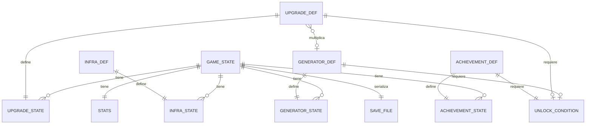
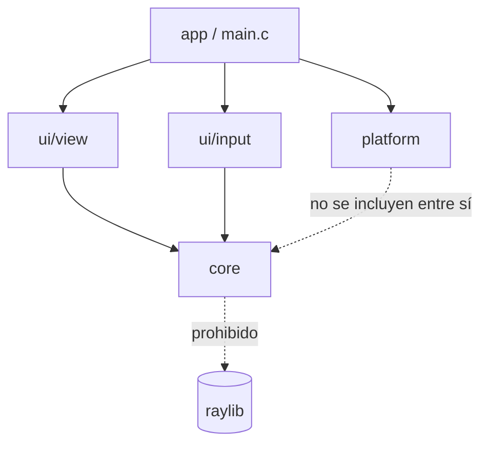
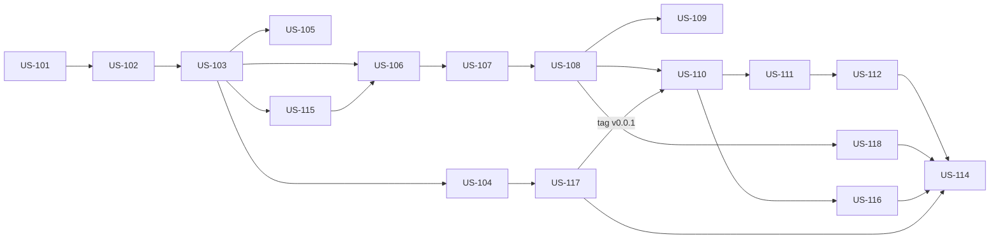

# Datacenter Tycoon — PRD / Plan de Desarrollo

## 1. Descripción general del producto

### 1.2 Visión del producto

Datacenter Tycoon es un juego idle/tycoon 2D donde el jugador arranca con un servidor viejo y escala hacia racks, clusters y datacenters completos. Es **principalmente un proyecto personal de aprendizaje y portfolio**: el juego tiene que ser divertido y pulido, pero el objetivo de fondo es practicar C (lógica, arquitectura, memoria) con estándares profesionales de calidad y distribución.

**Pilares:**

- **Core en C puro, testeable y aislado:** el modelo nunca depende de raylib.
- **Data-driven:** generadores y upgrades definidos en JSON, balance sin recompilar.
- **Distribución automatizada:** cada tag genera ejecutables, instalador y versión web.
- **Base primero, extensiones después:** C++ solo se suma sobre la v1.0 terminada.

### 1.3 Metas y no metas

**En el alcance (v1.0):**

- Clic manual para atender requests (además de la PC inicial).
- Generadores que producen recursos por segundo.
- Logros y pantalla de estadísticas de la partida.
- Upgrades que multiplican la producción.
- Costos exponenciales: `costo = base × crecimiento^cantidad`.
- Generadores y upgrades cargados desde JSON.
- Guardado versionado + autoguardado periódico.
- Progreso offline: `tiempo_ausente × producción`.
- Números grandes con `double` y formateo (1.2K, 3.4M, 5e20).
- UI con raylib + raygui; simulación con fixed timestep.
- Tests unitarios e integración del core con CTest, ASan + UBSan.
- Builds: Windows (ejecutable + instalador), Linux (AppImage), web (WebAssembly).
- CI/CD con GitHub Actions (`ci.yml`, `release.yml`, `pages.yml`).

El contenido se libera de forma incremental en versiones 0.x (ver 2.4): v1.0 es el juego base "completo y pulido" con las etapas 1 a 6 de la progresión.

**Fuera de alcance (v1.0):**

- Prestigio / nuevos datacenters (etapa 7) — va en v1.x.
- Recursos adicionales como monedas (ancho de banda, etc.) — v1.x.
- Audio y música.
- Telemetría o métricas de jugadores enviadas a un servidor: requiere backend, consentimiento y política de privacidad; no aporta al objetivo de aprendizaje de v1.0.
- Cualquier código C++ (panel de debug con Dear ImGui, ECS, pathfinding A\*, mapa tycoon visual) — se hace después de la v1.0, ver Roadmap futuro.
- Wrapping de headers en `extern "C"` — se agrega al final, sin tocar lógica.
- Go u otros lenguajes — descartado explícitamente.
- macOS — no está entre las plataformas objetivo.

### 1.4 Métricas de éxito

| Métrica                        | Definición / cómo se mide                                                              | Objetivo                  |
| ------------------------------ | -------------------------------------------------------------------------------------- | ------------------------- |
| **North Star: v1.0 publicada** | Release `v1.0.0` en GitHub Releases con binarios Windows + Linux y versión web jugable | 1 release completo        |
| Cobertura de tests del core    | Porcentaje de líneas de `src/core/` cubiertas por CTest                                | ≥ 80%                     |
| Sanitizers limpios             | Errores de ASan/UBSan en la suite de tests en CI                                       | 0                         |
| Leaks                          | Bytes perdidos reportados por Valgrind en los tests                                    | 0                         |
| Warnings del core              | Warnings con `-Wall -Wextra -Wpedantic -Werror`                                        | 0 (el build falla si hay) |
| CI verde                       | Porcentaje de pushes a `main` con `ci.yml` en verde                                    | 100%                      |
| Paridad de plataformas         | Plataformas donde el build del release funciona                                        | 3/3 (Windows, Linux, web) |

---

## 2. Contexto / dominio del problema: diseño de progresión

### 2.1 Recurso central

- **Capacidad (req/s):** cada servidor aguanta una cantidad de requests por segundo. Es el "poder de cómputo" del jugador y lo que se muestra como producción principal.
- **Dinero ($):** se gana por cada request atendida: `dinero/s = req/s × tarifa_por_request`. Es lo que se gasta en comprar y mejorar.
- Recursos adicionales (energía, temperatura, ancho de banda) se suman en versiones posteriores como **restricciones**, no como monedas nuevas (ver 2.4).

### 2.2 Secuencia de progresión propuesta

| Etapa                 | Qué se desbloquea                                                   | Mecánica nueva                                                                                                                           | Condición de desbloqueo                   |
| --------------------- | ------------------------------------------------------------------- | ---------------------------------------------------------------------------------------------------------------------------------------- | ----------------------------------------- |
| 1. Garage             | PC de escritorio vieja (arranca con 1) + clic manual                | Atender requests a mano y comprar más PCs (costo exponencial)                                                                            | Inicio del juego                          |
| 2. Primer rack        | Rack 42U + servidores Gen 1 de dos marcas ficticias                 | Los servidores ocupan **slots** de rack: hay que comprar racks para poder sumar servidores                                               | Alcanzar X req/s totales                  |
| 3. Sala de servidores | Ampliación de la sala (más espacio para racks)                      | Límite de racks por sala, ampliable                                                                                                      | Tener N racks llenos                      |
| 4. Infraestructura    | Generadores eléctricos, aire acondicionado, sistema contra incendio | Cada servidor consume **kW** y genera **calor**; si se supera la capacidad, la producción cae                                            | Primera ampliación de sala                |
| 5. Generaciones       | Gen 2, Gen 3, … de cada marca                                       | Servidores más modernos: más req/s por slot y por kW                                                                                     | Investigación/compra con dinero acumulado |
| 6. Cluster            | Clusterización de racks                                             | No se compra directamente: es un **upgrade** que da bonus multiplicador a racks agrupados (ej. cada 4 racks llenos = 1 cluster con ×1.5) | Tener N racks de la misma generación      |
| 7. Datacenter         | Nuevo datacenter (otra sede)                                        | Mecánica de **prestigio**: se reinicia el progreso a cambio de un multiplicador permanente                                               | Alcanzar un umbral alto de dinero total   |

**Marcas ficticias (placeholders, nombres a definir):** "Dellmar" (balanceada) y "Hewpack" (más cara, más eficiente en energía). Ambas con generaciones Gen 1 → Gen N.

### 2.3 Upgrades

Dos tipos, ambos temáticos:

| Tipo                            | Ejemplos                                                       | Efecto                              |
| ------------------------------- | -------------------------------------------------------------- | ----------------------------------- |
| **Por generador**               | SSD en lugar de HDD (PC), más RAM (Gen 1), fuentes redundantes | ×2 a la producción de ese generador |
| **Globales**                    | Balanceador de carga, virtualización, caché/CDN, monitoreo     | ×1.25 a ×2 a toda la producción     |
| **Por infraestructura** (v0.4+) | Pasillo frío/caliente, UPS eficiente                           | Reduce consumo de kW o calor        |

### 2.4 Liberación incremental

Cada versión agrega una etapa de la tabla 2.2, así siempre hay un juego jugable y publicado:

| Versión | Contenido                                                                                                                                   |
| ------- | ------------------------------------------------------------------------------------------------------------------------------------------- |
| v0.0.1  | Preparación: repo, build, tests, CI y un ejecutable mínimo (ventana vacía). Sin juego                                                       |
| v0.1    | Etapa 1: clic manual, PCs + upgrades por generador. Loop de juego base, sin guardado. Canal: ejecutable Windows (`.zip`) y Linux (AppImage) |
| v0.2    | Guardado, autoguardado y progreso offline. Canal nuevo: versión web en GitHub Pages                                                         |
| v0.3    | Etapa 2: racks, slots, servidores Gen 1 de las dos marcas                                                                                   |
| v0.4    | Etapas 3 y 4: ampliación de sala + energía, refrigeración e incendio                                                                        |
| v0.5    | Etapa 5: generaciones nuevas + upgrades globales                                                                                            |
| v0.6    | Etapa 6: clusters + logros y estadísticas de la partida                                                                                     |
| v1.0    | Pulido, balance, instaladores y versión web estables                                                                                        |
| v1.x    | Etapa 7: prestigio / nuevos datacenters                                                                                                     |
| v2.x    | Extensiones C++ (ver Roadmap futuro)                                                                                                        |

> Los canales de distribución también se suman de a uno: ejecutables en v0.1, web en v0.2 e instalador de Windows en v1.0 (itch.io queda para v1.x). La v1.0 marca el juego base "completo y pulido".

---

## 3. Perfiles de usuario

| Perfil                                | Rol y contexto                                                                                    | Objetivo principal                                                                         | Problema actual                                                        |
| ------------------------------------- | ------------------------------------------------------------------------------------------------- | ------------------------------------------------------------------------------------------ | ---------------------------------------------------------------------- |
| **Jugador de idle games** (principal) | Juega Cookie Clicker, Adventure Capitalist o similares en pestañas abiertas o en ratos libres     | Ver números crecer, desbloquear cosas nuevas y volver después a cobrar el progreso offline | Los idle games suelen tener temáticas genéricas (galletitas, negocios) |
| **Público técnico** (secundario)      | Sysadmins, devs o estudiantes de IT que conocen racks, generaciones de servidores y refrigeración | Disfrutar referencias reales del mundo datacenter                                          | No hay idle games con temática de infraestructura realista             |
| **Reclutador / revisor de portfolio** | Mira el repo y la versión web                                                                     | Evaluar calidad de código, arquitectura y CI/CD                                            | Necesita ver un producto terminado y jugable en segundos               |

**Perfil ampliado — jugador idle:** abre la versión web en itch.io o GitHub Pages, juega 10-15 minutos comprando servidores y upgrades, cierra la pestaña y vuelve horas después. Espera que el progreso offline esté calculado, que los números sean legibles (1.2K, 3.4M) y que siempre haya un próximo desbloqueo a la vista.

---

## 4. Arquitectura de datos

### 4.1 Entidades principales

- **GameConfig** (JSON, solo lectura): valores globales de balance: dinero inicial, tarifa por request, tope offline, % de reembolso de venta, parámetros de cluster.
- **GeneratorDef** (JSON, solo lectura): id, nombre, categoría (`pc`/`server`/`rack`), marca, generación, costo base, crecimiento, req/s, slots que ocupa (servidores), slots que provee (racks), kW, calor, condición de desbloqueo.
- **GeneratorState** (guardado): id de generador, cantidad comprada.
- **UpgradeDef** (JSON): id, nombre, tipo (`generator`/`click`/`global`/`infra`/`research`/`cluster`), objetivo, multiplicador, costo, condición de desbloqueo.
- **UpgradeState** (guardado): id, comprado sí/no.
- **InfraDef / InfraState** (v0.4+): sala, energía, refrigeración e incendio, cada uno con niveles (costo, capacidad, requisitos) y el nivel actual. Los racks **no** son infraestructura: son generadores de categoría `rack`.
- **UnlockCondition**: tipo (req/s totales, dinero total, cantidad de X, investigación) + umbral.
- **GameState**: dinero, dinero total histórico, desbloqueos, más las colecciones de estados.
- **SaveFile**: serialización JSON de GameState con campos `version` y `saved_at`.
- **AchievementDef** (JSON, v0.6+): id, nombre, descripción, condición (reusa UnlockCondition).
- **AchievementState** (guardado): ids de logros obtenidos con su timestamp.
- **Stats** (guardado, v0.6+): tiempo jugado, clics totales, compras totales, récord de req/s, dinero offline cobrado, fecha de inicio de la partida.
- **Settings** (v1.0, archivo aparte del guardado): escala de UI, tips vistos. No es parte del core.

### 4.2 Reglas de integridad

- Todo `id` de estado debe existir en las definiciones cargadas; si un guardado trae un id desconocido se descarta con log, sin romper la carga.
- `cantidad ≥ 0`, `dinero ≥ 0`; una compra sin dinero suficiente no modifica el estado.
- Servidores comprados ≤ slots disponibles (v0.3+); racks ≤ capacidad de la sala (v0.4+).
- Un guardado con `version` mayor a la soportada no se carga; con versión menor se migra.

### 4.3 Valores derivados (no se guardan, se calculan)

- req/s totales, dinero/s, costo de la próxima unidad, multiplicador efectivo, consumo de kW y
  calor vs. capacidad.



---

## 5. Arquitectura de software

### 5.1 Capas y responsabilidades

| Capa                      | Carpeta                      | Responsabilidad                                                                                                    | Puede incluir                             |
| ------------------------- | ---------------------------- | ------------------------------------------------------------------------------------------------------------------ | ----------------------------------------- |
| **core** (Model)          | `src/core/`, `include/core/` | Estado del juego, generadores, upgrades, economía, progreso offline, guardado (serialización), formateo de números | Solo C estándar + cJSON. **Nunca raylib** |
| **ui/view** (View)        | `src/ui/view/`               | Dibuja el estado; lo lee sin modificarlo (`const GameState *`)                                                     | core, raylib, raygui                      |
| **ui/input** (Controller) | `src/ui/input/`              | Lee mouse/teclado y genera **acciones** (`ACTION_BUY_GENERATOR` + id)                                              | core, raylib                              |
| **platform**              | `src/platform/`              | Lo que cambia entre web y escritorio: escritura de guardado (archivo vs IndexedDB), timestamps                     | C estándar, Emscripten                    |
| **app**                   | `src/main.c`                 | Game loop: input → `game_apply()` → `game_update()` (fixed timestep) → draw                                        | Todo lo anterior                          |

### 5.2 Regla de dependencias

Un solo sentido: `app → ui → core`. `core` no conoce ni a `ui` ni a `platform`; recibe los bytes del guardado y el tiempo actual como parámetros.



### 5.3 Patrones usados

- **Acciones (Command):** toda modificación del estado pasa por `game_apply(GameState *, Action)`. La UI nunca escribe el estado directamente → el core se testea sin ventana.
- **Structs opacos:** `GameState` se declara en el header y se define en el `.c`; se accede con funciones `game_*`.
- **Pares create/destroy:** `game_create()` / `game_destroy()`, ownership documentado en el header.
- **Data-driven:** definiciones en `data/*.json`, cargadas al inicio con cJSON.
- **Fixed timestep:** acumulador de tiempo; la simulación avanza en pasos fijos (ej. 1/60 s) independientes de los FPS.

---

## 6. Acuerdo de ingeniería y estándares

Proyecto en equipo dentro de **stack-dos**, desarrollado en tiempo libre.

### 6.1 Principios de desarrollo

- **Tests junto con cada historia:** ninguna historia que toque `core/` se cierra sin sus tests.
- **Git flow:** `main` (solo releases taggeados), `develop` (integración), `feature/US-xxx-nombre`, `release/vX.Y.Z`, `hotfix/vX.Y.Z`.
- **Code review obligatorio:** todo merge a `develop` va por PR con al menos 1 aprobación de otro miembro del equipo y CI en verde.
- **Un PR = una historia de usuario** (o una parte acotada de una historia XL).

### 6.2 Calidad de código y pruebas

- Core compilado con `-Wall -Wextra -Wpedantic -Werror`.
- Tests unitarios e integración con CTest; ASan + UBSan en todos los tests y en CI.
- Valgrind en CI (Linux) sobre la suite de tests: 0 leaks.
- Cobertura objetivo del core ≥ 80% (ver 1.4). La UI no se testea automáticamente.
- Formato con `clang-format` (archivo compartido en el repo) para evitar discusiones de estilo.

---

## 7. Reglas de negocio consolidadas

1. **Costo de compra:** `costo(n) = costo_base × crecimiento^n`, donde `n` es la cantidad ya comprada de ese generador. Crecimiento por defecto: 1.15 (definible por generador en JSON).
2. **Compra atómica:** si el dinero no alcanza, la acción no modifica nada. Si alcanza, se descuenta el costo y se suma la unidad en el mismo paso.
3. **Producción:** `req/s = Σ (cantidad × req_s_base × multiplicadores del generador) × multiplicadores globales`. Los multiplicadores se combinan **multiplicando** (×2 y ×2 = ×4).
4. **Ingreso:** `dinero/s = req/s × tarifa_por_request × factor_infra`.
5. **Factor de infraestructura (v0.4+):** si la demanda de kW o de refrigeración supera la capacidad, `factor_infra = min(capacidad_kW / demanda_kW, capacidad_frío / calor)`; si no, 1.
6. **Desbloqueos permanentes:** una vez cumplida una condición de desbloqueo, el ítem queda disponible aunque después el valor baje.
7. **Upgrades de compra única:** cada upgrade se compra una sola vez.
8. **Progreso offline:** `dinero_offline = segundos_ausente × dinero/s` al momento del guardado, con **tope de 8 horas** (propuesto, ajustable en balance). Si el reloj del sistema va hacia atrás, el tiempo ausente cuenta como 0.
9. **Autoguardado:** cada 30 s, al cerrar la ventana y al ocultar la pestaña (web).
10. **Formateo de números:** < 1.000 se muestra entero; hasta 10^15 con sufijos K, M, B, T, Qa y un decimal (1.2K, 3.4M); desde ahí notación científica (5.0e20).
11. **Venta (v0.5+):** vender una unidad devuelve `0.5 × costo(n − 1)` (porcentaje configurable en JSON) y no reduce el dinero total histórico.
12. **Clusters (v0.6+):** con la investigación "Clusterización", cada `cluster_slots` slots ocupados por servidores de la misma generación forman un cluster; la producción de esa generación se multiplica por `1 + cluster_bonus × clusters`.
13. **Clic manual:** cada clic suma `tarifa × (click_base + click_pct × req/s) × multiplicadores de clic`. Máximo 20 clics por segundo; los clics no cuentan para el progreso offline.
14. **Logros (v0.6+):** se desbloquean una sola vez con las mismas condiciones que los desbloqueos (regla 6) y son solo reconocimiento: no dan bonus de producción en v1.0.

---

## 8. Requisitos No Funcionales (NFR)

| Categoría     | Requisito                                                                     | Objetivo                                                                      |
| ------------- | ----------------------------------------------------------------------------- | ----------------------------------------------------------------------------- |
| Rendimiento   | FPS en escritorio, PC de gama baja (iGPU, 4 GB RAM)                           | 60 FPS estables                                                               |
| Rendimiento   | FPS en web (Chrome/Firefox actuales)                                          | ≥ 50 FPS                                                                      |
| Rendimiento   | Tiempo de un `game_update()` con todo el contenido de v1.0                    | < 1 ms                                                                        |
| Rendimiento   | Tiempo de arranque hasta pantalla jugable                                     | < 2 s escritorio, < 5 s web                                                   |
| Tamaño        | Descarga de la versión web (`.wasm` + `.js` + `.data`)                        | < 5 MB                                                                        |
| Tamaño        | Instalador de Windows / AppImage                                              | < 15 MB                                                                       |
| Precisión     | Simulación determinista: mismo estado + mismo tiempo = mismo resultado        | 100% en tests                                                                 |
| Precisión     | Diferencia entre progreso offline y la misma cantidad de tiempo jugado online | < 0,1%                                                                        |
| Confiabilidad | Guardado corrupto o ilegible                                                  | Nunca crashea; se carga partida nueva y se conserva el archivo como `.bak`    |
| Confiabilidad | Compatibilidad de guardados entre versiones                                   | Todo guardado desde v0.2 se puede cargar en versiones posteriores (migración) |
| Memoria       | Leaks en tests (Valgrind) / errores ASan-UBSan                                | 0 / 0                                                                         |
| Portabilidad  | Plataformas                                                                   | Windows 10+ x64, Linux x64 (glibc 2.31+), navegadores con WebAssembly         |
| Usabilidad    | Resolución mínima soportada                                                   | 1280×720, UI escalable                                                        |
| Usabilidad    | Juego completo con mouse; atajos de teclado opcionales                        | 100% de acciones con mouse                                                    |

---

## 9. ADRs (Architecture Decision Records)

### 9.1 Decisiones tomadas

| ID      | Título                      | Decisión                                                                            | Estado    |
| ------- | --------------------------- | ----------------------------------------------------------------------------------- | --------- |
| ADR-001 | Lenguaje del juego base     | C puro (C11); C++ solo para extensiones posteriores en `src/ext/`. Go descartado    | Aceptada  |
| ADR-002 | Librería gráfica            | raylib 6.2 + raygui 5.0                                                             | Aceptada  |
| ADR-003 | Formato de datos y guardado | JSON con cJSON 1.7.18                                                               | Aceptada  |
| ADR-004 | Sistema de build            | CMake (≥ 3.29) + Ninja, con un `Makefile` raíz como atajo; targets de escritorio, web (Emscripten) y tests | Aceptada  |
| ADR-005 | Arquitectura                | Capas `app → ui → core`, core sin raylib, cambios al estado solo por acciones       | Aceptada  |
| ADR-006 | Números grandes             | `double` + formateo propio (sin librería de bignum)                                 | Aceptada  |
| ADR-007 | Simulación                  | Fixed timestep, independiente de los FPS                                            | Aceptada  |
| ADR-008 | CI/CD                       | GitHub Actions: `ci.yml`, `release.yml`, `pages.yml`                                | Aceptada  |
| ADR-009 | Builds de distribución      | Windows con MinGW (compilación cruzada) + instalador; Linux con AppImage            | Aceptada  |
| ADR-010 | Estrategia de ramas         | Git flow (`main`, `develop`, `feature/*`, `release/*`, `hotfix/*`)                  | Aceptada  |
| ADR-011 | Recurso central             | req/s como capacidad que se convierte en dinero; energía y calor como restricciones | Propuesta |
| ADR-012 | Entorno de desarrollo       | Linux o WSL (Ubuntu); finales de línea LF forzados con `.gitattributes`             | Aceptada  |

### 9.2 ADRs pendientes

| ID      | Decisión pendiente          | Opciones                                                                                                         | Bloquea                               |
| ------- | --------------------------- | ---------------------------------------------------------------------------------------------------------------- | ------------------------------------- |
| ADR-P01 | Framework de tests          | Unity (ThrowTheSwitch) vs macros propias — **supuesto: Unity**                                                   | Hito 1 (primer test)                  |
| ADR-P02 | Hosting web                 | GitHub Pages, itch.io o ambos — **supuesto: GitHub Pages** (itch.io opcional después)                            | Hito 2 (US-210, `pages.yml`)          |
| ADR-P03 | Instalador Windows          | Inno Setup vs NSIS                                                                                               | Hito de v1.0 (`release.yml` completo) |
| ADR-P04 | Guardado web                | IndexedDB (IDBFS de Emscripten) vs `localStorage` — **supuesto: IDBFS** (mismo código de archivo que escritorio) | Hito 2 (v0.2)                         |
| ADR-P05 | Nombres de marcas ficticias | "Dellmar" / "Hewpack" u otros                                                                                    | Hito de v0.3                          |

---

## 10. Hitos → Épicas → Historias de Usuario

### Hito 1 — Garage: base del proyecto y loop jugable (v0.0.1 → v0.1)

- **Objetivo del hito:** tener el repo, el build, los tests y la CI funcionando, y un primer juego jugable (clic manual, comprar PCs y upgrades por generador) publicado como ejecutable para Windows y Linux.
- **Épicas:** 4 · **Historias:** 17
- **Dos fases con su propio tag** (se mantiene un solo hito para no renumerar las historias):
  - **Fase 1.1 — Preparación (tag `v0.0.1`,):** épica H1-E1. Repo, build, tests, CI, logs y un ejecutable mínimo (ventana vacía) publicado por `release.yml`, para probar toda la cadena de punta a punta antes de escribir lógica.
  - **Fase 1.2 — Garage (tag `v0.1.0`, ~64 h):** épicas H1-E2 a H1-E4. El juego jugable.
- **Supuesto de este hito:** framework de tests **Unity** (ADR-P01, recomendado por traer asserts para `double` y runner simple). Si se decide otra cosa, solo cambia US-103.

#### Épica H1-E1: Infraestructura del proyecto (Fase 1.1 — Preparación)

#### US-101 — Estructura de carpetas y build con CMake

- **Prioridad:** Urgente
- **Objetivo Funcional:** que cualquiera de los dos pueda clonar y compilar con un solo comando.
- **Narrativa:** Como desarrollador, quiero una estructura y un build estándar, para empezar a programar sin configurar nada a mano.
- **Detalle técnico:**
  - `CMakeLists.txt` raíz con C11, opción `DCT_BUILD_TESTS` y targets `dct_core` (librería estática) y `datacenter_tycoon` (ejecutable). Los tests se suman en US-103.
  - `dct_core` con `-Wall -Wextra -Wpedantic -Werror`.
  - Generador Ninja y `Makefile` raíz como fachada: `make dependencias`, `make` (configura
    en Debug y compila), `make run`, `make clean`.
  - `.gitignore`, `.gitattributes` (LF), `.clang-format`, `README.md` con instrucciones de build.
  - Ramas `main` y `develop` creadas (ver ADR-010).
- **Criterios de Aceptación:**
  - AC1: `cmake -B build && cmake --build build` compila en Linux y Windows (MinGW) sin warnings.
  - AC2: `dct_core` no linkea ni incluye raylib.
  - AC3: el árbol de carpetas coincide con la sección 5.4.
- **Entidades/Modelos implicados:** —
- **Testing Mínimo:** el build de los dos targets en ambas plataformas (los tests llegan en US-103).
- **Archivos a crear:**

  ```txt
  CMakeLists.txt
  .gitignore
  .clang-format
  README.md
  include/core/  include/ui/  include/platform/  src/core/  src/ui/view/  src/ui/input/  src/platform/
  tests/unit/  tests/integration/  tests/fixtures/  data/  assets/  docs/
  ```

#### US-102 — Dependencias externas (raylib, raygui, cJSON, Unity)

- **Esfuerzo:** M (6 h) · **Prioridad:** Urgente · **Dependencias:** US-101
- **Objetivo Funcional:** dependencias con versión fija, iguales en las dos máquinas y en CI.
- **Narrativa:** Como desarrollador, quiero las dependencias versionadas en el repo, para que el
  build sea reproducible.
- **Detalle técnico:**
  - Submódulos git en `lib/` con tag fijo: raylib `6.2`, raygui `5.0`, cJSON `v1.7.18`,
    Unity `v2.6.0` (Unity se agrega en US-103).
  - raylib con `add_subdirectory` (`BUILD_EXAMPLES=OFF`).
  - raygui es header-only: target estático `raygui` compilado desde `src/ui/raygui_impl.c`
    (único `.c` con `RAYGUI_IMPLEMENTATION`), linkea raylib como `PUBLIC`.
  - cJSON: target estático `cjson` desde `lib/cjson/cJSON.c` (sin usar su CMakeLists).
  - Los warnings estrictos son `PRIVATE` de nuestros targets y **no** se aplican a `lib/`.
  - Paquetes de desarrollo de X11/OpenGL/ALSA/Wayland en `make dependencias`.
- **Criterios de Aceptación:**
  - AC1: `git clone --recursive` + build funciona sin descargar nada más.
  - AC2: cada submódulo apunta a un tag de release, no a una rama.
- **Testing Mínimo:** el build de CI (US-104) valida la integración.
- **Archivos a crear:**
  ```
  .gitmodules
  lib/raylib/  lib/raygui/  lib/cjson/  lib/unity/
  ```

#### US-103 — Tests con CTest, Unity y sanitizers

- **Esfuerzo:** M (8 h) · **Prioridad:** Urgente · **Dependencias:** US-102
- **Objetivo Funcional:** poder escribir tests del core desde el día uno y detectar errores de
  memoria automáticamente.
- **Narrativa:** Como desarrollador, quiero correr todos los tests con ASan y UBSan con un
  comando, para encontrar errores de memoria antes de mergear.
- **Detalle técnico:**
  - `cmake/sanitizers.cmake` con opción `DCT_SANITIZE` (`-fsanitize=address,undefined
-fno-omit-frame-pointer`).
  - Un ejecutable de test por módulo, registrado con `add_test`.
  - `scripts/valgrind.sh` corre la suite con `--leak-check=full --error-exitcode=1`.
- **Criterios de Aceptación:**
  - AC1: `ctest --output-on-failure` corre todos los tests.
  - AC2: un leak introducido a propósito hace fallar el build con sanitizers.
- **Testing Mínimo:** `test_sanity` pasa con y sin sanitizers.
- **Archivos a crear:**
  ```
  cmake/sanitizers.cmake
  tests/CMakeLists.txt
  tests/unit/test_sanity.c
  scripts/valgrind.sh
  ```

#### US-104 — Pipeline de CI (`ci.yml`)

- **Esfuerzo:** M (6 h) · **Prioridad:** Alta · **Dependencias:** US-103
- **Objetivo Funcional:** que ningún PR roto llegue a `develop`.
- **Narrativa:** Como equipo, queremos que cada push y PR compile y corra los tests, para revisar
  código sabiendo que funciona.
- **Detalle técnico:**
  - Jobs: Linux (gcc + sanitizers + Valgrind), Windows (MinGW cross desde Linux), check de
    `clang-format`.
  - Reporte de cobertura del core (gcov/lcov) publicado como artefacto, informativo desde v0.1
    (el mínimo de 80% se exige en US-707).
  - Branch protection en `develop` y `main`: CI verde + 1 aprobación.
- **Criterios de Aceptación:**
  - AC1: un test fallando bloquea el merge del PR.
  - AC2: la CI completa tarda menos de 10 minutos.
- **Testing Mínimo:** PR de prueba con un test roto que la CI rechaza.
- **Archivos a crear:**
  ```
  .github/workflows/ci.yml
  cmake/toolchain-mingw.cmake
  ```

#### US-115 — Módulo de logs

- **Esfuerzo:** S (4 h) · **Prioridad:** Alta · **Dependencias:** US-103
- **Objetivo Funcional:** que cuando un jugador o un miembro del equipo reporte un bug haya
  información para diagnosticarlo (sobre todo errores de carga de JSON y de guardado).
- **Narrativa:** Como desarrollador, quiero un log con niveles, para saber qué pasó sin tener que
  reproducir el bug con un debugger.
- **Detalle técnico:**
  - `log_write(LogLevel, const char *fmt, ...)` con niveles `DEBUG`, `INFO`, `WARN`, `ERROR`.
  - El core no escribe archivos: `log_set_sink(void (*sink)(LogLevel, const char *))` y
    `platform/` decide el destino (escritorio: stderr + `game.log` rotado a 1 MB junto al
    guardado; web: consola del navegador).
  - `DEBUG` solo en builds de debug.
- **Criterios de Aceptación:**
  - AC1: sin sink configurado, `log_write` no hace nada (los tests no ensucian la salida).
  - AC2: un mensaje más largo que el buffer interno se trunca sin overflow.
  - (Los módulos que lo usan —`defs`, `save`— lo dejan en sus propias historias.)
- **Testing Mínimo:** `test_log.c` con un sink falso que captura los mensajes.
- **Archivos a crear:**
  ```
  include/core/log.h
  src/core/log.c
  src/platform/log_sink.c
  tests/unit/test_log.c
  ```

#### US-117 — Ejecutable mínimo y release v0.0.1 (`release.yml`)

- **Esfuerzo:** M (8 h) · **Prioridad:** Alta · **Dependencias:** US-104
- **Objetivo Funcional:** cerrar la fase de preparación con un tag real y la cadena de release
  probada antes de que haya lógica de juego.
- **Narrativa:** Como equipo, queremos publicar un ejecutable mínimo, para saber desde el día uno
  que el empaquetado y la publicación funcionan en las dos plataformas.
- **Detalle técnico:**
  - `src/main.c` mínimo: abre una ventana 1280×720 con el título y la versión, y cierra limpio.
  - `release.yml` con tag `v*`: `.zip` para Windows (MinGW) y AppImage para Linux, adjuntos al
    GitHub Release. El instalador llega en el Hito 7 (ADR-P03).
  - Versión inyectada desde el tag (`-DDCT_VERSION=...`), visible en la ventana.
  - `CHANGELOG.md` inicial; merge de `develop` a `main` y tag `v0.0.1` (sección 13.3).
- **Criterios de Aceptación:**
  - AC1: pushear el tag `v0.0.1` publica el release con los dos binarios.
  - AC2: los binarios abren en una máquina limpia (sin dependencias instaladas).
- **Testing Mínimo:** probar los binarios descargados en Windows y Linux.
- **Archivos a crear:**
  ```
  src/main.c
  .github/workflows/release.yml
  scripts/package_appimage.sh
  CHANGELOG.md
  ```

#### Épica H1-E2: Core económico (Fase 1.2 — Garage)

#### US-105 — Formateo de números grandes

- **Esfuerzo:** S (4 h) · **Prioridad:** Alta · **Dependencias:** US-103
- **Objetivo Funcional:** que el jugador lea cualquier cantidad de un vistazo.
- **Narrativa:** Como jugador, quiero ver "3.4M" y no "3400000", para entender rápido cuánto tengo.
- **Detalle técnico:**
  - `numfmt_format(double value, char *buf, size_t buf_len)` en `src/core/numfmt.c`, sin `malloc`.
- **Criterios de Aceptación:**
  - AC1: cumple la regla de negocio 10 (sección 7).
  - AC2: nunca escribe más de `buf_len` bytes; devuelve error si no entra.
  - AC3: maneja 0, negativos, `INFINITY` y `NAN` sin crashear.
- **Reglas de Negocio:** regla 10.
- **Testing Mínimo:** `test_numfmt.c`: bordes 999, 1000, 999.95K, 1e15, 5e20, buffer chico.
- **Archivos a crear:**
  ```
  include/core/numfmt.h
  src/core/numfmt.c
  tests/unit/test_numfmt.c
  ```

#### US-106 — Carga de definiciones desde JSON

- **Esfuerzo:** M (8 h) · **Prioridad:** Urgente · **Dependencias:** US-103, US-115
- **Objetivo Funcional:** balancear el juego editando JSON, sin recompilar.
- **Narrativa:** Como diseñador del balance, quiero definir generadores y upgrades en JSON, para
  ajustar números sin tocar C.
- **Detalle técnico:**
  - `defs_create()` / `defs_destroy(Defs *)`; `defs_add(Defs *, const char *json_text)` una vez
    por archivo (cada uno con su clave raíz: `config`, `generators`, `upgrades`, y `infra` desde
    v0.4) y `defs_finalize(Defs *)` valida las referencias cruzadas. El core recibe el texto, no
    lee archivos (eso es `platform/`). En el resto del documento, "`defs_load()`" se refiere a
    esta secuencia.
  - Struct opaco `Defs` con arrays de `GeneratorDef` y `UpgradeDef` (sección 4.1, solo campos de
    v0.1: id, nombre, costo base, crecimiento, req/s; upgrades: objetivo, multiplicador, costo).
  - `data/config.json` (GameConfig: dinero inicial, tarifa por request; los campos de versiones
    posteriores se agregan con valor por defecto), `data/generators.json` con la PC vieja y
    `data/upgrades.json` con 3 upgrades de la PC.
- **Criterios de Aceptación:**
  - AC1: JSON inválido o con campos faltantes devuelve error con mensaje (también logueado con
    `log_write`), sin leaks.
  - AC2: ids duplicados se rechazan.
  - AC3: un upgrade que apunta a un generador inexistente se rechaza.
- **Reglas de Negocio:** integridad de ids (sección 4.2).
- **Entidades/Modelos implicados:** GameConfig, GeneratorDef, UpgradeDef.
- **Testing Mínimo:** `test_defs.c` con fixtures válidos e inválidos, bajo ASan.
- **Archivos a crear:**
  ```
  include/core/defs.h
  src/core/defs.c
  data/config.json
  data/generators.json
  data/upgrades.json
  tests/unit/test_defs.c
  tests/fixtures/defs_valid.json
  tests/fixtures/defs_invalid_*.json
  ```

#### US-107 — Estado del juego y compra de generadores

- **Esfuerzo:** M (8 h) · **Prioridad:** Urgente · **Dependencias:** US-106
- **Objetivo Funcional:** que el jugador pueda gastar dinero en más PCs.
- **Narrativa:** Como jugador, quiero comprar otra PC, para atender más requests.
- **Detalle técnico:**
  - `game_create(const Defs *)` / `game_destroy(GameState *)`; `GameState` opaco. El estado no
    es dueño de `Defs` (documentado en el header).
  - `enum ActionType { ACTION_BUY_GENERATOR, ACTION_BUY_UPGRADE }`; `Action { type, id }`.
  - `game_apply(GameState *, Action)` devuelve un código de resultado (ok, sin dinero, id inválido).
  - `economy_cost(const GeneratorDef *, unsigned owned)`.
  - Getters: `game_money()`, `game_owned()`, `game_next_cost()`.
- **Criterios de Aceptación:**
  - AC1: se arranca con 1 PC y el dinero inicial definido en JSON.
  - AC2: comprar sin dinero suficiente no cambia el estado.
  - AC3: el costo de la unidad n respeta la regla 1.
- **Reglas de Negocio:** reglas 1 y 2.
- **Entidades/Modelos implicados:** GameState, GeneratorState.
- **Testing Mínimo:** `test_economy.c` (fórmula de costo), `test_game_buy.c` (compra ok, sin
  dinero, id inválido).
- **Archivos a crear:**
  ```
  include/core/game.h
  include/core/economy.h
  src/core/game.c
  src/core/economy.c
  tests/unit/test_economy.c
  tests/unit/test_game_buy.c
  ```

#### US-108 — Producción con fixed timestep

- **Esfuerzo:** M (6 h) · **Prioridad:** Urgente · **Dependencias:** US-107
- **Objetivo Funcional:** que el dinero crezca solo y siempre igual, sin importar los FPS.
- **Narrativa:** Como jugador, quiero que mis PCs generen dinero solas, para que el juego avance
  aunque no haga clic.
- **Detalle técnico:**
  - `game_update(GameState *, double dt)` con acumulador y paso fijo `GAME_TICK = 1.0 / 60`.
  - Tope de pasos por llamada para evitar el "espiral de la muerte" si un frame tarda mucho.
  - Getters `game_reqs_per_sec()`, `game_money_per_sec()` y `game_money_total()` (dinero total
    histórico, base de los desbloqueos de v0.3).
- **Criterios de Aceptación:**
  - AC1: 60 llamadas de 1/60 s producen el mismo dinero que 1 llamada de 1 s (diferencia < 1e-9).
  - AC2: se cumplen las reglas 3 y 4 (sin factor de infra todavía).
  - AC3: gastar dinero no reduce el dinero total histórico.
- **Reglas de Negocio:** reglas 3 y 4.
- **Testing Mínimo:** `test_production.c`: determinismo y fórmula.
- **Archivos a crear:**
  ```
  src/core/production.c
  tests/unit/test_production.c
  ```

#### US-109 — Upgrades por generador

- **Esfuerzo:** S (4 h) · **Prioridad:** Alta · **Dependencias:** US-108
- **Objetivo Funcional:** primera decisión de juego: ¿más PCs o mejorar las que tengo?
- **Narrativa:** Como jugador, quiero ponerle SSD a mis PCs, para duplicar su producción.
- **Detalle técnico:**
  - `ACTION_BUY_UPGRADE` en `game_apply()`; `UpgradeState` con flag de comprado.
  - El multiplicador se aplica en `production.c`.
- **Criterios de Aceptación:**
  - AC1: un upgrade comprado no se puede volver a comprar (regla 7).
  - AC2: dos upgrades ×2 dan ×4 (regla 3).
- **Reglas de Negocio:** reglas 2, 3 y 7.
- **Entidades/Modelos implicados:** UpgradeDef, UpgradeState.
- **Testing Mínimo:** `test_upgrades.c`; integración `test_session_basic.c` (comprar PCs +
  upgrade + avanzar 60 s → dinero esperado).
- **Archivos a crear:**
  ```
  include/core/upgrade.h
  src/core/upgrade.c
  tests/unit/test_upgrades.c
  tests/integration/test_session_basic.c
  ```

#### US-118 — Clic manual: atender requests a mano

- **Esfuerzo:** S (4 h) · **Prioridad:** Alta · **Dependencias:** US-108
- **Objetivo Funcional:** que el jugador tenga algo para hacer desde el segundo uno, antes de que
  la producción pasiva sea significativa.
- **Narrativa:** Como jugador nuevo, quiero hacer clic para atender requests a mano, para sentir
  que hago avanzar mi datacenter desde el principio.
- **Detalle técnico:**
  - `ACTION_MANUAL_CLICK` en `game_apply()`: suma dinero según la regla 13.
  - `click_base` y `click_pct` en `config.json`; tipo de upgrade `click` para mejorarlo
    (ej. "Teclado mecánico": ×2).
  - El contador de clics para estadísticas llega en US-607 (no se guarda antes).
- **Criterios de Aceptación:**
  - AC1: un clic suma `tarifa × (click_base + click_pct × req/s)` (regla 13).
  - AC2: se ignoran clics por encima de 20 por segundo (tope anti-autoclicker).
  - AC3: el clic no cuenta para el progreso offline.
- **Reglas de Negocio:** regla 13.
- **Testing Mínimo:** `test_click.c`: valor del clic, upgrade de clic, tope por segundo.
- **Archivos a crear:**
  ```
  src/core/click.c
  tests/unit/test_click.c
  ```

#### Épica H1-E3: UI y game loop

#### US-110 — Game loop de escritorio y web

- **Esfuerzo:** M (6 h) · **Prioridad:** Urgente · **Dependencias:** US-108, US-117
- **Objetivo Funcional:** abrir el juego y que corra.
- **Narrativa:** Como jugador, quiero abrir el juego en ventana o en el navegador, para jugarlo.
- **Detalle técnico:**
  - `src/main.c`: carga de `data/*.json` vía `src/platform/fs.c`, loop input → apply → update →
    draw. `emscripten_set_main_loop` bajo `#ifdef __EMSCRIPTEN__`.
  - Ventana 1280×720 redimensionable, 60 FPS objetivo.
- **Criterios de Aceptación:**
  - AC1: el ejecutable abre en Linux y Windows; si falta un JSON muestra un error claro.
  - AC2: al cerrar la ventana se libera todo (Valgrind sin leaks del código propio).
- **Testing Mínimo:** manual en ambas plataformas, con checklist en el PR.
- **Archivos a crear:** (`src/main.c` ya existe desde US-117; acá se completa el loop)
  ```
  src/platform/fs.c
  include/platform/fs.h
  ```

#### US-111 — Vista: panel de generadores, upgrades y totales

- **Esfuerzo:** L (12 h) · **Prioridad:** Alta · **Dependencias:** US-110
- **Objetivo Funcional:** que el jugador vea qué tiene, cuánto gana y qué puede comprar.
- **Narrativa:** Como jugador, quiero ver mi dinero, mis req/s y los botones de compra, para
  decidir qué hacer.
- **Detalle técnico:**
  - `view_draw(const GameState *, const Defs *)` con raygui: barra superior (dinero, $/s,
    req/s), botón grande "Atender request" (clic manual, US-118), lista de generadores
    (cantidad, costo, botón) y lista de upgrades.
  - Botones deshabilitados cuando no alcanza el dinero.
  - Todos los números pasan por `numfmt_format()`.
- **Criterios de Aceptación:**
  - AC1: la vista no modifica el estado (recibe `const`).
  - AC2: se ve bien desde 1280×720.
- **Testing Mínimo:** manual, con captura de pantalla en el PR.
- **Archivos a crear:**
  ```
  include/ui/view.h
  src/ui/view/view.c
  ```

#### US-112 — Input: clics → acciones

- **Esfuerzo:** S (4 h) · **Prioridad:** Alta · **Dependencias:** US-111
- **Objetivo Funcional:** que los botones compren de verdad.
- **Narrativa:** Como jugador, quiero hacer clic en "Comprar", para sumar una PC.
- **Detalle técnico:**
  - `input_poll(...)` devuelve las `Action` del frame y `main.c` las aplica con `game_apply()`.
    Como raygui detecta el clic durante el draw, la vista registra la acción pedida y el input
    la entrega (acuerdo documentado en `input.h`).
- **Criterios de Aceptación:**
  - AC1: un clic = una acción, aunque el botón quede presionado.
  - AC2: ninguna función de `ui/` escribe el estado directamente.
- **Testing Mínimo:** manual.
- **Archivos a crear:**
  ```
  include/ui/input.h
  src/ui/input/input.c
  ```

#### US-116 — Overlay de debug y benchmark del core

- **Esfuerzo:** S (4 h) · **Prioridad:** Media · **Dependencias:** US-108, US-110
- **Objetivo Funcional:** poder medir los NFR de rendimiento (sección 8) desde v0.1 en vez de
  descubrir problemas recién en v1.0.
- **Narrativa:** Como desarrollador, quiero ver FPS y tiempo de `game_update()` en pantalla, y un
  benchmark repetible, para detectar si un cambio empeoró el rendimiento.
- **Detalle técnico:**
  - Overlay con F3 (solo builds de debug): FPS, ms por frame, ms de `game_update()`, ticks por
    frame.
  - `tools/bench_update.c` (solo linkea `dct_core`, target `dct_bench`): estado sintético con
    todo el contenido de `data/` y cantidades altas, corre 100.000 `game_update()` e imprime ms
    promedio y máximo. Como lee los JSON reales, crece solo a medida que se agrega contenido.
  - Se corre a mano antes de cada release (paso del checklist de 13.3), no en CI: los runners
    compartidos dan tiempos demasiado variables.
- **Criterios de Aceptación:**
  - AC1: el benchmark imprime un resultado comparable entre corridas en la misma máquina (±10%).
  - AC2: el overlay no aparece en builds de release.
- **Testing Mínimo:** —
- **Archivos a crear:**
  ```
  src/ui/view/debug_overlay.c
  tools/bench_update.c
  ```

#### Épica H1-E4: Publicación v0.1

#### US-113 — (movida a US-210)

La publicación web se pasó al Hito 2 para liberar por canales de a uno: primero ejecutables
(v0.1), después web (v0.2), al final instalador (v1.0). El número queda sin usar.

#### US-114 — Release v0.1

- **Esfuerzo:** S (4 h) · **Prioridad:** Alta · **Dependencias:** US-109, US-112, US-116, US-117,
  US-118
- **Objetivo Funcional:** primera versión jugable descargable para Windows y Linux.
- **Narrativa:** Como jugador, quiero bajar el juego para mi sistema operativo, para jugarlo
  sin navegador.
- **Detalle técnico:**
  - `release.yml` ya existe (US-117): solo se suma `data/` al paquete.
  - Rama `release/v0.1.0`, CHANGELOG, tag `v0.1.0`.
- **Criterios de Aceptación:**
  - AC1: pushear el tag `v0.1.0` publica el release con los dos binarios y los JSON de `data/`.
  - AC2: se puede jugar una partida completa de v0.1 en las dos plataformas.
- **Testing Mínimo:** probar los binarios descargados en Windows y Linux.
- **Archivos a crear:** — (actualiza `release.yml` y `CHANGELOG.md`)

**Dependencias del Hito 1** (después de US-103, el core y la infraestructura de CI se pueden
repartir entre las dos personas):



### Hito 2 — Persistencia: guardado y progreso offline (v0.2)

- **Objetivo del hito:** que el jugador nunca pierda su partida y que el juego "trabaje" mientras
  no está, en escritorio y en web.
- **Épicas:** 3 · **Historias:** 10 · **Esfuerzo total estimado:** ~60 h·persona (~30 h por
  persona)
- **Supuesto de este hito:** guardado web con **IDBFS** de Emscripten (ADR-P04): el core y
  `platform/` escriben un archivo igual que en escritorio y solo se agrega la sincronización con
  IndexedDB.

#### Épica H2-E1: Serialización en el core

#### US-201 — Serializar y deserializar el estado

- **Esfuerzo:** M (8 h) · **Prioridad:** Urgente · **Dependencias:** US-109
- **Objetivo Funcional:** convertir la partida a texto y de vuelta sin perder nada.
- **Narrativa:** Como jugador, quiero que mi partida se guarde completa, para seguir exactamente
  donde la dejé.
- **Detalle técnico:**
  - `save_serialize(const GameState *, char **out_json)`: el llamador libera `out_json` con
    `save_free()` (ownership documentado en `save.h`).
  - `save_deserialize(const char *json, const Defs *, GameState **out)`.
  - Formato: `{ "version": 1, "money", "money_total", "saved_at", "generators": {id: cantidad},
"upgrades": [ids] }`.
  - `saved_at` lo recibe como parámetro y `save_saved_at()` lo devuelve al cargar (el core no lee
    el reloj).
- **Criterios de Aceptación:**
  - AC1: serializar → deserializar da un estado igual al original (dinero exacto, cantidades,
    upgrades).
  - AC2: ids desconocidos se descartan con `log_write(WARN)`, sin fallar (regla 4.2).
- **Reglas de Negocio:** integridad 4.2.
- **Entidades/Modelos implicados:** GameState, SaveFile.
- **Testing Mínimo:** `test_save_roundtrip.c`; fixture con id desconocido.
- **Archivos a crear:**
  ```
  include/core/save.h
  src/core/save.c
  tests/unit/test_save_roundtrip.c
  tests/fixtures/save_v1_valid.json
  tests/fixtures/save_v1_unknown_id.json
  ```

#### US-202 — Versionado, migraciones y guardados corruptos

- **Esfuerzo:** M (6 h) · **Prioridad:** Alta · **Dependencias:** US-201
- **Objetivo Funcional:** que una actualización del juego nunca rompa una partida existente.
- **Narrativa:** Como jugador, quiero que mi partida siga funcionando cuando sale una versión
  nueva, para no empezar de cero.
- **Detalle técnico:**
  - `SAVE_VERSION` actual + tabla de funciones `migrate_vN_to_vN1(cJSON *)` aplicadas en cadena.
  - Resultado de carga distingue: ok, migrado, versión futura, corrupto.
- **Criterios de Aceptación:**
  - AC1: un guardado con `version` mayor a la soportada no se carga y se informa.
  - AC2: un JSON corrupto devuelve "corrupto" sin crashear ni perder memoria.
  - AC3: existe una migración de prueba v0 → v1 cubierta por tests (sirve de plantilla).
- **Reglas de Negocio:** NFR de compatibilidad de guardados (sección 8).
- **Testing Mínimo:** `test_save_migration.c` con fixtures de cada versión y uno truncado.
- **Archivos a crear:**
  ```
  src/core/save_migrate.c
  tests/unit/test_save_migration.c
  tests/fixtures/save_v0.json
  tests/fixtures/save_corrupt.json
  ```

#### Épica H2-E2: Plataforma y autoguardado

#### US-203 — Guardado en archivo (escritorio)

- **Esfuerzo:** M (6 h) · **Prioridad:** Urgente · **Dependencias:** US-201
- **Objetivo Funcional:** guardar en disco sin riesgo de dejar un archivo a medio escribir.
- **Narrativa:** Como jugador, quiero que si se corta la luz mientras guarda no pierda la partida,
  para confiar en el autoguardado.
- **Detalle técnico:**
  - `platform_save_write(const char *json)` / `platform_save_read(char **out)`.
  - Escritura atómica: escribir `save.json.tmp` y renombrar sobre `save.json`.
  - Ruta: `%APPDATA%/DatacenterTycoon/` en Windows, `$XDG_DATA_HOME/datacenter-tycoon/` (o
    `~/.local/share/...`) en Linux.
  - Si la carga da "corrupto", renombrar a `save.json.bak` y arrancar partida nueva (NFR).
- **Criterios de Aceptación:**
  - AC1: matar el proceso durante el guardado nunca deja un `save.json` inválido.
  - AC2: un guardado corrupto queda como `.bak` y el juego arranca.
- **Testing Mínimo:** `test_platform_save.c` (integración, escritorio) sobre un directorio temporal.
- **Archivos a crear:**
  ```
  include/platform/save_io.h
  src/platform/save_io_desktop.c
  tests/integration/test_platform_save.c
  ```

#### US-204 — Guardado en web con IDBFS

- **Esfuerzo:** M (8 h) · **Prioridad:** Alta · **Dependencias:** US-203, US-210
- **Objetivo Funcional:** que la partida web sobreviva a cerrar la pestaña o el navegador.
- **Narrativa:** Como jugador web, quiero volver al link y encontrar mi partida, para jugar desde
  el navegador igual que en escritorio.
- **Detalle técnico:**
  - Montar IDBFS en `/save` al iniciar y esperar `FS.syncfs(true)` antes de cargar.
  - Después de cada escritura, `FS.syncfs(false)`.
  - Linkear con `-lidbfs.js`.
- **Criterios de Aceptación:**
  - AC1: recargar la página conserva la partida en Chrome y Firefox.
  - AC2: si IndexedDB no está disponible (modo privado), el juego corre igual y avisa que no se
    va a guardar.
- **Testing Mínimo:** manual en ambos navegadores, incluido modo privado.
- **Archivos a crear:**
  ```
  src/platform/save_io_web.c
  ```

#### US-205 — Autoguardado

- **Esfuerzo:** S (4 h) · **Prioridad:** Alta · **Dependencias:** US-204, US-209
- **Objetivo Funcional:** que el jugador nunca tenga que acordarse de guardar.
- **Narrativa:** Como jugador, quiero que el juego se guarde solo, para cerrarlo cuando quiera.
- **Detalle técnico:**
  - Timer en `main.c` (acumulando `dt`): cada 30 s y al cerrar la ventana (`WindowShouldClose`).
  - En web, `visibilitychange`/`beforeunload` registrados con `EM_JS` en `save_io_web.c`
    (regla 9).
  - Indicador visual breve "Guardado" en la vista (estado de UI que le pasa `main.c`).
- **Criterios de Aceptación:**
  - AC1: se guarda en los tres momentos de la regla 9.
  - AC2: guardar no produce un salto visible de FPS (< 1 frame).
- **Reglas de Negocio:** regla 9.
- **Testing Mínimo:** manual; cada guardado deja un `log_write(DEBUG)` con su timestamp.
- **Archivos a crear:** — (modifica `main.c` y `save_io_web.c`)

#### Épica H2-E3: Progreso offline y release

#### US-206 — Cálculo de progreso offline

- **Esfuerzo:** M (6 h) · **Prioridad:** Urgente · **Dependencias:** US-201
- **Objetivo Funcional:** que el juego produzca mientras el jugador no está.
- **Narrativa:** Como jugador, quiero volver horas después y cobrar lo que ganaron mis servidores,
  para sentir que el datacenter siguió funcionando.
- **Detalle técnico:**
  - `game_apply_offline(GameState *, double seconds_away)` devuelve el dinero ganado.
  - Tope configurable en JSON (`offline_cap_seconds`, por defecto 8 h); tiempo negativo → 0.
  - Cálculo directo (`segundos × dinero/s`), no simulando tick por tick.
- **Criterios de Aceptación:**
  - AC1: cumple la regla 8, incluido el tope y el reloj hacia atrás.
  - AC2: difiere < 0,1% de jugar online el mismo tiempo sin comprar nada (NFR).
- **Reglas de Negocio:** regla 8.
- **Testing Mínimo:** `test_offline.c`: 0 s, 1 h, 10 h (tope), tiempo negativo, comparación con
  `game_update()`.
- **Archivos a crear:**
  ```
  src/core/offline.c
  tests/unit/test_offline.c
  ```

#### US-207 — Pantalla "Mientras no estabas"

- **Esfuerzo:** S (4 h) · **Prioridad:** Media · **Dependencias:** US-209
- **Objetivo Funcional:** que el jugador vea y disfrute lo que ganó offline.
- **Narrativa:** Como jugador, quiero ver cuánto gané mientras no estaba, para tener ganas de
  seguir.
- **Detalle técnico:**
  - Modal en la vista con tiempo ausente, dinero ganado y aviso si se alcanzó el tope (datos que
    devuelve US-209 al iniciar).
  - Se cierra con un clic. Es estado de UI, no del juego: no pasa por `game_apply()`.
- **Criterios de Aceptación:**
  - AC1: aparece solo si el tiempo ausente es mayor a 60 s.
  - AC2: los números usan `numfmt_format()`.
- **Testing Mínimo:** manual.
- **Archivos a crear:**
  ```
  src/ui/view/offline_modal.c
  ```

#### US-209 — Carga al iniciar y aplicación del progreso offline

- **Esfuerzo:** M (6 h) · **Prioridad:** Urgente · **Dependencias:** US-202, US-203, US-206
- **Objetivo Funcional:** unir las piezas: al abrir el juego se carga la partida y se cobra el
  tiempo ausente.
- **Narrativa:** Como jugador, quiero abrir el juego y encontrar mi partida con lo ganado mientras
  no estaba, para no tener que hacer nada.
- **Detalle técnico:**
  - `platform_time_now()` (segundos Unix UTC) en `src/platform/time.c`.
  - Arranque en `main.c`: `platform_save_read()` → `save_deserialize()` → según el resultado
    (ok/migrado/futuro/corrupto) carga, avisa o arranca partida nueva (y `.bak` si es corrupto,
    US-203) → `game_apply_offline(now − saved_at)`.
  - Devuelve a la UI el resumen offline (segundos, dinero, si se tocó el tope) para US-207.
- **Criterios de Aceptación:**
  - AC1: sin guardado, arranca partida nueva sin errores.
  - AC2: un guardado de versión futura no se pisa: se avisa y se juega sin autoguardar.
  - AC3: el dinero offline se aplica una sola vez por arranque.
- **Reglas de Negocio:** regla 8.
- **Testing Mínimo:** `test_startup.c` (integración): las cuatro ramas de resultado con fixtures.
- **Archivos a crear:**
  ```
  include/platform/time.h
  src/platform/time.c
  tests/integration/test_startup.c
  ```

#### US-210 — Build web y deploy a GitHub Pages (`pages.yml`)

- **Esfuerzo:** M (8 h) · **Prioridad:** Alta · **Dependencias:** US-110
- **Objetivo Funcional:** segundo canal de distribución: que cualquiera pueda jugar desde un link.
- **Narrativa:** Como jugador, quiero jugar en el navegador, para no tener que instalar nada.
- **Detalle técnico:**
  - Target web con `emcmake`, `--preload-file data` y `web/shell.html` propio. El
    `#ifdef __EMSCRIPTEN__` del loop ya existe desde US-110; acá se compila y publica.
  - `pages.yml`: en cada push a `main`, build y deploy a GitHub Pages (ADR-P02, supuesto).
  - Job de build web también en `ci.yml`, para que no se rompa entre releases.
- **Criterios de Aceptación:**
  - AC1: el juego carga en Chrome y Firefox actuales.
  - AC2: descarga total < 5 MB (NFR).
- **Testing Mínimo:** smoke test manual del link publicado.
- **Archivos a crear:**
  ```
  web/shell.html
  .github/workflows/pages.yml
  ```

#### US-208 — Release v0.2

- **Esfuerzo:** S (4 h) · **Prioridad:** Media · **Dependencias:** US-205, US-207, US-209, US-210
- **Objetivo Funcional:** publicar la versión con guardado y estrenar la versión web.
- **Narrativa:** Como jugador, quiero bajar la versión que guarda mi partida o jugarla en el
  navegador.
- **Detalle técnico:**
  - Rama `release/v0.2.0`, CHANGELOG, tag; `release.yml` existente y primer deploy de `pages.yml`.
  - Verificar que un guardado de v0.2 cargue en una build de `develop` posterior.
- **Criterios de Aceptación:**
  - AC1: release publicado en GitHub Releases y web actualizada.
  - AC2: guardar, cerrar, esperar y abrir funciona en Windows, Linux y web.
- **Testing Mínimo:** checklist manual de las tres plataformas.
- **Archivos a crear:** — (solo actualiza `CHANGELOG.md`)

### Hito 3 — Primer rack: slots y servidores Gen 1 (v0.3)

- **Objetivo del hito:** pasar del garage al primer rack: los servidores necesitan slots, los
  slots vienen de comprar racks, y el contenido se desbloquea por progreso.
- **Épicas:** 3 · **Historias:** 9 · **Esfuerzo total estimado:** ~50 h·persona (~25 h por
  persona)
- **Supuesto de este hito:** marcas **"Dellmar"** y **"Hewpack"** (ADR-P05); como son datos en
  JSON, renombrarlas después no toca código.

#### Épica H3-E1: Modelo de racks y desbloqueos

#### US-301 — Definiciones extendidas: categorías, slots, marca y generación

- **Esfuerzo:** M (6 h) · **Prioridad:** Urgente · **Dependencias:** US-106
- **Objetivo Funcional:** que el JSON pueda describir PCs, servidores y racks.
- **Narrativa:** Como diseñador del balance, quiero definir servidores con marca, generación y
  slots que ocupan, para agregar contenido sin tocar C.
- **Detalle técnico:**
  - `GeneratorDef` suma: `category` (`pc`, `server`, `rack`), `brand`, `generation`,
    `slots_used` (servidores), `slots_provided` (racks), `unlock` (opcional).
  - Validación en `defs_load()`: un `server` necesita `slots_used > 0`; un `rack` necesita
    `slots_provided > 0` y produce 0 req/s.
- **Criterios de Aceptación:**
  - AC1: los JSON de v0.1 siguen cargando (campos nuevos con valores por defecto: `pc`, sin slots).
  - AC2: combinaciones inválidas (rack con req/s, server sin slots) se rechazan con mensaje.
- **Entidades/Modelos implicados:** GeneratorDef, UnlockCondition.
- **Testing Mínimo:** casos nuevos en `test_defs.c` + fixtures inválidos.
- **Archivos a crear:**
  ```
  tests/fixtures/defs_v03_valid.json
  tests/fixtures/defs_invalid_rack.json
  ```

#### US-302 — Condiciones de desbloqueo

- **Esfuerzo:** M (6 h) · **Prioridad:** Urgente · **Dependencias:** US-301
- **Objetivo Funcional:** que siempre haya un próximo objetivo a la vista.
- **Narrativa:** Como jugador, quiero desbloquear cosas nuevas al crecer, para sentir progreso.
- **Detalle técnico:**
  - `UnlockCondition { type, target_id, threshold }` con tipos `REQS_TOTAL`, `MONEY_TOTAL`,
    `OWNED` (cantidad de un generador).
  - Aplica a generadores **y** upgrades (ambos tienen `unlock` opcional en su def).
  - `unlock_check(GameState *)` en cada `game_update()` y al final de `game_apply_offline()`;
    los desbloqueos se guardan en el estado.
  - `game_apply()` rechaza comprar algo bloqueado (`RESULT_LOCKED`).
- **Criterios de Aceptación:**
  - AC1: cumplida la condición, el ítem queda desbloqueado para siempre (regla 6).
  - AC2: comprar un ítem bloqueado devuelve error y no cambia el estado.
  - AC3: `game_unlock_progress(id)` devuelve un valor 0..1 para mostrar en la UI.
- **Reglas de Negocio:** regla 6.
- **Testing Mínimo:** `test_unlock.c`: cada tipo de condición, permanencia, compra bloqueada.
- **Archivos a crear:**
  ```
  include/core/unlock.h
  src/core/unlock.c
  tests/unit/test_unlock.c
  ```

#### US-303 — Racks y slots

- **Esfuerzo:** M (8 h) · **Prioridad:** Urgente · **Dependencias:** US-301
- **Objetivo Funcional:** la mecánica central del hito: para sumar servidores hay que tener lugar.
- **Narrativa:** Como jugador, quiero comprar un rack para poder instalar más servidores, para
  escalar más allá del garage.
- **Detalle técnico:**
  - Slots totales = Σ (racks × `slots_provided`); slots usados = Σ (servidores × `slots_used`).
  - `game_apply(ACTION_BUY_GENERATOR)` de un `server` verifica slots libres; nuevo resultado
    `RESULT_NO_SLOTS`.
  - Getters `game_slots_total()` y `game_slots_used()`. Las PCs no usan slots.
- **Criterios de Aceptación:**
  - AC1: sin slots libres, la compra de servidor falla y no descuenta dinero (regla 2).
  - AC2: un rack 42U con servidores 1U/2U suma correctamente.
- **Reglas de Negocio:** regla 2; integridad "servidores ≤ slots" (4.2).
- **Entidades/Modelos implicados:** GeneratorDef, GeneratorState.
- **Testing Mínimo:** `test_slots.c`: slots exactos, rack lleno, servidores de distinto tamaño.
- **Archivos a crear:**
  ```
  src/core/slots.c
  tests/unit/test_slots.c
  ```

#### US-304 — Migración de guardado v1 → v2

- **Esfuerzo:** S (4 h) · **Prioridad:** Alta · **Dependencias:** US-202, US-302
- **Objetivo Funcional:** que las partidas de v0.2 sigan en v0.3.
- **Narrativa:** Como jugador de v0.2, quiero actualizar sin perder la partida.
- **Detalle técnico:**
  - `SAVE_VERSION = 2`: suma la lista `unlocked`. `migrate_v1_to_v2()` recalcula los desbloqueos
    según el estado cargado.
- **Criterios de Aceptación:**
  - AC1: un guardado v1 carga con el mismo dinero y cantidades.
  - AC2: lo que la partida ya merecía queda desbloqueado al cargar.
- **Testing Mínimo:** caso nuevo en `test_save_migration.c` con `save_v1_valid.json`.
- **Archivos a crear:**
  ```
  tests/fixtures/save_v2_valid.json
  ```

#### Épica H3-E2: Contenido Gen 1 y balance

#### US-305 — Contenido: rack y servidores Gen 1 de Dellmar y Hewpack

- **Esfuerzo:** M (6 h) · **Prioridad:** Alta · **Dependencias:** US-302, US-303
- **Objetivo Funcional:** primer catálogo real de hardware.
- **Narrativa:** Como jugador técnico, quiero elegir entre dos marcas con ventajas distintas,
  para tomar decisiones de compra.
- **Detalle técnico:**
  - `data/generators.json`: Rack 42U, Dellmar Gen 1 (1U y 2U), Hewpack Gen 1 (1U y 2U). Dellmar
    más barato, Hewpack más req/s por slot (la eficiencia en kW se usa recién en v0.4).
  - `data/upgrades.json`: 2 upgrades por servidor (ej. más RAM, fuentes redundantes).
- **Criterios de Aceptación:**
  - AC1: el rack se desbloquea al llegar a un umbral de req/s alcanzable en ~10-15 min de juego.
  - AC2: ninguna marca domina a la otra en todos los aspectos.
- **Testing Mínimo:** `test_content_load.c` carga los JSON reales de `data/` sin errores.
- **Archivos a crear:**
  ```
  tests/integration/test_content_load.c
  ```

#### US-306 — Simulador de balance

- **Esfuerzo:** S (4 h) · **Prioridad:** Media · **Dependencias:** US-305
- **Objetivo Funcional:** verificar el ritmo del juego sin jugarlo a mano durante horas.
- **Narrativa:** Como diseñador del balance, quiero simular una partida con una estrategia simple,
  para saber cuánto tarda cada desbloqueo.
- **Detalle técnico:**
  - Ejecutable `dct_balance` (solo linkea `dct_core`): estrategia "comprar siempre lo más barato
    que mejore $/s", imprime minuto de cada desbloqueo.
- **Criterios de Aceptación:**
  - AC1: corre en < 1 s para 2 h simuladas.
  - AC2: su salida se usa para validar el AC1 de US-305.
- **Testing Mínimo:** test `test_balance_v03` (registrado en CTest) que verifica que el rack se
  desbloquea entre 10 y 15 min simulados (el AC1 de US-305). Los hitos siguientes agregan sus
  propios casos al mismo test.
- **Archivos a crear:**
  ```
  tools/balance_sim.c
  ```

#### Épica H3-E3: UI del rack y release

#### US-307 — Vista: pestañas por categoría, ítems bloqueados y toasts

- **Esfuerzo:** M (6 h) · **Prioridad:** Alta · **Dependencias:** US-302
- **Objetivo Funcional:** que el jugador vea qué viene y qué acaba de desbloquear.
- **Narrativa:** Como jugador, quiero ver qué me falta para desbloquear lo próximo, para planear
  compras.
- **Detalle técnico:**
  - Pestañas por categoría (PCs, Servidores, Racks, Upgrades). Las pestañas de hitos siguientes
    (Infraestructura, Investigación, Clusters, Opciones) se suman a este mismo componente.
  - Ítems bloqueados en gris con barra de progreso (`game_unlock_progress`).
  - Sistema de toasts reutilizable: "¡Desbloqueado: X!" y mensajes de error de compra según el
    resultado de `game_apply()` que `main.c` le pasa a la vista.
- **Criterios de Aceptación:**
  - AC1: la vista sigue sin modificar el estado.
  - AC2: cada desbloqueo muestra un solo toast.
- **Testing Mínimo:** manual, con capturas en el PR.
- **Archivos a crear:**
  ```
  src/ui/view/tabs.c
  src/ui/view/toast.c
  ```

#### US-309 — Vista: rack y slots

- **Esfuerzo:** M (6 h) · **Prioridad:** Alta · **Dependencias:** US-303, US-307
- **Objetivo Funcional:** que el jugador entienda de un vistazo cuánto lugar le queda.
- **Narrativa:** Como jugador, quiero ver mi rack llenándose, para saber cuándo comprar otro.
- **Detalle técnico:**
  - Dibujo del rack con slots ocupados/libres e indicador "slots: 12/42".
  - Toast "Sin slots libres: comprá un rack" ante `RESULT_NO_SLOTS` (usa US-307).
- **Criterios de Aceptación:**
  - AC1: el estado de slots en pantalla coincide siempre con el core.
  - AC2: se ve bien desde 1280×720 con muchos racks (scroll o resumen).
- **Testing Mínimo:** manual, con capturas en el PR.
- **Archivos a crear:**
  ```
  src/ui/view/rack_view.c
  ```

#### US-308 — Release v0.3

- **Esfuerzo:** S (4 h) · **Prioridad:** Media · **Dependencias:** US-304, US-306, US-309
- **Objetivo Funcional:** publicar la versión con racks.
- **Narrativa:** Como jugador, quiero la versión con racks y servidores, para seguir creciendo.
- **Detalle técnico:** rama `release/v0.3.0`, CHANGELOG, tag; pipelines existentes.
- **Criterios de Aceptación:**
  - AC1: release y web publicados.
  - AC2: un guardado de v0.2 se actualiza sin pérdida en las tres plataformas.
- **Testing Mínimo:** checklist manual de las tres plataformas.
- **Archivos a crear:** — (solo actualiza `CHANGELOG.md`)

### Hito 4 — Sala de servidores e infraestructura (v0.4)

- **Objetivo del hito:** agregar la primera restricción real: la sala tiene un límite de racks y
  cada servidor consume energía y genera calor que hay que cubrir con infraestructura.
- **Épicas:** 3 · **Historias:** 8 · **Esfuerzo total estimado:** ~50 h·persona (~25 h por
  persona)
- **Supuesto de este hito:** el sistema contra incendio es un **requisito** para ampliar la sala
  (sin eventos aleatorios de incendio en v1.0).

#### Épica H4-E1: Modelo de infraestructura

#### US-401 — Definiciones de infraestructura por niveles

- **Esfuerzo:** M (6 h) · **Prioridad:** Urgente · **Dependencias:** US-301
- **Objetivo Funcional:** describir sala, energía, refrigeración e incendio en JSON.
- **Narrativa:** Como diseñador del balance, quiero definir niveles de infraestructura con costo y
  capacidad, para ajustar la curva sin tocar C.
- **Detalle técnico:**
  - `data/infra.json` (clave raíz `infra`, cargado con `defs_add()`): tipos `room` (racks máx.),
    `power` (kW), `cooling` (calor), `fire` (nivel). Cada tipo tiene una lista de niveles con
    `cost`, `capacity` y `requires`. `InfraState` (nivel por tipo) se suma a `GameState`.
  - `GeneratorDef` suma `power_kw` y `heat`.
  - `infra_level(state, type)` y `infra_capacity(state, type)`.
- **Criterios de Aceptación:**
  - AC1: niveles fuera de orden o requisitos a tipos inexistentes se rechazan.
  - AC2: los JSON de v0.3 cargan con `power_kw` y `heat` en 0.
- **Entidades/Modelos implicados:** InfraDef, InfraState.
- **Testing Mínimo:** `test_infra_defs.c` con fixtures válidos e inválidos.
- **Archivos a crear:**
  ```
  include/core/infra.h
  src/core/infra.c
  data/infra.json
  tests/unit/test_infra_defs.c
  tests/fixtures/infra_valid.json
  ```

#### US-402 — Ampliación de sala con requisitos

- **Esfuerzo:** M (6 h) · **Prioridad:** Urgente · **Dependencias:** US-401, US-303
- **Objetivo Funcional:** que crecer en racks obligue a invertir en la sala.
- **Narrativa:** Como jugador, quiero ampliar mi sala para poner más racks, para seguir escalando.
- **Detalle técnico:**
  - `ACTION_UPGRADE_INFRA` + tipo. Ampliar la sala exige el nivel de `fire` (y opcionalmente
    `power`) indicado en `requires`.
  - Comprar un rack falla con `RESULT_NO_ROOM` si se supera `room.capacity`.
- **Criterios de Aceptación:**
  - AC1: sin el requisito, la ampliación falla y no descuenta dinero.
  - AC2: racks comprados ≤ capacidad de la sala (regla 4.2).
- **Reglas de Negocio:** regla 2; integridad 4.2.
- **Testing Mínimo:** `test_room.c`: requisitos, límite de racks.
- **Archivos a crear:**
  ```
  tests/unit/test_room.c
  ```

#### US-403 — Energía, calor y factor de infraestructura

- **Esfuerzo:** M (8 h) · **Prioridad:** Urgente · **Dependencias:** US-401
- **Objetivo Funcional:** que la infraestructura importe: si no alcanza, se produce menos.
- **Narrativa:** Como jugador, quiero ver que mis servidores se ahogan sin energía o frío, para
  decidir cuándo invertir en infraestructura.
- **Detalle técnico:**
  - Demanda: `Σ cantidad × power_kw` y `Σ cantidad × heat`.
  - `factor_infra` según regla 5, aplicado en `production.c` y en `offline.c`.
  - Getters `game_power_demand()`, `game_heat_demand()`, `game_infra_factor()`.
- **Criterios de Aceptación:**
  - AC1: con capacidad suficiente el factor es exactamente 1.
  - AC2: con demanda doble a la capacidad, la producción cae a la mitad.
  - AC3: el progreso offline usa el mismo factor.
- **Reglas de Negocio:** reglas 4, 5 y 8.
- **Testing Mínimo:** `test_infra_factor.c`: sin déficit, déficit de kW, de frío y de ambos.
- **Archivos a crear:**
  ```
  tests/unit/test_infra_factor.c
  ```

#### US-404 — Upgrades de infraestructura

- **Esfuerzo:** S (4 h) · **Prioridad:** Media · **Dependencias:** US-403
- **Objetivo Funcional:** una segunda vía para resolver el déficit: eficiencia en vez de capacidad.
- **Narrativa:** Como jugador, quiero instalar pasillo frío/caliente, para generar menos calor sin
  comprar más aire acondicionado.
- **Detalle técnico:** tipo de upgrade `infra` con objetivo `power` o `heat` y multiplicador < 1
  sobre la demanda.
- **Criterios de Aceptación:**
  - AC1: un upgrade ×0.8 de calor reduce la demanda de calor un 20%.
- **Testing Mínimo:** caso nuevo en `test_upgrades.c`.
- **Archivos a crear:** —

#### US-405 — Migración de guardado v2 → v3

- **Esfuerzo:** S (4 h) · **Prioridad:** Alta · **Dependencias:** US-402, US-403
- **Objetivo Funcional:** que las partidas de v0.3 sigan en v0.4.
- **Narrativa:** Como jugador de v0.3, quiero actualizar sin perder la partida.
- **Detalle técnico:**
  - `SAVE_VERSION = 3`: suma `infra: {tipo: nivel}`. La migración asigna el nivel mínimo de sala
    que permite los racks que el jugador ya tiene, y energía/frío suficientes para que no pierda
    producción al actualizar.
- **Criterios de Aceptación:**
  - AC1: un guardado v2 carga con el mismo $/s que tenía en v0.3.
- **Testing Mínimo:** caso nuevo en `test_save_migration.c`.
- **Archivos a crear:**
  ```
  tests/fixtures/save_v3_valid.json
  ```

#### Épica H4-E2: Contenido y balance

#### US-406 — Contenido de infraestructura y balance

- **Esfuerzo:** M (6 h) · **Prioridad:** Alta · **Dependencias:** US-403, US-306
- **Objetivo Funcional:** que la infraestructura aparezca como decisión, no como castigo.
- **Narrativa:** Como jugador, quiero que la falta de energía aparezca de a poco, para entender
  qué pasa antes de que me frene.
- **Detalle técnico:**
  - Niveles de sala, generadores eléctricos, A/C e incendio en `data/infra.json`; `power_kw` y
    `heat` para todos los servidores (Hewpack más eficiente en kW).
  - El simulador de balance suma la estrategia "comprar infraestructura cuando el factor < 1".
- **Criterios de Aceptación:**
  - AC1: el primer déficit aparece después de la primera ampliación de sala (etapa 4).
  - AC2: con la estrategia del simulador, el factor promedio nunca baja de 0.8.
- **Testing Mínimo:** test del simulador que verifica AC1 y AC2.
- **Archivos a crear:** —

#### Épica H4-E3: UI de infraestructura y release

#### US-407 — Vista: panel de infraestructura

- **Esfuerzo:** L (12 h) · **Prioridad:** Alta · **Dependencias:** US-402, US-403, US-307
- **Objetivo Funcional:** que el jugador vea el cuello de botella sin hacer cuentas.
- **Narrativa:** Como jugador, quiero ver barras de energía y calor, para saber qué comprar.
- **Detalle técnico:**
  - Pestaña "Infraestructura": nivel de cada tipo, botón de mejora con requisitos, barras
    demanda/capacidad de kW y calor (verde/amarillo/rojo).
  - Alerta en la barra superior cuando `factor_infra < 1`, mostrando el % de producción perdida.
  - En cada servidor, su consumo de kW y calor.
- **Criterios de Aceptación:**
  - AC1: los valores coinciden con los getters del core.
  - AC2: los colores no son la única señal (también hay texto/porcentaje).
- **Testing Mínimo:** manual, con capturas en el PR.
- **Archivos a crear:**
  ```
  src/ui/view/infra_view.c
  ```

#### US-408 — Release v0.4

- **Esfuerzo:** S (4 h) · **Prioridad:** Media · **Dependencias:** US-405, US-406, US-407
- **Objetivo Funcional:** publicar la versión con infraestructura.
- **Narrativa:** Como jugador, quiero la versión con sala e infraestructura.
- **Detalle técnico:** rama `release/v0.4.0`, CHANGELOG, tag; pipelines existentes.
- **Criterios de Aceptación:**
  - AC1: release y web publicados.
  - AC2: un guardado de v0.3 se actualiza sin pérdida de $/s.
- **Testing Mínimo:** checklist manual de las tres plataformas.
- **Archivos a crear:** — (solo actualiza `CHANGELOG.md`)

### Hito 5 — Generaciones y upgrades globales (v0.5)

- **Objetivo del hito:** dar progresión a largo plazo: investigar generaciones nuevas de
  servidores, reemplazar las viejas y sumar upgrades globales.
- **Épicas:** 3 · **Historias:** 7 · **Esfuerzo total estimado:** ~40 h·persona (~20 h por
  persona)

#### Épica H5-E1: Mecánicas de generación

#### US-501 — Investigación de generaciones

- **Esfuerzo:** M (6 h) · **Prioridad:** Urgente · **Dependencias:** US-302
- **Objetivo Funcional:** que cada generación nueva sea un hito que se compra.
- **Narrativa:** Como jugador, quiero investigar la Gen 2 de Dellmar, para comprar servidores más
  potentes.
- **Detalle técnico:**
  - Tipo de upgrade `research` que, al comprarse, desbloquea los generadores de una marca y
    generación. Se agrega a US-302 el tipo de condición `RESEARCH` (target = id de la
    investigación). Una investigación también puede habilitar una mecánica en vez de generadores
    (la usa "Clusterización" en US-601).
  - Cada investigación requiere la anterior de la misma marca.
- **Criterios de Aceptación:**
  - AC1: no se puede investigar Gen N+1 sin Gen N.
  - AC2: la investigación queda en el guardado como cualquier upgrade.
- **Reglas de Negocio:** reglas 6 y 7.
- **Testing Mínimo:** casos nuevos en `test_unlock.c`.
- **Archivos a crear:** —

#### US-502 — Vender servidores

- **Esfuerzo:** M (6 h) · **Prioridad:** Alta · **Dependencias:** US-303, US-402
- **Objetivo Funcional:** liberar slots para reemplazar servidores viejos por nuevos.
- **Narrativa:** Como jugador, quiero vender mis servidores Gen 1, para hacer lugar a los Gen 2.
- **Detalle técnico:**
  - `ACTION_SELL_GENERATOR`: reembolso del 50% del costo de la última unidad comprada
    (`reembolso = 0.5 × costo(n − 1)`), configurable en JSON.
  - Vender no reduce `money_total` (no afecta desbloqueos).
- **Criterios de Aceptación:**
  - AC1: no se puede vender con cantidad 0, ni la última PC (el jugador nunca queda sin producción).
  - AC2: comprar y vender en bucle nunca genera dinero.
  - AC3: no se puede vender un rack si los slots usados quedarían por encima de los totales
    (`RESULT_SLOTS_IN_USE`).
- **Reglas de Negocio:** nueva regla 11 (sección 7): reembolso de venta.
- **Testing Mínimo:** `test_sell.c`, incluido un test de "no hay ganancia por bucle".
- **Archivos a crear:**
  ```
  tests/unit/test_sell.c
  ```

#### US-503 — Upgrades globales

- **Esfuerzo:** S (4 h) · **Prioridad:** Alta · **Dependencias:** US-109
- **Objetivo Funcional:** compras que mejoran todo el datacenter.
- **Narrativa:** Como jugador, quiero poner un balanceador de carga, para mejorar toda mi
  producción.
- **Detalle técnico:** tipo de upgrade `global`, aplicado en `production.c` según la regla 3.
- **Criterios de Aceptación:**
  - AC1: un global ×1.5 y uno por generador ×2 dan ×3 en ese generador.
- **Testing Mínimo:** caso nuevo en `test_upgrades.c`.
- **Archivos a crear:** —

#### US-504 — Comprar ×1 / ×10 / máximo

- **Esfuerzo:** S (4 h) · **Prioridad:** Media · **Dependencias:** US-303, US-402
- **Objetivo Funcional:** que comprar cientos de unidades no sea tedioso.
- **Narrativa:** Como jugador, quiero comprar 10 o el máximo posible de una vez, para no hacer
  cientos de clics.
- **Detalle técnico:**
  - `economy_cost_n(def, owned, k)` con suma geométrica cerrada; `economy_max_affordable()`.
  - `Action` suma el campo `count`; el modo de compra se elige en la UI.
- **Criterios de Aceptación:**
  - AC1: comprar ×10 cuesta lo mismo que 10 compras de a una.
  - AC2: si no alcanza para las 10, no se compra ninguna (regla 2).
  - AC3: "máximo" respeta dinero, slots y sala.
- **Testing Mínimo:** casos nuevos en `test_economy.c` y `test_slots.c`.
- **Archivos a crear:** —

#### Épica H5-E2: Contenido

#### US-505 — Contenido Gen 2 a Gen 4 y upgrades globales

- **Esfuerzo:** M (6 h) · **Prioridad:** Alta · **Dependencias:** US-406, US-501, US-502, US-503
- **Objetivo Funcional:** al menos 1-2 horas más de progresión.
- **Narrativa:** Como jugador, quiero ver servidores cada vez más modernos, para seguir con ganas
  de crecer.
- **Detalle técnico:**
  - Gen 2-4 por marca, investigaciones, 4 upgrades globales (balanceador, virtualización,
    caché/CDN, monitoreo).
  - Cada generación da más req/s por slot y por kW que la anterior.
- **Criterios de Aceptación:**
  - AC1: en el simulador, Gen 4 se alcanza entre 2 y 4 horas de juego activo.
  - AC2: reemplazar Gen 1 por Gen 2 siempre mejora $/s por slot.
- **Testing Mínimo:** test del simulador que verifica AC1.
- **Archivos a crear:** —

#### Épica H5-E3: UI y release

#### US-506 — Vista: investigación, comparador y venta

- **Esfuerzo:** L (10 h) · **Prioridad:** Alta · **Dependencias:** US-502, US-504, US-505
- **Objetivo Funcional:** que elegir qué comprar o vender sea fácil.
- **Narrativa:** Como jugador, quiero comparar servidores por req/s por slot y por kW, para
  decidir qué reemplazar.
- **Detalle técnico:**
  - Pestaña "Investigación" con la línea de generaciones por marca.
  - Columnas req/s/slot y req/s/kW en la lista de servidores; botón Vender con confirmación.
  - Selector ×1 / ×10 / Máx.
- **Criterios de Aceptación:**
  - AC1: vender siempre pide confirmación.
  - AC2: se ve bien desde 1280×720.
- **Testing Mínimo:** manual, con capturas en el PR.
- **Archivos a crear:**
  ```
  src/ui/view/research_view.c
  ```

#### US-507 — Release v0.5

- **Esfuerzo:** S (4 h) · **Prioridad:** Media · **Dependencias:** US-506
- **Objetivo Funcional:** publicar la versión con generaciones.
- **Narrativa:** Como jugador, quiero la versión con generaciones nuevas.
- **Detalle técnico:** rama `release/v0.5.0`, CHANGELOG, tag; pipelines existentes. Sin cambio de
  formato de guardado (investigaciones = upgrades).
- **Criterios de Aceptación:**
  - AC1: release y web publicados; un guardado de v0.4 carga sin cambios.
- **Testing Mínimo:** checklist manual de las tres plataformas.
- **Archivos a crear:** — (solo actualiza `CHANGELOG.md`)

### Hito 6 — Clusters, logros y estadísticas (v0.6)

- **Objetivo del hito:** premiar la especialización con clusters y darle al jugador objetivos y
  memoria de su partida (logros y estadísticas). Es el último hito con contenido nuevo antes del
  feature freeze.
- **Épicas:** 3 · **Historias:** 9 · **Esfuerzo total estimado:** ~50 h·persona (~25 h por
  persona)
- **Supuesto de este hito:** el core no guarda en qué rack está cada servidor, solo cantidades.
  Por eso un cluster se define por capacidad: cada `cluster_slots` slots (en `config.json`, ej.
  168 = 4 racks de 42U) ocupados por servidores de **la misma generación** forman un cluster.

#### Épica H6-E1: Mecánica de cluster

#### US-601 — Cálculo de clusters y bonus

- **Esfuerzo:** M (8 h) · **Prioridad:** Urgente · **Dependencias:** US-501, US-303
- **Objetivo Funcional:** un multiplicador que crece con la escala.
- **Narrativa:** Como jugador, quiero que mis racks de la misma generación formen un cluster,
  para producir más.
- **Detalle técnico:**
  - Upgrade `research` "Clusterización" habilita la mecánica.
  - `clusters(gen) = floor(slots_usados_gen / cluster_slots)`.
  - Bonus por generación: `×(1 + cluster_bonus × clusters(gen))`, con `cluster_bonus = 0.5` en
    `config.json`.
- **Criterios de Aceptación:**
  - AC1: sin la investigación, no hay bonus.
  - AC2: mezclar generaciones no forma clusters entre sí.
- **Reglas de Negocio:** nueva regla 12 (sección 7): clusters.
- **Testing Mínimo:** `test_cluster.c`: borde exacto de un cluster, generaciones mezcladas.
- **Archivos a crear:**
  ```
  src/core/cluster.c
  tests/unit/test_cluster.c
  ```

#### US-602 — Upgrades de cluster

- **Esfuerzo:** S (4 h) · **Prioridad:** Media · **Dependencias:** US-601
- **Objetivo Funcional:** profundizar la mecánica sin agregar sistemas nuevos.
- **Narrativa:** Como jugador, quiero comprar un orquestador, para mejorar el bonus de mis
  clusters.
- **Detalle técnico:** tipo de upgrade `cluster` que modifica `cluster_bonus` o `cluster_slots`
  (ej. orquestador, red 100G).
- **Criterios de Aceptación:**
  - AC1: los cambios se ven reflejados en el próximo tick.
- **Testing Mínimo:** caso nuevo en `test_cluster.c`.
- **Archivos a crear:** —

#### US-603 — Contenido y balance de clusters

- **Esfuerzo:** S (4 h) · **Prioridad:** Alta · **Dependencias:** US-505, US-602
- **Objetivo Funcional:** que el primer cluster llegue en un momento que se sienta como logro.
- **Narrativa:** Como jugador, quiero armar mi primer cluster después de un esfuerzo razonable,
  para sentirlo como logro.
- **Detalle técnico:** valores en JSON + estrategia de cluster en el simulador.
- **Criterios de Aceptación:**
  - AC1: el primer cluster llega entre 30 y 60 min después de Gen 2 en el simulador.
- **Testing Mínimo:** test del simulador que verifica AC1.
- **Archivos a crear:** —

#### Épica H6-E2: Logros y estadísticas

#### US-606 — Logros en el core

- **Esfuerzo:** M (6 h) · **Prioridad:** Alta · **Dependencias:** US-302
- **Objetivo Funcional:** objetivos extra que no cuestan casi nada de balance.
- **Narrativa:** Como jugador, quiero ganar logros como "Primer rack" o "1M req/s", para tener
  metas además de comprar.
- **Detalle técnico:**
  - `data/achievements.json` (clave raíz `achievements`, cargado con `defs_add()`), con
    condiciones `UnlockCondition` (US-302) más tipos propios de estadísticas (`CLICKS_TOTAL`,
    `PLAY_TIME`).
  - `achievements_check()` dentro del mismo paso que `unlock_check()`; guarda id + timestamp.
  - Getter `game_achievement_new()` para que la UI muestre el toast una sola vez.
  - 15-20 logros iniciales repartidos en todas las etapas.
- **Criterios de Aceptación:**
  - AC1: cada logro se obtiene una sola vez y no se pierde (regla 14).
  - AC2: los logros no cambian la producción.
- **Reglas de Negocio:** regla 14.
- **Entidades/Modelos implicados:** AchievementDef, AchievementState.
- **Testing Mínimo:** `test_achievements.c`: cada tipo de condición, unicidad.
- **Archivos a crear:**
  ```
  include/core/achievements.h
  src/core/achievements.c
  data/achievements.json
  tests/unit/test_achievements.c
  ```

#### US-607 — Estadísticas de la partida en el core

- **Esfuerzo:** S (4 h) · **Prioridad:** Media · **Dependencias:** US-118, US-206
- **Objetivo Funcional:** registrar la historia de la partida.
- **Narrativa:** Como jugador, quiero ver cuánto jugué y mis récords, para sentir lo que crecí.
- **Detalle técnico:**
  - Struct `Stats` en `GameState`: tiempo jugado (acumulado en `game_update()`), clics, compras,
    récord de req/s, dinero offline cobrado, fecha de inicio.
  - Getter `game_stats(const GameState *)` que devuelve una copia `const`.
- **Criterios de Aceptación:**
  - AC1: el tiempo jugado no incluye el tiempo offline.
  - AC2: el récord de req/s nunca baja (aunque se vendan servidores).
- **Entidades/Modelos implicados:** Stats.
- **Testing Mínimo:** `test_stats.c`.
- **Archivos a crear:**
  ```
  src/core/stats.c
  tests/unit/test_stats.c
  ```

#### US-608 — Migración de guardado v3 → v4

- **Esfuerzo:** S (4 h) · **Prioridad:** Alta · **Dependencias:** US-606, US-607
- **Objetivo Funcional:** que las partidas de v0.5 sigan en v0.6 con logros y estadísticas.
- **Narrativa:** Como jugador de v0.5, quiero actualizar y que se me reconozcan los logros que ya
  merecía.
- **Detalle técnico:**
  - `SAVE_VERSION = 4`: suma `achievements` y `stats`. La migración otorga los logros que ya se
    cumplen, inicia `stats` con lo que se puede deducir (récord = req/s actual, fecha de inicio =
    `saved_at`) y el resto en 0.
- **Criterios de Aceptación:**
  - AC1: un guardado v3 carga con el mismo $/s y los logros que corresponden.
- **Testing Mínimo:** caso nuevo en `test_save_migration.c`.
- **Archivos a crear:**
  ```
  tests/fixtures/save_v4_valid.json
  ```

#### US-609 — Vista: logros y estadísticas

- **Esfuerzo:** M (8 h) · **Prioridad:** Media · **Dependencias:** US-606, US-607, US-307
- **Objetivo Funcional:** mostrar logros y estadísticas.
- **Narrativa:** Como jugador, quiero ver qué logros tengo y cuáles me faltan, para elegir mi
  próxima meta.
- **Detalle técnico:**
  - Pestaña "Logros": grilla con obtenidos (fecha) y pendientes (condición visible y progreso).
  - Pestaña "Estadísticas": tabla con `game_stats()` formateada con `numfmt_format()`.
  - Toast al obtener un logro (reusa US-307).
- **Criterios de Aceptación:**
  - AC1: cada logro obtenido muestra un solo toast.
  - AC2: se ve bien desde 1280×720 con todos los logros.
- **Testing Mínimo:** manual, con capturas en el PR.
- **Archivos a crear:**
  ```
  src/ui/view/achievements_view.c
  src/ui/view/stats_view.c
  ```

#### Épica H6-E3: UI de clusters y release

#### US-604 — Vista: clusters

- **Esfuerzo:** M (8 h) · **Prioridad:** Alta · **Dependencias:** US-601, US-307
- **Objetivo Funcional:** mostrar cuánto falta para el próximo cluster.
- **Narrativa:** Como jugador, quiero ver cuántos clusters tengo y cuánto me falta, para planear.
- **Detalle técnico:** sección por generación con clusters actuales, progreso al siguiente y
  bonus activo.
- **Criterios de Aceptación:**
  - AC1: coincide con `cluster.c` en todo momento.
- **Testing Mínimo:** manual, con capturas en el PR.
- **Archivos a crear:**
  ```
  src/ui/view/cluster_view.c
  ```

#### US-605 — Release v0.6

- **Esfuerzo:** S (4 h) · **Prioridad:** Media · **Dependencias:** US-603, US-604, US-608, US-609
- **Objetivo Funcional:** publicar la versión con clusters, logros y estadísticas (contenido
  completo de v1.0).
- **Narrativa:** Como jugador, quiero la versión con clusters y logros.
- **Detalle técnico:** rama `release/v0.6.0`, CHANGELOG, tag. A partir de acá, **feature freeze**
  hasta v1.0: solo pulido y bugs.
- **Criterios de Aceptación:**
  - AC1: release y web publicados; un guardado de v0.5 se migra sin pérdida (US-608).
- **Testing Mínimo:** checklist manual de las tres plataformas.
- **Archivos a crear:** — (solo actualiza `CHANGELOG.md`)

### Hito 7 — Pulido y distribución final (v1.0)

- **Objetivo del hito:** convertir el juego en un producto terminado: instalador, opciones,
  primera experiencia guiada, balance completo y calidad verificada contra las métricas de 1.4.
- **Épicas:** 3 · **Historias:** 9 · **Esfuerzo total estimado:** ~54 h·persona (~27 h por
  persona)
- **Supuesto de este hito:** instalador con **Inno Setup** (ADR-P03): scripts simples, corre en CI
  con Wine o en un runner de Windows.

#### Épica H7-E1: Distribución

#### US-701 — Instalador de Windows

- **Esfuerzo:** M (8 h) · **Prioridad:** Alta · **Dependencias:** US-114
- **Objetivo Funcional:** instalar el juego como cualquier programa de Windows.
- **Narrativa:** Como jugador de Windows, quiero un instalador con acceso directo, para no lidiar
  con un `.zip`.
- **Detalle técnico:** `installer/windows.iss` con acceso directo, desinstalador y versión desde
  el tag; job en `release.yml` (runner `windows-latest`).
- **Criterios de Aceptación:**
  - AC1: el instalador se publica en el release junto al `.zip`.
  - AC2: desinstalar no borra la partida guardada (está en `%APPDATA%`).
- **Testing Mínimo:** instalar y desinstalar en una VM o máquina limpia.
- **Archivos a crear:**
  ```
  installer/windows.iss
  ```

#### US-702 — AppImage final y metadatos

- **Esfuerzo:** S (4 h) · **Prioridad:** Media · **Dependencias:** US-114
- **Objetivo Funcional:** que en Linux se vea como una app de verdad.
- **Narrativa:** Como jugador de Linux, quiero que el juego aparezca con su ícono y nombre, para
  encontrarlo como cualquier app.
- **Detalle técnico:** `.desktop`, ícono y metadatos AppStream en el AppImage.
- **Criterios de Aceptación:**
  - AC1: el AppImage abre en Ubuntu 20.04+ sin dependencias extra (NFR glibc 2.31).
- **Testing Mínimo:** prueba en un contenedor o VM con Ubuntu 20.04.
- **Archivos a crear:**
  ```
  assets/icon.png
  installer/linux/datacenter-tycoon.desktop
  ```

#### Épica H7-E2: Pulido de experiencia

#### US-703 — Menú de opciones y gestión de partida

- **Esfuerzo:** M (6 h) · **Prioridad:** Alta · **Dependencias:** US-205
- **Objetivo Funcional:** control básico sobre la partida.
- **Narrativa:** Como jugador, quiero exportar mi partida o empezar de nuevo, para no depender de
  un solo dispositivo.
- **Detalle técnico:**
  - Exportar/importar guardado como texto (portapapeles con `SetClipboardText`/
    `GetClipboardText`), validado con `save_deserialize()`.
  - Reiniciar partida con doble confirmación.
  - Escala de UI (100% / 125% / 150%).
  - `settings.json` aparte del guardado (escala de UI, tips vistos), leído y escrito por
    `platform/` con la misma escritura atómica de US-203; no pasa por el core.
- **Criterios de Aceptación:**
  - AC1: un guardado importado inválido no reemplaza la partida actual.
  - AC2: reiniciar pide confirmación dos veces.
  - AC3: la escala de UI se mantiene al reabrir el juego.
- **Testing Mínimo:** test de importación inválida en `test_save_roundtrip.c`; resto manual.
- **Archivos a crear:**
  ```
  src/ui/view/options_view.c
  include/platform/settings.h
  src/platform/settings.c
  ```

#### US-704 — Primeros pasos guiados

- **Esfuerzo:** M (6 h) · **Prioridad:** Media · **Dependencias:** US-703
- **Objetivo Funcional:** que un jugador nuevo entienda el juego en el primer minuto.
- **Narrativa:** Como jugador nuevo, quiero que el juego me indique qué hacer al principio, para
  no abandonar confundido.
- **Detalle técnico:** 3-5 tips contextuales (comprar PC, primer upgrade, primer rack) disparados
  leyendo getters del core; los vistos se guardan en `settings.json` (US-703), no en el guardado.
- **Criterios de Aceptación:**
  - AC1: cada tip aparece una sola vez y se puede desactivar.
- **Testing Mínimo:** manual con partida nueva.
- **Archivos a crear:**
  ```
  src/ui/view/tips.c
  ```

#### US-705 — Pase visual y de UI

- **Esfuerzo:** M (6 h) · **Prioridad:** Media · **Dependencias:** US-605
- **Objetivo Funcional:** que el juego se vea consistente y terminado.
- **Narrativa:** Como jugador, quiero una interfaz prolija y coherente, para disfrutar el juego.
- **Detalle técnico:** estilo de raygui propio, paleta, tipografía e íconos por categoría;
  revisión de todas las pantallas desde 1280×720.
- **Criterios de Aceptación:**
  - AC1: todas las pantallas usan el mismo estilo.
  - AC2: contraste legible de texto sobre fondo.
- **Testing Mínimo:** revisión manual cruzada entre los dos miembros.
- **Archivos a crear:**
  ```
  assets/style.rgs
  assets/fonts/
  ```

#### US-706 — Pase de balance completo

- **Esfuerzo:** M (8 h) · **Prioridad:** Alta · **Dependencias:** US-605
- **Objetivo Funcional:** que de la PC vieja al último cluster el ritmo sea parejo.
- **Narrativa:** Como jugador, quiero que siempre haya algo cerca para comprar, para no aburrirme.
- **Detalle técnico:** ajuste de todos los JSON con el simulador; prueba de partidas reales de los
  dos miembros y de al menos 3 jugadores externos.
- **Criterios de Aceptación:**
  - AC1: en el simulador, nunca pasan más de 5 min sin una compra posible.
  - AC2: una partida completa (hasta el último contenido) dura 6-10 h de juego activo.
- **Testing Mínimo:** test del simulador que verifica AC1.
- **Archivos a crear:** —

#### Épica H7-E3: Calidad y release

#### US-707 — Auditoría de calidad contra las métricas

- **Esfuerzo:** M (8 h) · **Prioridad:** Urgente · **Dependencias:** US-706
- **Objetivo Funcional:** comprobar que se cumplen las métricas de 1.4 y los NFR de la sección 8.
- **Narrativa:** Como equipo, queremos verificar la calidad antes de llamarlo v1.0, para
  mostrarlo con confianza en el portfolio.
- **Detalle técnico:** reporte de cobertura (gcov/lcov) en CI, Valgrind, medición de FPS y
  `game_update()` con el overlay y `bench_update` (US-116), arranque y tamaño web.
- **Criterios de Aceptación:**
  - AC1: cobertura del core ≥ 80%; 0 leaks; 0 errores de sanitizers.
  - AC2: todos los NFR de la sección 8 medidos y cumplidos (o registrados como issue).
- **Testing Mínimo:** job de cobertura en `ci.yml`.
- **Archivos a crear:**
  ```
  docs/quality-report-v1.0.md
  ```

#### US-708 — README de portfolio

- **Esfuerzo:** S (4 h) · **Prioridad:** Media · **Dependencias:** US-705
- **Objetivo Funcional:** que un reclutador entienda el proyecto en un minuto.
- **Narrativa:** Como revisor de portfolio, quiero ver capturas, link para jugar y la arquitectura,
  para evaluar el trabajo rápido.
- **Detalle técnico:** README con GIF, link a la web, badges de CI, diagrama de capas y cómo
  compilar.
- **Criterios de Aceptación:**
  - AC1: el link para jugar está en las primeras 5 líneas.
- **Testing Mínimo:** —
- **Archivos a crear:** — (actualiza `README.md`)

#### US-709 — Release v1.0

- **Esfuerzo:** S (4 h) · **Prioridad:** Urgente · **Dependencias:** todas las del Hito 7
  (US-701 a US-708)
- **Objetivo Funcional:** la North Star del proyecto (sección 1.4).
- **Narrativa:** Como jugador, quiero la versión completa y pulida del juego.
- **Detalle técnico:** rama `release/v1.0.0`, CHANGELOG, tag `v1.0.0`; instalador, AppImage,
  `.zip` y web.
- **Criterios de Aceptación:**
  - AC1: los binarios de las 3 plataformas publicados y probados en máquinas limpias.
  - AC2: un guardado de v0.2 llega hasta v1.0 sin pérdida.
- **Testing Mínimo:** checklist manual completo de las tres plataformas.
- **Archivos a crear:** — (solo actualiza `CHANGELOG.md`)

### Resumen de hitos

| Hito                                               | Versión       | Historias | Esfuerzo (h·persona)        |
| -------------------------------------------------- | ------------- | --------- | --------------------------- |
| 1 — Garage (fase 1.1 preparación + fase 1.2 juego) | v0.0.1 → v0.1 | 17        | ~104 (40 + 64)              |
| 2 — Persistencia y web                             | v0.2          | 10        | ~60                         |
| 3 — Primer rack                                    | v0.3          | 9         | ~50                         |
| 4 — Infraestructura                                | v0.4          | 8         | ~50                         |
| 5 — Generaciones                                   | v0.5          | 7         | ~40                         |
| 6 — Clusters, logros y estadísticas                | v0.6          | 9         | ~50                         |
| 7 — Pulido                                         | v1.0          | 9         | ~54                         |
| **Total**                                          |               | **69**    | **~408 (~204 por persona)** |

---

## 11. Definición de "Hecho" (DoD)

Una historia está terminada cuando:

- [ ] Cumple todos sus criterios de aceptación.
- [ ] Si toca `core/`, tiene tests unitarios (y de integración si cruza módulos) que pasan.
- [ ] CI en verde: build Linux y Windows, tests con ASan + UBSan, Valgrind sin leaks.
- [ ] Sin warnings (`-Werror` en el core) y con `clang-format` aplicado.
- [ ] `core/` sigue sin incluir raylib.
- [ ] Toda memoria reservada tiene su liberación y el ownership está documentado en el header.
- [ ] PR revisado y aprobado por el otro miembro del equipo, mergeado a `develop`.
- [ ] Si cambia el formato de guardado: `SAVE_VERSION` incrementado, migración y fixture nuevos.
- [ ] Si cambia algo visible: captura en el PR y entrada en la sección "Unreleased" del CHANGELOG.

---

## 12. Catálogo técnico de criticidad

Tiempos pensados para un equipo de 2 personas en tiempo libre.

| Nivel       | Definición                                                   | Ejemplos                                                             | Respuesta esperada                            |
| ----------- | ------------------------------------------------------------ | -------------------------------------------------------------------- | --------------------------------------------- |
| **Crítico** | Pérdida de partida o el juego no abre                        | Guardado corrupto por un bug, crash al iniciar, release roto         | Hotfix en ≤ 3 días                            |
| **Alto**    | Una mecánica central no funciona o da resultados incorrectos | Compra que descuenta mal, offline que da de más, leak en el loop     | Próximo release, ≤ 2 semanas                  |
| **Medio**   | Funciona pero mal; hay alternativa                           | Botón mal alineado, número mal formateado, balance roto en una etapa | Se planifica en el hito actual o el siguiente |
| **Bajo**    | Detalle cosmético o mejora menor                             | Texto con typo, color poco legible                                   | Backlog                                       |

Cada bug se registra como issue de GitHub con la etiqueta `severity:<nivel>`.

---

## 13. Proceso de liberación de versiones

### 13.1 Versionado semántico

- **MAJOR** (`1.0.0`): juego base completo; `2.0.0` cuando entren las extensiones C++ o un
  cambio de diseño grande.
- **MINOR** (`0.3.0`): un hito nuevo (contenido o mecánica).
- **PATCH** (`0.3.1`): solo corrección de bugs, sin contenido nuevo.
- En `0.x` se permite cambiar el balance entre minors; **el formato de guardado siempre tiene
  migración**, aun en `0.x`.

### 13.2 Ramas (git flow)

- `main`: solo lo liberado; cada merge lleva tag `vX.Y.Z`.
- `develop`: integración; siempre compila y pasa la CI.
- `feature/US-xxx-descripcion`: una por historia, desde `develop`.
- `release/vX.Y.Z`: desde `develop` al cerrar un hito; solo correcciones.
- `hotfix/vX.Y.Z`: desde `main` para bugs críticos.

### 13.3 Pasos de un release

1. Todas las historias del hito mergeadas en `develop`.
2. Crear `release/vX.Y.Z`; mover "Unreleased" del CHANGELOG a la versión nueva.
3. Checklist manual de las tres plataformas sobre los artefactos de la CI, y correr
   `bench_update` comparando con el release anterior.
4. Merge a `main`, tag `vX.Y.Z` y push del tag (dispara `release.yml` y `pages.yml`).
5. Merge de vuelta a `develop`.
6. Verificar el GitHub Release y la web publicada.

### 13.4 Formato del CHANGELOG

[Keep a Changelog](https://keepachangelog.com/es-ES/), secciones: Agregado, Cambiado, Corregido,
Eliminado. Cada entrada referencia su US o issue.

```markdown
## [0.3.0] - AAAA-MM-DD

### Agregado

- Racks y slots para servidores (US-303).

### Corregido

- El progreso offline no aplicaba upgrades (#42).
```

### 13.5 Hotfix

1. `hotfix/vX.Y.Z+1` desde `main`.
2. Fix + test que reproduce el bug.
3. PR con revisión (la misma regla de 1 aprobación).
4. Merge a `main` con tag y luego a `develop`.

---

## 14. Estructura de repositorio final

```
datacenter-tycoon/
├── .github/workflows/
│   ├── ci.yml              # build + tests + sanitizers + Valgrind en cada push/PR
│   ├── release.yml         # tag v*: binarios Windows/Linux + instalador → GitHub Releases
│   └── pages.yml           # build web → GitHub Pages
├── assets/                 # ícono, fuentes, estilo de raygui
├── cmake/
│   ├── sanitizers.cmake    # opción DCT_SANITIZE
│   └── toolchain-mingw.cmake
├── data/                   # generators.json, upgrades.json, infra.json (balance)
├── docs/                   # PRD.md, reportes de calidad
├── lib/                    # submódulos: raylib, raygui, cjson, unity
├── include/
│   ├── core/               # API pública del core (structs opacos)
│   ├── ui/                 # view.h, input.h
│   └── platform/           # fs.h, save_io.h, time.h
├── installer/              # windows.iss, linux/*.desktop
├── scripts/                # valgrind.sh, package_appimage.sh
├── src/
│   ├── core/               # lógica pura en C (librería estática dct_core)
│   ├── ui/view/            # dibujo con raylib/raygui
│   ├── ui/input/           # input → acciones
│   ├── platform/           # escritorio vs web
│   ├── ext/                # (v2.x) extensiones C++
│   └── main.c              # game loop
├── tests/
│   ├── unit/               # un test por módulo del core
│   ├── integration/        # sesiones completas, guardado en disco, contenido real
│   └── fixtures/           # JSON de prueba
├── tools/                  # balance_sim.c (balance), bench_update.c (rendimiento)
├── web/shell.html          # página HTML del build web
├── CHANGELOG.md
├── CLAUDE.md
├── CMakeLists.txt
└── README.md
```

---

## 15. Convenciones rápidas

- **Idioma:** código (identificadores y comentarios) en inglés; documentación, issues y PRs en
  español.
- **Prefijo por módulo:** `game_`, `gen_`, `save_`, `numfmt_`, `infra_`, `platform_`, `view_`,
  `input_`.
- **Funciones internas `static`**; solo lo público va en el header.
- **Structs opacos** para el estado; acceso por funciones.
- **Pares `x_create()` / `x_destroy()`**, ownership documentado en el header de cada función que
  devuelve memoria.
- **Sin palabras reservadas de C++** (`new`, `class`, `delete`, `this`) y **casteo de `malloc`**,
  para la transición a C++.
- **El core no lee reloj ni archivos:** tiempo y texto se reciben como parámetros.
- **Un archivo = una responsabilidad** (`economy.c`, `slots.c`, `cluster.c`).
- **Timestamps** en segundos Unix UTC (`int64_t`).
- **Commits:** `tipo(US-xxx): descripción` (`feat`, `fix`, `test`, `docs`, `refactor`, `ci`).
- **Ramas:** `feature/US-xxx-descripcion-corta`.

---

## 16. Roadmap futuro (fuera de alcance v1.0)

> **No es compromiso de entrega.** Son ideas para después de v1.0, en el orden en que tendrían
> más sentido.

| Versión | Idea                                                                                      | Origen (sección 1.3) |
| ------- | ----------------------------------------------------------------------------------------- | -------------------- |
| v1.1    | Prestigio: abrir un nuevo datacenter reiniciando a cambio de un multiplicador permanente  | Prestigio (etapa 7)  |
| v1.2    | Recursos adicionales: ancho de banda / contratos de clientes con demanda de req/s         | Recursos adicionales |
| v1.x    | Publicación en itch.io con butler                                                         | ADR-P02 (opcional)   |
| v1.x    | Audio: efectos de compra, ambiente de datacenter                                          | Audio                |
| v1.x    | Eventos aleatorios (incendios, cortes de energía) mitigados por la infraestructura        | Supuesto del Hito 4  |
| v1.x    | Telemetría opt-in (anónima) para medir dónde abandonan los jugadores                      | Telemetría           |
| v2.0    | Headers con `extern "C"` y primeras extensiones C++ en `src/ext/`                         | Código C++           |
| v2.x    | Panel de debug con Dear ImGui                                                             | Código C++           |
| v2.x    | Mapa tycoon visual del datacenter (racks en una grilla) con pathfinding A\* para técnicos | Código C++           |
| v2.x    | ECS para entidades del mapa                                                               | Código C++           |
| —       | macOS                                                                                     | Fuera de alcance     |
